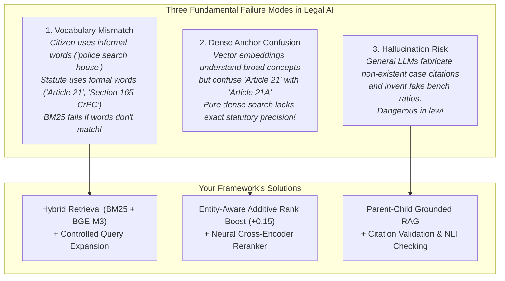

# 00: Start Here — Quick Orientation & Guide to Your Project 🚀

> **Welcome to your project textbook!**  
> If you are nervous about your viva or code demonstration, this document is your starting block. It will give you an immediate high-level understanding of what your system does, how it works, and how to study this codebase without getting overwhelmed.

---

## 1. What Did You Build? (The 30-Second Summary)

You built the **Indian Constitution Legal AI Assistant** (*Academic Title*: *Entity-Aware Hybrid Retrieval and Reranking Framework for Indian Constitutional Question Answering*).

It is a specialized, locally runnable artificial intelligence system designed to answer legal questions about the Constitution of India, Supreme Court landmark decisions, and Central statutory law (such as the Code of Criminal Procedure).

Unlike generic chatbots (like ChatGPT) which frequently **hallucinate** fake Supreme Court citations and fabricated legal clauses, your system:
1. **Never guesses**: It answers queries **strictly and exclusively** from an authoritative local legal database (886 verified documents, 7,470 indexed passages).
2. **Finds the right law using Hybrid Search**: It combines exact keyword search (BM25) with conceptual AI vector embeddings (`BAAI/bge-m3`), fuses them with mathematical rank reciprocity (RRF), and refines them with a neural Cross-Encoder reranker.
3. **Uses Parent-Child Context Recovery**: It searches tiny statutory chunks for laser precision, but gives the full Article or Judgment to the AI so no context is lost.
4. **Validates its own answers**: It checks every citation against the retrieved documents and uses Natural Language Inference (NLI) to ensure no facts are contradicted.
5. **Safely abstains**: If someone asks an out-of-scope question (like a cake recipe) or if the database lacks evidence, it explicitly refuses to answer rather than speculating.
6. **Works 100% offline**: It includes an offline deterministic legal synthesis engine that generates grounded answers without requiring paid API keys or internet access.

---

## 2. Why Was This Project Necessary? (The Problem You Solved)

In Indian legal informatics, answering citizen and researcher questions is notoriously difficult due to **three catastrophic failure modes**:

---

## 3. How the Codebase is Organized

Here is the mental map of where everything lives in this repository:

| Directory / File | What It Does | Key File Inside |
|---|---|---|
| `app.py` | The web application interface | Streamlit UI with dark theme, input box, and audit expanders |
| `config.py` | Master settings | File paths, model names, hyperparameters, weights |
| `retriever.py` | Legacy hybrid retriever facade | Backward-compatible wrapper around modern retrieval components |
| `ingestion.py` | Legacy ingestion facade | Backward-compatible wrapper around modern chunking components |
| `agents.py` | Prompt templates & router | Specialized prompts for Article Agent, Case-Law Agent, and Plain Language Agent |
| `nlp/` | Natural Language Processing | Text preprocessing, 10-class NER, Entity Linking, Intent Classifier, Query Expansion |
| `retrieval/` | Information Retrieval (IR) | Dense vector search, BM25 keyword search, RRF fusion, Entity Boost, Cross-Encoder reranker |
| `rag/` | Grounding & Generation | Structure-aware chunking, parent-child recovery, grounded generation, citation validation, NLI checking, abstention |
| `routing/` | Query Routing | Specialized rule-based router that picks retrieval strategy based on NLP signals |
| `data/` | All legal data & indexes | Raw/processed Constitution, judgments, Central Acts, manifests, and ChromaDB vector store |
| `evaluation/` | Academic benchmarking | Computes Hit@K, MRR, NDCG@K, Macro-F1 across 200 benchmark queries |
| `experiments/` | Standalone experiments | 8 individual ablation study scripts (Exp 1 to Exp 8) |
| `scripts/` | Data & maintenance tools | Corpus download, indexing, verification, and audit tools |
| `tests/` | Automated test suite | 28 test files with **319 passing automated tests (100% pass rate)** |

---

## 4. How to Study This Guide

Do not try to memorize everything at once. Follow this 4-step study system:

### Step 1: Grasp the Big Picture (1–2 Hours)
1. Read [**`01_PROJECT_OVERVIEW.md`**](01_PROJECT_OVERVIEW.md) to understand why your project is important.
2. Read [**`02_PROJECT_ARCHITECTURE.md`**](02_PROJECT_ARCHITECTURE.md) to visualize the multi-stage pipeline.
3. Read [**`03_COMPLETE_EXECUTION_FLOW.md`**](03_COMPLETE_EXECUTION_FLOW.md) to follow a query from user input to screen display.

### Step 2: Understand the Core Code (2–3 Hours)
Study the four files your professor is most likely to ask about:
- [**`05_MAIN_APPLICATION/app_py.md`**](05_MAIN_APPLICATION/app_py.md): How the user interacts with the app.
- [**`07_RETRIEVAL_MODULE/hybrid_retrieval.md`**](07_RETRIEVAL_MODULE/hybrid_retrieval.md): How BM25, Dense search, RRF, and Reranking work together.
- [**`08_RAG_MODULE/rag_pipeline.md`**](08_RAG_MODULE/rag_pipeline.md): How the complete 16-stage pipeline executes.
- [**`08_RAG_MODULE/citation_validation.md`**](08_RAG_MODULE/citation_validation.md) & [**`08_RAG_MODULE/verification.md`**](08_RAG_MODULE/verification.md): How hallucinations are detected and eliminated.

### Step 3: Master the Demonstration (1 Hour)
Open [**`17_VIVA_PREPARATION/code_demonstration_script.md`**](17_VIVA_PREPARATION/code_demonstration_script.md).
It tells you:
- Exactly what command to type to start the app (`streamlit run app.py`).
- Exactly what sample query to enter (*"Can police search my house without a warrant under Article 21 and CrPC?"*).
- Exactly which buttons to click in the browser.
- Exactly which lines of code in VS Code to show to your professor.

### Step 4: Practice Viva Questions (1–2 Hours)
Read through [**`17_VIVA_PREPARATION/viva_questions_and_answers.md`**](17_VIVA_PREPARATION/viva_questions_and_answers.md) and [**`17_VIVA_PREPARATION/difficult_questions.md`**](17_VIVA_PREPARATION/difficult_questions.md).
Practice saying the 2-minute pitch from [**`17_VIVA_PREPARATION/project_explanation_2_minutes.md`**](17_VIVA_PREPARATION/project_explanation_2_minutes.md) out loud.

---

## 5. Key Numbers You Must Memorize for Your Viva

Whenever professors evaluate a capstone project, they look for concrete empirical numbers. Memorize these:

- **Corpus Size**: **886** verified primary documents.
  - **477** Constitutional Articles (all articles and Schedules 1–12).
  - **106** Constitutional Amendment Acts (1st to 106th).
  - **286** Supreme Court Judgment records (92 full SCR decisions, 97 landmark briefs, 97 registry entries).
  - **17** Central Acts (1,975 statutory sections across IPC, CrPC, CPC, Evidence Act, etc.).
- **Indexed Passages**: **7,470** structure-aware child chunks.
- **Automated Tests**: **319 passing tests out of 319 (100% pass rate)**.
- **Dense Embedding Dimensions**:
  - `BAAI/bge-m3`: **1024 dimensions** (L2 normalized).
  - `all-MiniLM-L6-v2`: **384 dimensions**.
- **Cross-Encoder Reranker**: `cross-encoder/ms-marco-MiniLM-L-6-v2`.
- **RRF Constant**: $k = 60$.
- **Entity Boost**: $+0.15$ additive ranking boost.
- **NDCG@10 Retrieval Quality**:
  - BM25 Baseline: **0.5484**
  - Dense Baseline: **0.5739**
  - Hybrid RRF: **0.6558**
  - Full Pipeline (+ Cross-Encoder Reranker): **0.7787** (a **+41.9%** relative improvement over BM25!).
- **Intent Classification Macro-F1**: **0.8485** across 10 constitutional intent classes.
- **Legal NER Macro-F1**: **0.8496** across 10 legal entity categories.

---

## 6. Real-World Analogy: How Your System Works

To explain your project simply to anyone, use this library analogy:

1. **User asks a question**: A citizen walks into the Supreme Court library and asks: *"Can police search my house without a warrant?"*
2. **Stage 1 & 2 (NLP Query Understanding)**: The library intake desk cleans the question, notices it is in English, identifies key concepts (*search*, *warrant*, *police*), and expands it with formal legal synonyms (*CrPC Section 165*, *Article 21*, *inviolability of home*).
3. **Stage 3 (Hybrid Search)**: Two different librarians run to fetch books:
   - *Librarian A (BM25)* searches the card catalog for exact words (*"search"*, *"warrant"*).
   - *Librarian B (Dense BGE-M3)* searches using semantic concepts (understanding that *"searching private property"* relates to *"personal liberty"*).
4. **Rank Fusion & Entity Boosting**: Both lists are merged using Reciprocal Rank Fusion ($k=60$). If a book specifically discusses *Article 21* or *CrPC Section 165*, its score is boosted by $+0.15$.
5. **Stage 3 (Neural Reranker)**: The head librarian (Cross-Encoder) reads all top-30 candidate passages side-by-side with the question and sorts the absolute best 5 passages to the top.
6. **Stage 4 (Parent Context Recovery)**: Instead of handing the student torn scraps of paper (child chunks), the librarian pulls down the **entire original law books** (the full Article 21 and the complete CrPC section) from `parent_store.json`.
7. **Stage 4 (Grounded Generation & Validation)**: The AI summarizes the answer **strictly from the retrieved books**. It cites every paragraph with `[Doc: parent_...]`. A validator checks that every citation exists in the retrieved pile, and an NLI checker ensures no facts contradict the law.
8. **Final Display**: The user receives a clean Direct Answer, relevant provisions, landmark case precedents, and expandable full statutory texts in Streamlit!

Now, proceed to [**`01_PROJECT_OVERVIEW.md`**](01_PROJECT_OVERVIEW.md) to explore the project background in detail!

