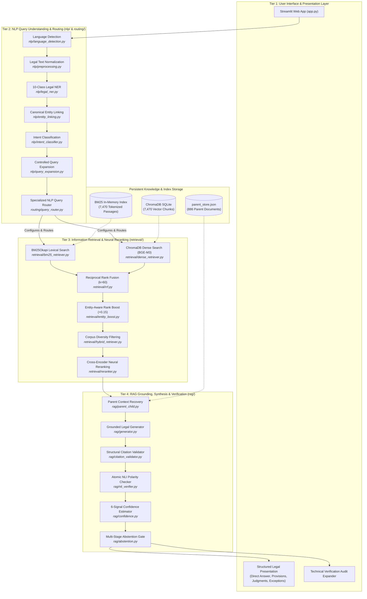
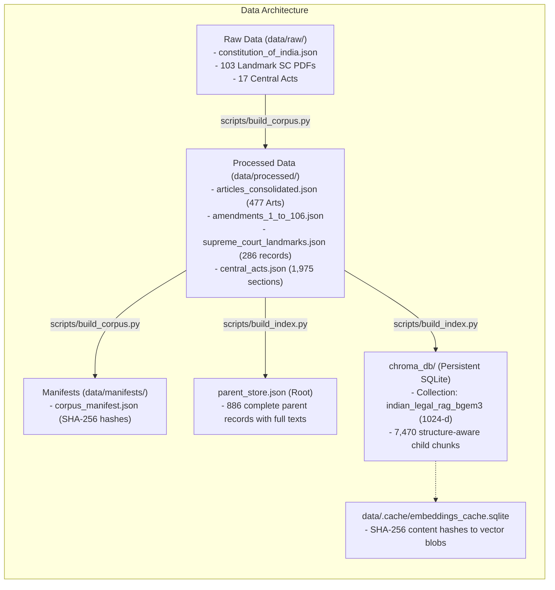

# 02: System Architecture & Subsystem Design 🏛️

---

## 1. High-Level Architectural Blueprint

The **Indian Constitution Legal AI Assistant** is designed around a decoupled, modular 4-tier architecture. Each tier has strict boundaries, deterministic input-output schemas, and zero unneeded coupling.

---

## 2. The Four Architectural Subsystems

### 2.1 Subsystem 1: User Interface & Presentation Layer
- **Core File**: [`app.py`](../app.py)
- **Role**: Lightweight, reactive presentation engine built with Streamlit.
- **Responsibilities**:
  - Initializes and caches the entire pipeline via `@st.cache_resource` so heavy models are loaded only once on startup.
  - Renders custom CSS styling matching a modern dark-theme legal portal (`#0d1117` GitHub dark theme palette).
  - Handles session state (`st.session_state`) for seamless query interaction without loss of state.
  - Formats results into distinct, non-overlapping cards: Direct Answer, Provisions, Judgments, Exceptions, and Verified Citations.
  - Exposes an expandable **Technical Details & Verification Audit** expander for examiners to inspect internal pipeline metrics in real time.

---

### 2.2 Subsystem 2: NLP Query Understanding & Routing
- **Directory**: [`nlp/`](../nlp) and [`routing/`](../routing)
- **Role**: Transforms raw user strings into rich, structured semantic representations before any retrieval occurs.
- **Key Components**:
  1. **Language Detection** ([`nlp/language_detection.py`](../nlp/language_detection.py)): Analyzes Unicode character blocks (Devanagari vs Latin) and checks for Hinglish transliterated keywords (`kya`, `kanoon`, `adhikar`).
  2. **Text Normalization** ([`nlp/preprocessing.py`](../nlp/preprocessing.py)): Normalizes Unicode (NFKC), standardizes typographic quotes and dashes, and expands statutory abbreviations (`Art.` $\to$ `Article`, `u/s` $\to$ `under Section`, `SC` $\to$ `Supreme Court`).
  3. **Legal NER** ([`nlp/legal_ner.py`](../nlp/legal_ner.py)): High-precision span extractor covering 10 legal categories: `ARTICLE`, `CASE`, `PERSON`, `COURT`, `LEGAL_CONCEPT`, `RIGHT`, `AMENDMENT`, `ACT`, `SECTION`, `DATE`.
  4. **Entity Linking** ([`nlp/entity_linking.py`](../nlp/entity_linking.py)): Normalizes surface forms (e.g., *"Puttaswamy case"* or *"Aadhaar ruling"*) to canonical database IDs (`CASE_PUTTASWAMY_2017`).
  5. **Intent Classification** ([`nlp/intent_classifier.py`](../nlp/intent_classifier.py)): Hybrid classifier combining deterministic regex rules with Scikit-learn TF-IDF + Logistic Regression across 10 constitutional intent classes + `OUT_OF_SCOPE`.
  6. **Controlled Query Expansion** ([`nlp/query_expansion.py`](../nlp/query_expansion.py)): Enriches colloquial queries with statutory synonyms using a verified domain graph, bounded by a strict `max_terms=3` ceiling to prevent semantic drift.
  7. **Specialized Query Router** ([`routing/query_router.py`](../routing/query_router.py)): Deterministically determines the retrieval strategy (`ARTICLE_SEARCH`, `CASE_SEARCH`, `COMPARISON_SEARCH`, `RIGHTS_SEARCH`, `HYBRID_SEARCH`, `OUT_OF_SCOPE`), candidate pool depth, and document filters.

---

### 2.3 Subsystem 3: Information Retrieval & Neural Reranking
- **Directory**: [`retrieval/`](../retrieval)
- **Role**: Multi-stage candidate retrieval and fine-grained neural ranking.
- **Key Components**:
  1. **Sparse Lexical Retrieval** ([`retrieval/bm25_retriever.py`](../retrieval/bm25_retriever.py)): BM25Okapi scoring with custom compound legal tokenization preserving statutory tokens like `article_21`, `section_165`, and `42th_amendment`.
  2. **Dense Vector Retrieval** ([`retrieval/dense_retriever.py`](../retrieval/dense_retriever.py)): Connects to ChromaDB vector store; converts cosine distances to cosine similarity scores in $[0.0, 1.0]$.
  3. **Dense Embedding Engine** ([`retrieval/embeddings.py`](../retrieval/embeddings.py)): Manages `BAAI/bge-m3` (1024-d) with L2 normalization, automatic GPU/CPU detection, and persistent SQLite disk caching to prevent re-encoding identical text.
  4. **Reciprocal Rank Fusion** ([`retrieval/rrf.py`](../retrieval/rrf.py)): Blends sparse and dense rank lists using rank reciprocity:
     $$\text{RRF\_Score}(d) = \sum_{L \in \{\text{BM25}, \text{Dense}\}} \frac{1}{k + \text{rank}_L(d)}, \quad k = 60$$
  5. **Entity-Aware Boost** ([`retrieval/entity_boost.py`](../retrieval/entity_boost.py)): Applies an additive $+0.15$ score boost to candidates whose statutory metadata matches recognized query entities.
  6. **Cross-Encoder Neural Reranker** ([`retrieval/reranker.py`](../retrieval/reranker.py)): Uses `cross-encoder/ms-marco-MiniLM-L-6-v2` to compute full joint cross-attention over `(query, passage)` pairs for the top-30 candidate pool, slicing to top 5.
  7. **Corpus Diversity Filter** ([`retrieval/hybrid_retriever.py`](../retrieval/hybrid_retriever.py)): Prevents large multi-section statutes (e.g. CrPC) from monopolizing all top-5 slots, guaranteeing cross-corpus representation of constitutional articles and judicial precedents.

---

### 2.4 Subsystem 4: RAG Grounding, Synthesis & Verification
- **Directory**: [`rag/`](../rag)
- **Role**: Context expansion, factual synthesis, strict verification, and safe refusal.
- **Key Components**:
  1. **Structure-Aware Chunking** ([`rag/chunking.py`](../rag/chunking.py)): Divides statutory text along natural legal boundaries (Articles $\to$ Clauses $\to$ Sub-clauses; Judgments $\to$ Facts, Issues, Ratio Decidendi, Verdict).
  2. **Parent Context Recovery** ([`rag/parent_child.py`](../rag/parent_child.py)): Uses winning child passage IDs to look up and dynamically rehydrate the **full parent Article or Judgment** from `parent_store.json`.
  3. **Grounded Legal Generator** ([`rag/generator.py`](../rag/generator.py)): Generates structured legal responses constrained exclusively to the retrieved parent documents. Supports online Google Gemini (`gemini-3.8-flash`) and offline deterministic legal synthesis.
  4. **Structural Citation Validator** ([`rag/citation_validator.py`](../rag/citation_validator.py)): Verifies that every cited document ID exists in the database and was actually part of the retrieved evidence for this specific query.
  5. **NLI Verification Engine** ([`rag/nli_verifier.py`](../rag/nli_verifier.py)): Deconstructs the generated answer into atomic propositions and checks each proposition against retrieved text for modal and polarity contradictions (`shall` vs `shall not`, `permitted` vs `prohibited`).
  6. **Explainable Confidence Estimator** ([`rag/confidence.py`](../rag/confidence.py)): Calculates an explainable composite confidence score based on 6 transparent signals: retrieval strength, evidence count, entity alignment, method agreement, citation integrity, and query coverage.
  7. **Multi-Stage Abstention Manager** ([`rag/abstention.py`](../rag/abstention.py)): Evaluates multi-stage gating criteria (router, retrieval, context, citations, confidence) and triggers automated safe refusals when thresholds are not met.

---

## 3. Storage Architecture & Provenance

---

## 4. Subsystem Interaction Matrix

| Calling Module | Target Module | Data Passed | Data Returned | Purpose |
|---|---|---|---|---|
| `app.py` | `rag/pipeline.py` | Raw query string, API key | `PipelineResult` object | Executes the end-to-end legal assistant workflow |
| `rag/pipeline.py` | `nlp/` modules | Raw query string | Language, normalized text, entities, linked records, intent, expansion | Complete linguistic understanding of user intent |
| `rag/pipeline.py` | `routing/query_router.py` | NLP context | `RoutingDecision` dataclass | Determines search strategy, filter, and candidate depth |
| `rag/pipeline.py` | `retrieval/hybrid_retriever.py` | Query, entities, top-K, doc filter | Top-K reranked child chunk dictionaries | Multi-stage hybrid retrieval with Cross-Encoder scores |
| `rag/pipeline.py` | `rag/parent_child.py` | Top-K child chunks | Deduplicated parent records, provenance, formatted prompt context | Rehydrates full parent context from `parent_store.json` |
| `rag/pipeline.py` | `rag/generator.py` | Query, parent context, routing decision | Generated answer, structured citations | Produces grounded legal synthesis |
| `rag/pipeline.py` | `rag/citation_validator.py` | Answer, citations, parent context | Validation report with validity score | Structurally validates citations and checks NLI consistency |
| `rag/pipeline.py` | `rag/confidence.py` | Query, chunks, context, validation | 6-signal composite confidence report | Quantifies system certainty |
| `rag/pipeline.py` | `rag/abstention.py` | Routing, chunks, context, validation, confidence | `should_abstain` boolean, safe refusal notice | Protects against hallucinations or out-of-scope answers |
| `app.py` | `rag/ui_formatter.py` | `PipelineResult` | `FormattedLegalAnswer` | Transforms raw results into clean UI cards |

---

## 5. What's Next?

Proceed to [**`03_COMPLETE_EXECUTION_FLOW.md`**](03_COMPLETE_EXECUTION_FLOW.md) to walk through the exact 16-stage step-by-step execution path of a user query.

