# 03: Complete Execution Flow — Trace of a Query 🔄

---

## 1. Overview of the Query Lifecycle

To explain your project with 100% confidence to your professor, you must be able to trace **exactly what happens behind the scenes** from the instant a user types a query into the Streamlit text box until the final verified answer renders on the screen.

In this document, we trace a realistic constitutional question through all **16 sequential stages** of the pipeline:

> **Example Query**:  
> *"Can police search my house without a warrant under Article 21 and CrPC?"*

---

## 2. Complete End-to-End Execution Flowchart

```mermaid
sequenceDiagram
    autonumber
    actor User as User / Examiner
    participant UI as app.py (Streamlit)
    participant Pipe as rag/pipeline.py (LegalRAGPipeline)
    participant NLP as nlp/ (NER, Linker, Intent, Expansion)
    participant Router as routing/query_router.py (QueryRouter)
    participant Ret as retrieval/hybrid_retriever.py (HybridRetriever)
    participant PC as rag/parent_child.py (ParentChildRecovery)
    participant Gen as rag/generator.py (GroundedGenerator)
    participant Val as rag/citation_validator.py (CitationValidator)
    participant NLI as rag/nli_verifier.py (NLIVerifier)
    participant Conf as rag/confidence.py (ConfidenceEstimator)
    participant Abs as rag/abstention.py (AbstentionManager)
    participant Formatter as rag/ui_formatter.py (UIFormatter)

    User->>UI: Submits question in text area & clicks 'Ask Assistant'
    UI->>Pipe: pipeline.run(query_str, dynamic_api_key, override_top_k)
    
    rect rgb(30, 45, 60)
        Note over Pipe,NLP: Stage 1 to 6: NLP Query Understanding
        Pipe->>NLP: detect_language("Can police search...")
        NLP-->>Pipe: {"language": "en", "confidence": 0.98}
        Pipe->>NLP: normalize_legal_text("Can police search...")
        NLP-->>Pipe: "can police search my house without a warrant under Article 21 and Code of Criminal Procedure?"
        Pipe->>NLP: legal_ner.extract_entities(norm_q)
        NLP-->>Pipe: {"ARTICLE": ["Article 21"], "ACT": ["Code of Criminal Procedure"]}
        Pipe->>NLP: entity_linker.link_all(entities)
        NLP-->>Pipe: [{"entity_id": "ARTICLE_21", "canonical_name": "Article 21"}]
        Pipe->>NLP: intent_classifier.classify(norm_q)
        NLP-->>Pipe: {"intent": "RIGHTS_QUERY", "confidence": 0.86}
        Pipe->>NLP: query_expander.expand(norm_q)
        NLP-->>Pipe: "can police search... [Section 165 CrPC] [procedure established by law]"
    end

    rect rgb(40, 50, 40)
        Note over Pipe,Router: Stage 7 & 8: Routing & Early Abstention
        Pipe->>Router: query_router.route(nlp_context)
        Router-->>Pipe: RoutingDecision(strategy="RIGHTS_SEARCH", filter_doc_type=None, top_k=30, final_top_k=5)
        Pipe->>Abs: abstention_manager.evaluate(routing_decision)
        Abs-->>Pipe: {"should_abstain": False}
    end

    rect rgb(50, 40, 50)
        Note over Pipe,Ret: Stage 9 to 13: Hybrid Retrieval & Reranking
        Pipe->>Ret: retriever.retrieve(query, entities, top_k=5)
        Ret->>Ret: BM25Retriever.retrieve() -> Top 30 sparse candidates
        Ret->>Ret: DenseRetriever.retrieve() -> Top 30 dense candidates
        Ret->>Ret: rrf.fuse([bm25, dense], k=60) -> Fused candidates
        Ret->>Ret: entity_boost.apply_entity_boost() -> Boost Art 21 & CrPC (+0.15)
        Ret->>Ret: reranker.CrossEncoderReranker.rerank() -> Top 30 scored to Top 5
        Ret->>Ret: _apply_corpus_diversity() -> Ensures Art 21, CrPC, and case law coexist
        Ret-->>Pipe: Top 5 reranked child chunks
    end

    rect rgb(40, 50, 60)
        Note over Pipe,PC: Stage 14: Parent Context Recovery
        Pipe->>PC: parent_recovery.recover(reranked_chunks)
        PC-->>Pipe: 3 Recovered Parents (Article 21, CrPC Section 165/100, Kharak Singh)
    end

    rect rgb(60, 40, 40)
        Note over Pipe,Gen: Stage 15 to 19: Grounded Generation & Self-Verification
        Pipe->>Gen: generator.generate(query, recovered_context)
        Gen-->>Pipe: Structured answer with [Doc: ...] citations
        Pipe->>Val: citation_validator.validate(answer, citations, recovered_context)
        Val->>NLI: nli_verifier.verify_answer(answer, recovered_context)
        NLI-->>Val: {"nli_status": "VERIFIED_ENTAILED", "has_contradictions": False}
        Val-->>Pipe: {"valid": True, "validation_score": 1.0}
        Pipe->>Conf: confidence_estimator.estimate(signals)
        Conf-->>Pipe: {"confidence_score": 0.84, "confidence_level": "HIGH"}
        Pipe->>Abs: abstention_manager.evaluate(post_generation)
        Abs-->>Pipe: {"should_abstain": False}
    end

    Pipe-->>UI: PipelineResult dataclass
    UI->>Formatter: format_legal_pipeline_result(pipeline_result)
    Formatter-->>UI: FormattedLegalAnswer
    UI->>User: Renders Direct Answer card, Provisions, Judgments, Exceptions & Audit Details
```



---

## 3. Step-by-Step Breakdown of All 16 Pipeline Stages

Let us examine each stage in detail, highlighting the exact Python function called, the input received, the operation performed, and the output returned.

---

### Stage 1: Input Ingestion & Page Setup
- **File**: [`app.py`](file:///c:/Users/ramsa/Desktop/Indian%20Constitution%20Legal%20AI%20Assistant/app.py) (Lines 436–465)
- **What Happens**:
  - The user enters `"Can police search my house without a warrant under Article 21 and CrPC?"` in the Streamlit `st.text_area`.
  - The user clicks `"Ask Assistant"`.
  - Streamlit stores the input in `st.session_state.current_query`.
  - The app invokes the unified pipeline:
    ```python
    pipeline_result = stage4_pipeline.run(
        query_str,
        dynamic_api_key=user_api_key,
        override_top_k=top_k
    )
    ```

---

### Stage 2: Language Detection
- **File**: [`nlp/language_detection.py`](file:///c:/Users/ramsa/Desktop/Indian%20Constitution%20Legal%20AI%20Assistant/nlp/language_detection.py) (Function: `detect_language`)
- **Input**: `"Can police search my house without a warrant under Article 21 and CrPC?"`
- **Processing**:
  - Counts script blocks using regex: Devanagari characters vs. Latin characters.
  - Detects that Latin characters account for > 70% of tokens.
  - Matches English grammatical indicators (`can`, `without`, `under`, `article`).
- **Output**:
  ```python
  {
      "language": "en",
      "is_english": True,
      "confidence": 0.98,
      "script": "latin",
      "reason": "English grammatical patterns and Latin script"
  }
  ```

---

### Stage 3: Text Normalization & Abbreviation Expansion
- **File**: [`nlp/preprocessing.py`](file:///c:/Users/ramsa/Desktop/Indian%20Constitution%20Legal%20AI%20Assistant/nlp/preprocessing.py) (Function: `normalize_legal_text`)
- **Input**: Raw query string.
- **Processing**:
  - Calls `clean_unicode_and_quotes` (normalizes NFKC, converts curved quotes to standard ASCII).
  - Calls `expand_legal_abbreviations` using regex:
    - `CrPC` is recognized as the Code of Criminal Procedure.
    - Statutory markers like `Art.` are expanded to `Article`.
  - Collapses multiple whitespace characters.
- **Output**:
  ```text
  "can police search my house without a warrant under Article 21 and Code of Criminal Procedure?"
  ```

---

### Stage 4: Legal Named Entity Recognition (NER)
- **File**: [`nlp/legal_ner.py`](file:///c:/Users/ramsa/Desktop/Indian%20Constitution%20Legal%20AI%20Assistant/nlp/legal_ner.py) (Class: `LegalNER`, Method: `extract_entities`)
- **Processing**:
  - Evaluates regex patterns for statutory citations: matches `Article 21` $\to$ category `ARTICLE`.
  - Searches gazetteer for Central Acts: matches `Code of Criminal Procedure` $\to$ category `ACT`.
  - Searches concepts gazetteer: matches `search warrant` and `search without warrant` $\to$ category `LEGAL_CONCEPT`.
- **Output**:
  ```python
  {
      "ARTICLE": ["Article 21"],
      "ACT": ["Code of Criminal Procedure"],
      "LEGAL_CONCEPT": ["search warrant", "search without warrant"],
      "CASE": [], "PERSON": [], "COURT": [], "RIGHT": [],
      "AMENDMENT": [], "SECTION": [], "DATE": []
  }
  ```

---

### Stage 5: Canonical Entity Linking
- **File**: [`nlp/entity_linking.py`](file:///c:/Users/ramsa/Desktop/Indian%20Constitution%20Legal%20AI%20Assistant/nlp/entity_linking.py) (Class: `EntityLinker`, Method: `link_all`)
- **Processing**:
  - Takes extracted entities and normalizes keys against the pre-indexed alias registry.
  - Resolves `Article 21` to canonical database ID `ARTICLE_21`.
  - Links to `parent_store.json` document `parent_const_art_021`.
- **Output**:
  ```python
  [
      {
          "entity_id": "ARTICLE_21",
          "canonical_name": "Article 21",
          "entity_type": "ARTICLE",
          "surface_form": "Article 21",
          "confidence": 1.0,
          "metadata": {"title": "Protection of life and personal liberty", "part": "Part III"}
      }
  ]
  ```

---

### Stage 6: Intent Classification
- **File**: [`nlp/intent_classifier.py`](file:///c:/Users/ramsa/Desktop/Indian%20Constitution%20Legal%20AI%20Assistant/nlp/intent_classifier.py) (Class: `HybridIntentClassifier`, Method: `classify`)
- **Processing**:
  - The query contains words: `"search house"`, `"without warrant"`, `"Article 21"`.
  - Rule classifier matches the personal liberty/search pattern $\to$ predicts `RIGHTS_QUERY` ($0.86$ confidence).
  - ML classifier (TF-IDF + Logistic Regression) evaluates n-gram vectors.
  - Spurious out-of-scope guard verifies that because constitutional entities (`Article 21`) are present, the query cannot be mistakenly classified as `OUT_OF_SCOPE`.
- **Output**:
  ```python
  {
      "intent": "RIGHTS_QUERY",
      "confidence": 0.86,
      "method": "rule",
      "is_out_of_scope": False,
      "explanation": "Matched fundamental rights or personal liberty search query"
  }
  ```

---

### Stage 7: Controlled Query Expansion
- **File**: [`nlp/query_expansion.py`](file:///c:/Users/ramsa/Desktop/Indian%20Constitution%20Legal%20AI%20Assistant/nlp/query_expansion.py) (Class: `QueryExpander`, Method: `expand`)
- **Processing**:
  - Matches the trigger concept `"search without warrant"` in `legal_synonyms.json`.
  - Retrieves domain synonyms: `Section 165 CrPC`, `procedure established by law`, `inviolability of home`.
  - Appends up to 3 terms to construct the expanded retrieval string.
- **Output**:
  ```text
  "can police search my house without a warrant under Article 21 and Code of Criminal Procedure? Section 165 CrPC procedure established by law"
  ```

---

### Stage 8: Specialized Query Routing & Strategy Selection
- **File**: [`routing/query_router.py`](file:///c:/Users/ramsa/Desktop/Indian%20Constitution%20Legal%20AI%20Assistant/routing/query_router.py) (Class: `QueryRouter`, Method: `route`)
- **Processing**:
  - Analyzes intent (`RIGHTS_QUERY`), language (`en`), and entities (`Article 21`, `CrPC`).
  - Chooses strategy `RIGHTS_SEARCH`.
  - Crucial Decision: Sets `filter_doc_type = None` because answering this question requires **both** constitutional text (*Article 21*) and statutory procedural sections (*CrPC Sections 165, 100*). Filtering to only "constitution" would lose the police search rules!
- **Output**:
  ```python
  RoutingDecision(
      strategy="RIGHTS_SEARCH",
      retrieval_query=expanded_query,
      filter_doc_type=None,
      use_bm25=True,
      use_dense=True,
      use_rrf=True,
      use_entity_boost=True,
      use_reranker=True,
      top_k_candidates=30,
      final_top_k=5,
      recommended_agent="explanation_agent",
      is_out_of_scope=False
  )
  ```

---

### Stage 9: Early Abstention Check (Router Level)
- **File**: [`rag/abstention.py`](file:///c:/Users/ramsa/Desktop/Indian%20Constitution%20Legal%20AI%20Assistant/rag/abstention.py) (Class: `AbstentionManager`, Method: `evaluate`)
- **Processing**:
  - Evaluates `is_out_of_scope` flag and query emptiness.
  - Query is valid legal text; `should_abstain = False`. Pipeline proceeds to retrieval.

---

### Stage 10: Candidate Retrieval (BM25 + Dense BGE-M3)
- **File**: [`retrieval/hybrid_retriever.py`](file:///c:/Users/ramsa/Desktop/Indian%20Constitution%20Legal%20AI%20Assistant/retrieval/hybrid_retriever.py) (Method: `retrieve`)
- **Sparse BM25 Search** ([`retrieval/bm25_retriever.py`](file:///c:/Users/ramsa/Desktop/Indian%20Constitution%20Legal%20AI%20Assistant/retrieval/bm25_retriever.py)):
  - Tokenizes query preserving compound statutory markers: `['police', 'search', 'house', 'warrant', 'article_21', 'section_165']`.
  - Returns top 30 passages ranked by BM25Okapi scores.
- **Dense Vector Search** ([`retrieval/dense_retriever.py`](file:///c:/Users/ramsa/Desktop/Indian%20Constitution%20Legal%20AI%20Assistant/retrieval/dense_retriever.py)):
  - Generates 1024-dimensional embedding using `BAAI/bge-m3` (with SQLite cache lookup).
  - Queries ChromaDB collection `indian_legal_rag_bgem3` using cosine distance.
  - Inverts distance to similarity ($1.0 - \text{distance}$) and returns top 30 passages.

---

### Stage 11: Reciprocal Rank Fusion (RRF)
- **File**: [`retrieval/rrf.py`](file:///c:/Users/ramsa/Desktop/Indian%20Constitution%20Legal%20AI%20Assistant/retrieval/rrf.py) (Function: `fuse`)
- **Processing**:
  - Blends the two 30-item candidate lists using formula:
    $$\text{Score}(d) = \frac{1}{60 + \text{rank}_{\text{BM25}}(d)} + \frac{1}{60 + \text{rank}_{\text{Dense}}(d)}$$
  - Merges duplicate chunk entries and preserves individual rank details (`bm25_rank`, `vector_rank`).

---

### Stage 12: Legal Entity-Aware Ranking Boost
- **File**: [`retrieval/entity_boost.py`](file:///c:/Users/ramsa/Desktop/Indian%20Constitution%20Legal%20AI%20Assistant/retrieval/entity_boost.py) (Function: `apply_entity_boost`)
- **Processing**:
  - Inspects each candidate's metadata for matches with `Article 21` or `Code of Criminal Procedure`.
  - Candidate chunk `child_const_art_021_cl_0` matches `Article 21` $\to$ receives $+0.15$ additive boost.
  - Candidate chunks from `parent_act_crpc_1973` match `Section 165` $\to$ receive $+0.15$ boost.
  - Re-sorts candidates descending by boosted score.

---

### Stage 13: Neural Cross-Encoder Reranking & Diversity
- **File**: [`retrieval/reranker.py`](file:///c:/Users/ramsa/Desktop/Indian%20Constitution%20Legal%20AI%20Assistant/retrieval/reranker.py) (Class: `CrossEncoderReranker`, Method: `rerank`)
- **Processing**:
  - Feeds 30 pairs of `(query, passage_text)` into `cross-encoder/ms-marco-MiniLM-L-6-v2`.
  - Cross-attention evaluates token-to-token interactions directly, outputting neural logit scores.
  - [`_apply_corpus_diversity`](file:///c:/Users/ramsa/Desktop/Indian%20Constitution%20Legal%20AI%20Assistant/retrieval/hybrid_retriever.py#L281-L332): Ensures that CrPC sections do not take all 5 slots; guarantees that Article 21, CrPC Section 165, and the landmark *Kharak Singh* judgment (inviolability of dwelling) all make the top 5!
- **Output**: 5 highest-ranked child passages with calibrated rerank scores.

---

### Stage 14: Parent Context Recovery
- **File**: [`rag/parent_child.py`](file:///c:/Users/ramsa/Desktop/Indian%20Constitution%20Legal%20AI%20Assistant/rag/parent_child.py) (Class: `ParentChildRecovery`, Method: `recover`)
- **Processing**:
  - Takes the 5 winning child chunks.
  - Looks up their parent IDs (`parent_const_art_021`, `parent_act_crpc_1973`, `parent_case_sc_kharak_singh_1963`) in `parent_store.json`.
  - Deduplicates parents: Even if two child chunks belong to CrPC, the parent document is loaded only once.
  - Renders a clean markdown prompt context with structured `[Doc: parent_...]` headers.

---

### Stage 15: Grounded Legal Answer Generation
- **File**: [`rag/generator.py`](file:///c:/Users/ramsa/Desktop/Indian%20Constitution%20Legal%20AI%20Assistant/rag/generator.py) (Class: `GroundedGenerator`, Method: `generate`)
- **Processing**:
  - Formulates answer strictly bounded by the recovered parent texts.
  - If a Gemini API key is active, executes Google Gemini with zero temperature (`temperature=0.0`).
  - If offline, executes `_synthesize_grounded_offline` which uses deterministic structural rules to synthesize:
    1. Direct Answer on police search powers.
    2. Emergency search conditions under Section 165 CrPC (recording written grounds, sending copy to Magistrate).
    3. Occupant protections and search of closed place under Section 100 CrPC (calling independent local witnesses).
    4. Constitutional right to privacy and inviolability of the home (*Kharak Singh v. State of U.P.*).
    5. Notice regarding legislative transition to Bharatiya Nagarik Suraksha Sanhita (BNSS, 2023).

---

### Stage 16: Citation Validation & NLI Contradiction Checking
- **Files**: [`rag/citation_validator.py`](file:///c:/Users/ramsa/Desktop/Indian%20Constitution%20Legal%20AI%20Assistant/rag/citation_validator.py) & [`rag/nli_verifier.py`](file:///c:/Users/ramsa/Desktop/Indian%20Constitution%20Legal%20AI%20Assistant/rag/nli_verifier.py)
- **Structural Citation Validation**:
  - Scans answer for `[Doc: ...]` tags.
  - Verifies that `parent_const_art_021` and `parent_act_crpc_1973` actually exist in the database and were part of the retrieved evidence pile.
- **NLI Proposition Checking**:
  - Decomposes the answer into atomic sentences.
  - Checks each sentence against retrieved text for polarity conflicts (ensuring the system does not say *"police can search anytime without restrictions"* when the law requires written grounds).
  - Returns `nli_status: "VERIFIED_ENTAILED"`.

---

### Stage 17: Confidence Scoring & Final Abstention Gate
- **Files**: [`rag/confidence.py`](file:///c:/Users/ramsa/Desktop/Indian%20Constitution%20Legal%20AI%20Assistant/rag/confidence.py) & [`rag/abstention.py`](file:///c:/Users/ramsa/Desktop/Indian%20Constitution%20Legal%20AI%20Assistant/rag/abstention.py)
- **Confidence Estimation**:
  - Evaluates 6 signals: retrieval score ($0.82$), evidence count ($1.0$), entity alignment ($1.0$), method agreement ($0.75$), citation validity ($1.0$), query coverage ($0.85$).
  - Weighted composite confidence score = **0.84** (`HIGH`).
- **Final Abstention Evaluation**:
  - All safety thresholds are met $\to$ `should_abstain = False`.
  - Packages results into `PipelineResult`.

---

### Stage 18: UI Formatting & Display
- **Files**: [`rag/ui_formatter.py`](file:///c:/Users/ramsa/Desktop/Indian%20Constitution%20Legal%20AI%20Assistant/rag/ui_formatter.py) & [`app.py`](file:///c:/Users/ramsa/Desktop/Indian%20Constitution%20Legal%20AI%20Assistant/app.py)
- **Formatting**:
  - Converts `PipelineResult` into `FormattedLegalAnswer`.
  - Extracts the Direct Answer card.
  - Formats provisions into distinct styled HTML blocks (`<div class="provision-block">`).
  - Formats judgments into distinct styled HTML blocks (`<div class="judgment-block">`).
  - Renders compact source cards with `✓ Verified Citation` badges and independent expanders for full statutory text.
  - Populates the **Technical Details & Verification Audit** expander with 4 metrics: Strategy (`RIGHTS_SEARCH`), Query Intent (`RIGHTS_QUERY`), Confidence (`0.84 HIGH`), Citations Checked (`3 Validated`).

---

## 4. What's Next?

Proceed to [**`04_TECHNOLOGY_STACK.md`**](04_TECHNOLOGY_STACK.md) to examine every programming language, library, embedding model, and vector database used across the project.

