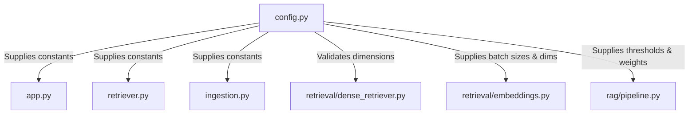

# Code Explanation: `config.py` ⚙️

> **Source File**: [`config.py`](../../config.py)  
> **Lines of Code**: 246 lines  
> **Primary Responsibility**: Centralized configuration management, filesystem path resolution, hyperparameters, model definitions, API key resolution, and collection dimension protection.

---

## 1. Basic Introduction

### What is this file?
[`config.py`](../../config.py) is the single source of truth for the entire **Indian Constitution Legal AI Assistant** repository. It contains all directory paths, model identifiers, embedding dimensions, chunking parameters, ranking weights, evaluation settings, and API key lookups.

### Why does this file exist?
In complex machine learning and IR applications, hardcoding file paths, model dimensions, or hyperparameters inside individual code files causes severe issues:
- If a path changes, you have to edit dozens of files.
- If you switch from MiniLM (384-d) to BGE-M3 (1024-d), a dimension mismatch can silently corrupt your vector database.
- If an API key is hardcoded, it risks accidental exposure in version control.

[`config.py`](../../config.py) eliminates these issues by centralizing all settings in one location and enforcing automated directory creation and dimension safety checks.

---

## 2. Imports and Dependencies

```python
import os                       # Reading environment variables and system settings
from pathlib import Path        # Cross-platform object-oriented filesystem paths
from typing import Optional, Any # Type hinting

try:
    from dotenv import load_dotenv  # Loads .env files into environment variables
    load_dotenv()
except ImportError:
    pass
```

- **`pathlib.Path`**: Used instead of raw strings or `os.path.join`. Ensures paths work consistently across Windows (`\`) and Linux (`/`).
- **`dotenv.load_dotenv()`**: Loads local `.env` variables (e.g. `GEMINI_API_KEY`, `EMBEDDING_MODEL`) into `os.environ` before configuration constants are set.

---

## 3. Detailed Breakdown of Configuration Constants

### 3.1 Base Paths and Production Pipeline Paths (Lines 10–44)
- `BASE_DIR = Path(__file__).resolve().parent`: Absolute root directory of the repository.
- `DATA_DIR = BASE_DIR / "data"`: Root data folder.
- `CHROMA_PERSIST_DIR = BASE_DIR / "chroma_db"`: Local persistent ChromaDB database folder.
- `PARENT_STORE_PATH = BASE_DIR / "parent_store.json"`: Flat JSON store containing all 886 parent documents for fast hydration.
- `RAW_DIR = DATA_DIR / "raw"`: Unprocessed downloads (Constitution, 103 landmark SC judgment PDFs, 17 Central Acts).
- `PROCESSED_DIR = DATA_DIR / "processed"`: Schema-compliant JSON files (`articles_consolidated.json`, `amendments_1_to_106.json`, `supreme_court_landmarks.json`, `central_acts.json`).
- `MANIFESTS_DIR = DATA_DIR / "manifests"`: Cryptographic SHA-256 manifests (`corpus_manifest.json`).
- `REPORTS_DIR = DATA_DIR / "reports"`: Validation and corpus freshness logs.
- **Automated Directory Creation** (Lines 38–43): The file executes a loop on startup that runs `_dir.mkdir(parents=True, exist_ok=True)` for all directories, ensuring no missing folder errors occur.

---

### 3.2 Embedding Models and Vector Database Settings (Lines 64–73, 140)
- `BGE_M3_MODEL_NAME = "BAAI/bge-m3"`: Primary dense semantic model.
- `MINILM_MODEL_NAME = "sentence-transformers/all-MiniLM-L6-v2"`: Fast baseline model.
- `DEFAULT_EMBEDDING_MODEL`: Evaluates `os.getenv("EMBEDDING_MODEL", BGE_M3_MODEL_NAME)`.
- `BGE_M3_EMBEDDING_DIM = 1024`: Vector size for BGE-M3.
- `MINILM_EMBEDDING_DIM = 384`: Vector size for MiniLM.
- `EMBEDDING_BATCH_SIZE = 32`: Number of texts encoded per neural forward pass.
- `CHROMA_COLLECTION_NAME`: Dynamically resolved collection name (`indian_legal_rag_bgem3` or `indian_legal_rag`).

---

### 3.3 Chunking Hyperparameters (Lines 142–149)
- `PARENT_CHUNK_SIZE = 1200`: Characters (~200 words) for full parent document context.
- `PARENT_CHUNK_OVERLAP = 100`: Character overlap between adjacent parent chunks.
- `CHILD_CHUNK_SIZE = 300`: Characters (~50 words) for fine-grained retrieval passages.
- `CHILD_CHUNK_OVERLAP = 50`: Character overlap for sliding-window child passages.
- `MAX_CLAUSE_CHUNK_CHARS = 800`: Hard ceiling for structure-aware legal clauses.
- `MIN_CHUNK_CHARS = 40`: Discards noise fragments smaller than 40 characters.

---

### 3.4 Information Retrieval & Reranker Hyperparameters (Lines 155–168)
- `BM25_K1 = 1.5`: BM25 term frequency saturation parameter.
- `BM25_B = 0.75`: BM25 document length normalization parameter.
- `RRF_K = 60`: Reciprocal Rank Fusion constant ($k=60$) preventing high-ranked outliers from dominating.
- `DEFAULT_TOP_K = 4`: Default retrieval count for the UI.
- `RERANKER_MODEL_NAME = "cross-encoder/ms-marco-MiniLM-L-6-v2"`: Neural cross-attention reranker.
- `RETRIEVAL_CANDIDATE_POOL = 30`: Initial pool of candidates retrieved by BM25 and Dense search.
- `ENTITY_BOOST_WEIGHT = 0.15`: Additive score boost for candidates matching recognized legal entities.
- `FINAL_TOP_K = 5`: Number of top reranked candidates passed to the generator.

---

### 3.5 Intent Classes and NLP Hyperparameters (Lines 194–215)
- `INTENT_MODEL_PATH = NLP_DIR / "intent_classifier.joblib"`: Serialized Scikit-learn model.
- `SYNONYM_GRAPH_PATH = NLP_DIR / "legal_synonyms.json"`: Domain synonym dictionary.
- `MAX_EXPANSION_TERMS = 3`: Maximum synonyms appended to query.
- `INTENT_CONFIDENCE_THRESHOLD = 0.35`: Minimum confidence for ML intent.
- `INTENT_CLASSES`: The 10 constitutional intent classes + `OUT_OF_SCOPE`:
  ```python
  [
      "ARTICLE_LOOKUP", "CASE_LAW_QUERY", "CASE_COMPARISON",
      "LEGAL_EXPLANATION", "RIGHTS_QUERY", "AMENDMENT_QUERY",
      "PRECEDENT_QUERY", "DEFINITION_QUERY", "CONSTITUTIONAL_PROCEDURE",
      "MULTI_DOCUMENT_QUERY", "OUT_OF_SCOPE"
  ]
  ```

---

### 3.6 Confidence, Validation & Abstention Settings (Lines 216–228)
- `CONFIDENCE_ABSTENTION_THRESHOLD = 0.30`: System safely abstains if composite confidence $< 0.30$.
- `MIN_RETRIEVAL_SCORE_THRESHOLD = 0.005`: Rejects candidates with negligible relevance scores.
- `CITATION_VALIDATION_THRESHOLD = 0.50`: Minimum structural validity required.
- `CONFIDENCE_SIGNAL_WEIGHTS`:
  ```python
  {
      "retrieval": 0.25,        # Strength of top reranked/fusion score
      "evidence_count": 0.15,   # Number of supporting chunks
      "entity_match": 0.20,     # Alignment between query and passage entities
      "method_agreement": 0.15, # Jaccard agreement between BM25 and Dense
      "citation_validity": 0.15,# Structural integrity of citations
      "evidence_coverage": 0.10 # Proportion of query keywords covered
  }
  ```

---

## 4. Functions in `config.py`

### `get_chroma_collection_name(model_name: Optional[str] = None) -> str`
- **Lines in Source**: [Lines 75–82](../../config.py#L75-L82)
- **What it does**: Returns `"indian_legal_rag_bgem3"` if `bge-m3` is in the model name; otherwise returns `"indian_legal_rag"` (for MiniLM).
- **Why it is needed**: ChromaDB collections are bound to a specific vector dimension. Storing 1024-d vectors and 384-d vectors in the same collection causes database corruption. This function ensures each model maps to its dedicated collection.

---

### `get_embedding_dimension(model_name: Optional[str] = None) -> int`
- **Lines in Source**: [Lines 84–90](../../config.py#L84-L90)
- **What it does**: Returns `1024` for BGE-M3 and `384` for MiniLM.
- **Why it is needed**: Used by dimension safety checks before inserting vectors into ChromaDB.

---

### `validate_collection_dimension(collection: Any, expected_dim: int, model_name: str = "") -> None`
- **Lines in Source**: [Lines 93–138](../../config.py#L93-L138)
- **What it does**: Samples an existing embedding from the ChromaDB collection and checks if its length matches `expected_dim`.
- **Why it is needed**: If a developer accidentally points the 1024-d BGE-M3 model at a collection created with the 384-d MiniLM model, ChromaDB will throw low-level C++ HNSW errors. This function catches the mismatch upfront and raises a clear `ValueError`.

---

### `get_gemini_api_key() -> str`
- **Lines in Source**: [Lines 177–187](../../config.py#L177-L187)
- **What it does**: Searches for the Google Gemini API key across multiple locations in order of priority:
  1. `os.getenv("GEMINI_API_KEY")`
  2. `os.getenv("GOOGLE_API_KEY")`
  3. Streamlit Cloud secrets (`st.secrets["GEMINI_API_KEY"]` or `st.secrets["GOOGLE_API_KEY"]`).
- **Return**: API key string, or empty string `""` if not found.

---

## 5. Actual Code Walkthrough

### Code Excerpt 1: Dimension Validation Guardrail
```python
# Lines 106-119 in config.py
if hasattr(collection, "get") and hasattr(collection, "count"):
    if collection.count() > 0:
        sample = collection.get(limit=1, include=["embeddings"])
        embeddings = sample.get("embeddings") if sample else None
        if embeddings is not None and len(embeddings) > 0 and embeddings[0] is not None:
            actual_dim = len(embeddings[0])
            if actual_dim != expected_dim:
                col_name = getattr(collection, "name", "unknown")
                raise ValueError(
                    f"Collection embedding dimension mismatch: collection '{col_name}' "
                    f"expects dimension {actual_dim}, but embedding model '{model_name}' "
                    f"produces dimension {expected_dim}. Aborting operation to prevent data corruption."
                )
```
- **Explanation**: Retrieves a single vector from ChromaDB and measures `len(embeddings[0])`. If it does not equal `expected_dim`, it raises a clear error.
- **Why is this needed?**: Protects against vector database corruption during development and evaluation.
- **What happens next**: If valid, execution continues safely; if invalid, operation is aborted.

---

## 6. Connection to Other Files



- **Imported by**: Virtually every module across the repository (`app.py`, `retriever.py`, `ingestion.py`, `rag/`, `retrieval/`, `nlp/`, `scripts/`, `evaluation/`).
- **Proceed to**: [**`ingestion_py.md`**](ingestion_py.md) to inspect how parent documents and child chunks are created and indexed.

