# 06: Natural Language Processing (NLP) Module Overview 🧠

> **Subsystem**: Stage 2 NLP Query Understanding  
> **Source Directory**: [`nlp/`](file:///c:/Users/ramsa/Desktop/Indian%20Constitution%20Legal%20AI%20Assistant/nlp/)  
> **Primary Responsibility**: Linguistic preprocessing, 10-class Legal Named Entity Recognition, Canonical Entity Linking, Dual-Tier Intent Classification, Controlled Synonym Expansion, and Language Identification.

---

## 1. Architectural Role of the NLP Subsystem

Before any information retrieval can take place in ChromaDB or BM25, the system must transform raw, unstructured user keystrokes into a rich, structured semantic representation.

In traditional search engines, user queries are sent directly to the index. If a user enters informal words (*"can cops tap my phone"*), traditional search fails because of the **Vocabulary Mismatch Problem**.

In the **Indian Constitution Legal AI Assistant**, every query passes through a sequential 6-stage NLP pipeline:

```mermaid
flowchart LR
    UQ["Raw Query"] --> LD["1. Language Detection<br>(language_detection.py)"]
    LD --> PRE["2. Text Normalization<br>(preprocessing.py)"]
    PRE --> NER["3. Legal NER (10 classes)<br>(legal_ner.py)"]
    NER --> EL["4. Entity Linking<br>(entity_linking.py)"]
    EL --> IC["5. Intent Classifier<br>(intent_classifier.py)"]
    IC --> QE["6. Query Expansion<br>(query_expansion.py)"]
    QE --> OUT["Structured NLP Context<br>(To Query Router)"]
```

---

## 2. Directory Files & Responsibilities

| Documentation File | Source Python File | Core Purpose & Capabilities |
|---|---|---|
| [**`preprocessing.md`**](preprocessing.md) | [`nlp/preprocessing.py`](file:///c:/Users/ramsa/Desktop/Indian%20Constitution%20Legal%20AI%20Assistant/nlp/preprocessing.py) | Unicode NFKC normalization, typographic quote cleaning, legal abbreviation expansion (`Art.` $\to$ `Article`, `u/s` $\to$ `under Section`), and compound tokenization. |
| [**`intent_classification.md`**](intent_classification.md) | [`nlp/intent_classifier.py`](file:///c:/Users/ramsa/Desktop/Indian%20Constitution%20Legal%20AI%20Assistant/nlp/intent_classifier.py) | Dual-tier intent classifier: rule baseline + Scikit-learn TF-IDF + Logistic Regression across 10 constitutional intent classes + `OUT_OF_SCOPE`. |
| [**`entity_recognition.md`**](entity_recognition.md) | [`nlp/legal_ner.py`](file:///c:/Users/ramsa/Desktop/Indian%20Constitution%20Legal%20AI%20Assistant/nlp/legal_ner.py) | 10-class legal named entity extractor combining regex rules and dynamically loaded gazetteers from the corpus. |
| [**`entity_linking.md`**](entity_linking.md) | [`nlp/entity_linking.py`](file:///c:/Users/ramsa/Desktop/Indian%20Constitution%20Legal%20AI%20Assistant/nlp/entity_linking.py) | Maps surface mentions, abbreviations, and informal aliases to canonical statutory document IDs (`parent_const_art_021`). |
| [**`query_expansion.md`**](query_expansion.md) | [`nlp/query_expansion.py`](file:///c:/Users/ramsa/Desktop/Indian%20Constitution%20Legal%20AI%20Assistant/nlp/query_expansion.py) | Deterministically enriches colloquial queries with statutory legal terminology from `legal_synonyms.json` (max 3 terms). |
| [**`language_detection.md`**](language_detection.md) | [`nlp/language_detection.py`](file:///c:/Users/ramsa/Desktop/Indian%20Constitution%20Legal%20AI%20Assistant/nlp/language_detection.py) | Detects whether the query is English, Devanagari Hindi, or transliterated Hinglish using Unicode block metrics and indicator keywords. |

---

## 3. Empirical Performance of the NLP Subsystem

The NLP components were rigorously evaluated on annotated benchmark datasets:
- **10-Class Legal NER**: Macro Precision **0.8650**, Macro Recall **0.8402**, Macro F1 **0.8496**.
- **Intent Classification**: Accuracy **84.85%**, Macro F1 **0.8485** across 10 constitutional intent classes + `OUT_OF_SCOPE` (5-fold Stratified Cross-Validation).
- **Canonical Entity Linking**: Exact Linking Accuracy **86.67%**.

---

## 4. Next Step

Click [**`preprocessing.md`**](preprocessing.md) to inspect how raw queries are cleaned, normalized, and tokenized.

