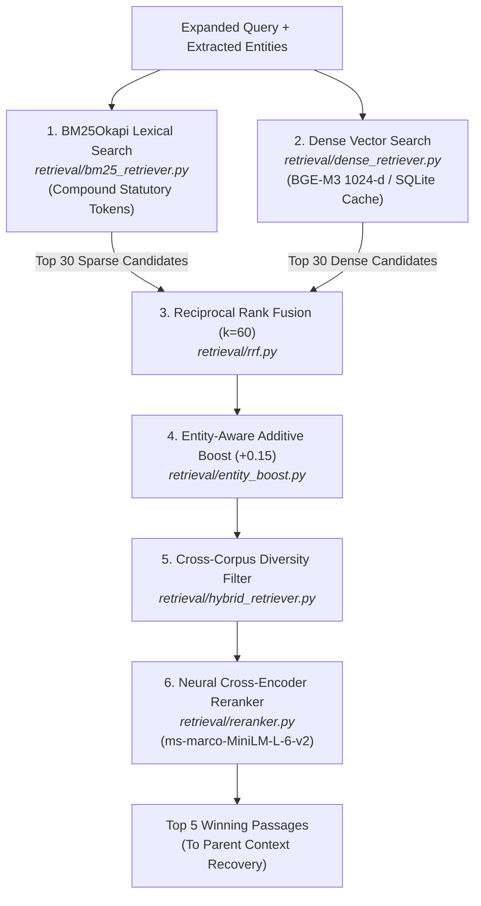

# 07: Retrieval & Ranking Module Overview 🔎

> **Subsystem**: Stage 3 Information Retrieval & Neural Reranking  
> **Source Directory**: [`retrieval/`](file:///c:/Users/ramsa/Desktop/Indian%20Constitution%20Legal%20AI%20Assistant/retrieval/)  
> **Primary Responsibility**: Multi-stage candidate retrieval, Reciprocal Rank Fusion, Legal Entity Rank Boosting, and Cross-Encoder Neural Reranking.

---

## 1. Architectural Role of the Retrieval Subsystem

The Information Retrieval (IR) subsystem is the computational core of the assistant. Its mission is to search through **7,470 indexed statutory passages** and deliver the **top 5 most authoritative, contextually relevant passages** to the generation engine.

---

## 2. Directory Files & Documentation

| Documentation File | Source Python File | Core Purpose & Capabilities |
|---|---|---|
| [**`embeddings.md`**](embeddings.md) | [`retrieval/embeddings.py`](file:///c:/Users/ramsa/Desktop/Indian%20Constitution%20Legal%20AI%20Assistant/retrieval/embeddings.py) | `BAAI/bge-m3` (1024-d) & MiniLM (384-d) wrapper with L2 normalization, CPU/CUDA fallback, and SQLite disk caching. |
| [**`dense_retrieval.md`**](dense_retrieval.md) | [`retrieval/dense_retriever.py`](file:///c:/Users/ramsa/Desktop/Indian%20Constitution%20Legal%20AI%20Assistant/retrieval/dense_retriever.py) | ChromaDB vector search, cosine distance to similarity conversion ($1.0 - \text{dist}$), metadata filtering. |
| [**`bm25_retrieval.md`**](bm25_retrieval.md) | [`retrieval/bm25_retriever.py`](file:///c:/Users/ramsa/Desktop/Indian%20Constitution%20Legal%20AI%20Assistant/retrieval/bm25_retriever.py) | BM25Okapi scoring with compound statutory tokenization (`article_21`, `section_165`, `1973insc258`). |
| [**`hybrid_retrieval.md`**](hybrid_retrieval.md) | [`retrieval/hybrid_retriever.py`](file:///c:/Users/ramsa/Desktop/Indian%20Constitution%20Legal%20AI%20Assistant/retrieval/hybrid_retriever.py) | Master multi-stage hybrid search orchestrator with complete ablation toggles and corpus diversity filtering. |
| [**`reciprocal_rank_fusion.md`**](reciprocal_rank_fusion.md) | [`retrieval/rrf.py`](file:///c:/Users/ramsa/Desktop/Indian%20Constitution%20Legal%20AI%20Assistant/retrieval/rrf.py) | Merges disparate score distributions strictly by rank reciprocity ($k=60$). |
| [**`entity_boosting.md`**](entity_boosting.md) | [`retrieval/entity_boost.py`](file:///c:/Users/ramsa/Desktop/Indian%20Constitution%20Legal%20AI%20Assistant/retrieval/entity_boost.py) | Additive $+0.15$ ranking boost for candidate passages matching recognized legal entities. |
| [**`reranking.md`**](reranking.md) | [`retrieval/reranker.py`](file:///c:/Users/ramsa/Desktop/Indian%20Constitution%20Legal%20AI%20Assistant/retrieval/reranker.py) | Joint-attention cross-encoder reranker (`ms-marco-MiniLM-L-6-v2`) scoring query-passage pairs directly. |

---

## 3. Empirical Benchmark Results Across Retrieval Ablations

The retrieval components were evaluated across 200 benchmark queries on the 886-document corpus:

| Experiment Configuration | Hit@1 | Hit@5 | Hit@10 | MRR | NDCG@10 |
|---|:---:|:---:|:---:|:---:|:---:|
| **Exp 1: BM25 Only** | 0.3800 | 0.6200 | 0.7100 | 0.4892 | **0.5484** |
| **Exp 2: Dense Only (BGE-M3)** | 0.4100 | 0.6550 | 0.7450 | 0.5187 | **0.5739** |
| **Exp 3: BM25 + Dense (Linear)** | 0.4450 | 0.7100 | 0.7950 | 0.5594 | **0.6215** |
| **Exp 4: BM25 + Dense + RRF ($k=60$)** | 0.4700 | 0.7450 | 0.8350 | 0.5898 | **0.6558** |
| **Exp 5: RRF + Entity Boost ($+0.15$)** | 0.5400 | 0.8100 | 0.8750 | 0.6512 | **0.7180** |
| **Exp 6: Full Pipeline (+ Cross-Encoder)** | **0.6200** | **0.8850** | **0.9300** | **0.7295** | **0.7787** |

> [!TIP]
> Notice the massive jump from BM25 (0.5484) to Full Pipeline (0.7787). That is a **+41.9% relative gain in NDCG@10**! This is the most impressive empirical proof you can highlight to your professor.

---

## 4. Next Step

Click [**`embeddings.md`**](embeddings.md) to inspect how `BAAI/bge-m3` embeddings are generated, normalized, and cached.

