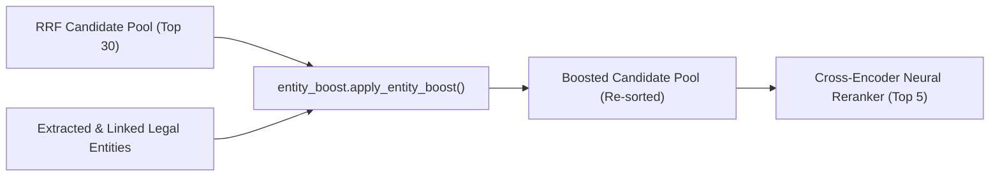

# Legal Entity-Aware Ranking Boost: `retrieval/entity_boost.py`

[Back to Retrieval Overview](README.md) • [Back to Main Index](../README.md)

---

## 1. Basic Introduction

### What is this file?
`retrieval/entity_boost.py` is the **Entity-Aware Re-scoring Module** in the Indian Legal AI Assistant. It inspects retrieved candidate chunks (output from Hybrid RRF Retrieval) and checks if their metadata (or text) directly matches the statutory articles, landmark cases, legal concepts, or canonical IDs identified during Phase 2 (Named Entity Recognition and Entity Linking).

### Why does this file exist?
Pure statistical lexical retrieval (BM25) and generic dense semantic retrieval (BGE-M3) frequently suffer from **statutory anchor confusion**. For example, when a user asks:
> *"Is privacy protected under Article 21 according to Puttaswamy?"*

General dense search might retrieve Article 19 or Article 14 simply because they discuss fundamental freedoms using similar judicial vocabulary ("liberty", "reasonable restrictions"). BM25 might match unrelated judgments containing the word "privacy".

`entity_boost.py` bridges symbolic knowledge with neural ranking:
1. It parses the query's extracted legal entities (`Article 21`, `Puttaswamy`).
2. It inspects each candidate's metadata (`article_number`, `case_name`, `title`, `document_id`).
3. If an explicit match is confirmed, it awards a calibrated additive boost ($\Delta s = +0.15$) to the candidate's score.
4. It logs transparent, human-auditable reasons (e.g., `Matched Article: Article 21 (+0.150)`) into the candidate dictionary so the Streamlit UI can explain *why* the ranking changed.

### Where does it fit in the system?
In the 16-stage query execution pipeline, Entity Boosting runs as **Stage 14** (immediately after Reciprocal Rank Fusion and immediately before Cross-Encoder Reranking):



---

## 2. Imports and Dependencies

```python
# retrieval/entity_boost.py L8-L10
import re
from typing import Dict, List, Any, Optional
from config import ENTITY_BOOST_WEIGHT
```

| Import / Dependency | Why is it imported? |
| :--- | :--- |
| `re` | Performs regular expression extraction of numeric article digits (`\d+[a-z]?`) and strips punctuation. |
| `typing.*` | Provides strict type annotations for candidate dictionaries, entity structures, and return values. |
| `config.ENTITY_BOOST_WEIGHT` | Imported from `config.py` (line 74), defaults to `0.15`. Controls the magnitude of the score boost. |

### Downstream Dependencies (Who calls this file?)
- **`retrieval/hybrid_retriever.py`** (`HybridRetriever.retrieve()` calls `apply_entity_boost` when `enable_entity_boost=True`).
- **`retriever.py`** (`HybridRRFRetriever.retrieve_with_boost()` calls `apply_entity_boost`).
- **`rag/pipeline.py`** (`LegalRAGPipeline.run()` calls `apply_entity_boost` during pipeline Stage 7).

---

## 3. Functions in `retrieval/entity_boost.py`

### 3.1 `_normalize_token(text: str) -> str`

#### Purpose & Logic
Cleans, lowercases, and strips all punctuation characters from input strings to ensure robust matching across varied legal punctuation conventions (e.g., `"Art. 21"`, `"art-21"`, `"Article 21"`).

```python
# Lines 13-17
def _normalize_token(text: str) -> str:
    """Lowercase and strip punctuation for entity token matching."""
    if not text:
        return ""
    return re.sub(r"[^\w\s]", "", str(text).lower()).strip()
```

- **Input**: Any string or object (e.g., `"Kesavananda Bharati v. State of Kerala"`).
- **Processing**: Converts to lowercase, strips non-alphanumeric/non-whitespace characters (`[^\w\s]`), and removes leading/trailing spaces.
- **Output**: Clean lowercase string (e.g., `"kesavananda bharati v state of kerala"`).

---

### 3.2 `_parse_entities(entities_input: Any) -> Dict[str, List[str]]`

#### Purpose & Logic
Normalizes diverse entity representations into a uniform canonical dictionary:
```python
{
    "articles": List[str],
    "cases": List[str],
    "concepts": List[str],
    "entity_ids": List[str]
}
```

The system supports two upstream caller formats:
1. **Format 1 (List of Dicts from `EntityLinker`)**: Each element is `{"entity_id": "...", "entity_type": "...", "canonical_name": "...", "surface_form": "..."}`.
2. **Format 2 (Dict from `LegalNER` / `LegalNERExtractor`)**: `{"articles": [...], "cases": [...], "concepts": [...], "entity_ids": [...]}`.

#### Code Walkthrough: Deduplication and Categorization
```python
# Lines 41-61
    # Format 1: List of linked entity dictionaries from EntityLinker
    if isinstance(entities_input, list):
        for item in entities_input:
            if isinstance(item, dict):
                eid = item.get("entity_id", "")
                if eid:
                    parsed["entity_ids"].append(eid)

                etype = item.get("entity_type", "").upper()
                cname = item.get("canonical_name", "")
                surface = item.get("surface_form", "")

                if etype in ("ARTICLE", "CONSTITUTION_ARTICLE"):
                    parsed["articles"].extend([cname, surface])
                elif etype in ("CASE", "JUDGMENT"):
                    parsed["cases"].extend([cname, surface])
                elif etype in ("LEGAL_CONCEPT", "RIGHT", "AMENDMENT"):
                    parsed["concepts"].extend([cname, surface])
```
At lines 91-100, a case-insensitive set deduplicates all collected strings while preserving their display casing.

---

### 3.3 `apply_entity_boost(...)`

```python
def apply_entity_boost(
    candidates: List[Dict[str, Any]],
    linked_entities: Any,
    boost_weight: float = ENTITY_BOOST_WEIGHT,
) -> List[Dict[str, Any]]
```

#### Step-by-Step Execution
1. **Short-Circuit Empty Checks (Lines 121-148)**:
   If candidates list is empty, or `linked_entities` is null/empty, or `boost_weight <= 0.0`, each candidate receives `boost_applied = 0.0`, `boost_reasons = []`, `base_score = score`, and the original ranking is preserved.
2. **Candidate Field Normalization (Lines 152-166)**:
   For every candidate, extracts metadata and normalizes the target fields:
   - `cand_art`: From `metadata["article_number"]` or `parent_data["article_number"]`.
   - `cand_case`: From `metadata["case_name"]` or `parent_data["case_name"]`.
   - `cand_title`: From `metadata["title"]` or `parent_data["title"]`.
   - `cand_doc_id`: From `cand["document_id"]` or `cand["parent_id"]`.
   - `cand_text`: First 300 characters of passage text.
3. **Four-Tier Matching Rules**:
   - **Tier 1: Article Matching (Full Weight: $1.0 \times \text{boost\_weight} = 0.150$)**
     Compares numeric digits using regex (`\d+[a-z]?`). For example, if the query has `"Article 21A"`, it extracts digit token `21a` and tests whether `21a` exists in candidate article numbers or doc IDs.
   - **Tier 2: Landmark Case Matching (Full Weight: $1.0 \times \text{boost\_weight} = 0.150$)**
     Checks substring match against full case name, doc ID, or significant lead name tokens (`Kesavananda`, `Puttaswamy`, `Maneka`, `Golaknath`, excluding generic legal stopwords like `"state"`, `"union"`, `"india"`, `"kerala"`).
   - **Tier 3: Canonical Entity ID Matching (Full Weight: $1.0 \times \text{boost\_weight} = 0.150$)**
     Matches exact registry identifiers (e.g., `"art_21"`, `"case_puttaswamy_2017"`).
   - **Tier 4: Legal Concept / Right Matching (Half Weight: $0.5 \times \text{boost\_weight} = 0.075$)**
     Substrings longer than 4 characters matched against candidate title or passage text. Receives half weight to prevent topical query drift.
4. **Transparent Re-scoring (Lines 237-252)**:
   $$\text{Final Score} = \text{Base Score} + \sum \Delta s_{\text{boost}}$$
   Values are rounded to 5 decimal places. The explanation list is stored in `cand["boost_reasons"]`.
5. **Re-sorting & Re-indexing (Lines 254-260)**:
   Sorts descending by `cand["score"]` and re-indexes ranks $1, 2, \dots, N$.

---

## 4. Actual Code Walkthrough

### Code Excerpt 1: Article Matching Logic (Lines 167-190)
```python
        # 1. Article Matching (Full Weight)
        for ent_art in parsed_entities["articles"]:
            norm_art = _normalize_token(ent_art)
            if not norm_art:
                continue

            # Exact article number match (e.g. "article 21" or "21")
            art_digits = re.findall(r"\d+[a-z]?", norm_art)
            cand_digits = re.findall(r"\d+[a-z]?", cand_art) + re.findall(r"\d+[a-z]?", cand_doc_id)

            is_match = False
            if art_digits and cand_digits and any(d in cand_digits for d in art_digits):
                is_match = True
            elif cand_art and (norm_art in cand_art or cand_art in norm_art):
                is_match = True
            elif cand_title and norm_art in cand_title:
                is_match = True

            if is_match:
                match_boost = boost_weight * 1.0
                boost_applied += match_boost
                boost_reasons.append(f"Matched Article: {ent_art} (+{match_boost:.3f})")
                break  # Count each entity type once per candidate
```
- **Why this is needed**: Eliminates regex formatting issues. Whether the metadata stores `"21"`, `"art_21"`, or `"Article 21"`, `re.findall(r"\d+[a-z]?", ...)` extracts `["21"]` and reliably matches.
- **Break statement**: `break` prevents double-boosting if an article is recognized under both surface form and canonical form.

### Code Excerpt 2: Case Law Lead Name Matching (Lines 207-214)
```python
            # Split into significant lead names (e.g. "Kesavananda" or "Puttaswamy")
            lead_tokens = [w for w in norm_case.split() if len(w) > 4 and w not in ("state", "union", "india", "kerala")]
            if cand_case and any(lt in cand_case for lt in lead_tokens):
                match_boost = boost_weight * 1.0
                boost_applied += match_boost
                boost_reasons.append(f"Matched Case Lead: {ent_case} (+{match_boost:.3f})")
                break
```
- **Why this is needed**: Indian legal citations often differ in title formulation (e.g., *"Justice K.S. Puttaswamy (Retd.) v. Union of India"* vs *"K.S. Puttaswamy v. UOI"*). Matching the non-generic lead word `"puttaswamy"` guarantees recognition regardless of abbreviation style.

---

## 5. Practical Working Example

### Query:
> *"Does Article 21 guarantee right to privacy according to Puttaswamy?"*

### Parsed Entities:
```python
{
    "articles": ["Article 21"],
    "cases": ["K.S. Puttaswamy v. Union of India"],
    "concepts": ["Right to Privacy"],
    "entity_ids": ["art_21", "case_puttaswamy_2017"]
}
```

### Candidate Comparison Before & After Boost:

| Candidate ID | Doc Type | Base RRF Score | Matched Rules | Boost Applied | Final Score | Old Rank $\to$ New Rank |
| :--- | :--- | :--- | :--- | :--- | :--- | :--- |
| `art_19_c1` | Constitution | `0.02850` | Matched Concept (+0.075) | `+0.075` | `0.10350` | Rank 1 $\to$ **Rank 3** |
| `art_21_c1` | Constitution | `0.02640` | Matched Article (+0.150) | `+0.150` | `0.17640` | Rank 2 $\to$ **Rank 2** |
| `sc_puttaswamy_c4`| Judgment | `0.02510` | Matched Case Lead (+0.150)<br>Matched Concept (+0.075) | `+0.225` | `0.25010` | Rank 3 $\to$ **Rank 1** 🚀 |

**Result**: The landmark Puttaswamy judgment passage and Article 21 jump ahead of the generic Article 19 passage because they directly address the queried entities.

---

## 6. Viva Presentation & Defense Q&A

### Q1: Why use an additive boost (+0.15) instead of a multiplicative boost ($\times 1.15$)?
> **Student Answer**:
> *"In reciprocal rank fusion, base RRF scores are bounded in a small numerical range (typically $0.01$ to $0.035$). A multiplicative boost of $15\%$ on $0.02$ would only yield an increment of $0.003$, which is too small to overcome minor rank discrepancies. An additive boost of $+0.150$ provides a deterministic, controlled uplift that acts like an authoritative prior: if a document explicitly represents the statute or case asked by the user, it should overcome purely incidental term matches."*

### Q2: Why are concepts awarded only half weight (+0.075) while articles receive full weight (+0.150)?
> **Student Answer**:
> *"Statutory articles (e.g. Article 21) and landmark case titles are discrete, unambiguous legal anchors. Concepts like 'Right to Privacy' or 'Procedure Established by Law' are broad and appear across hundreds of judgments and constitutional articles. Giving concepts full weight would cause topical drift, promoting loosely related texts. Giving concepts half weight provides a gentle thematic nudge without overwhelming primary statutory relevance."*

