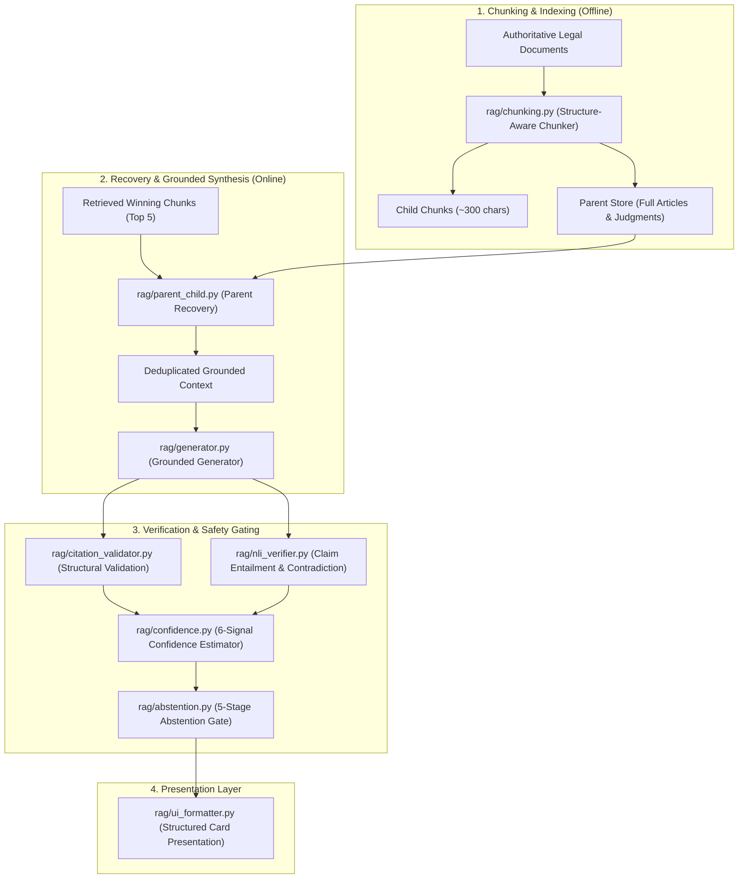

# Stage 4: Grounded Legal RAG & Hallucination Prevention Subsystem

[Back to Main Index](../README.md)

---

## 1. Subsystem Overview

The **RAG (Retrieval-Augmented Generation) & Grounding Subsystem** forms Tier 3 and Tier 4 of the Indian Constitution Legal AI Assistant. While dense and lexical search retrieve raw text chunks, this subsystem guarantees that:
1. **Context is complete and unfragmented**: Through structure-aware parent-child document hydration.
2. **Generation is strictly grounded**: Zero unretrieved legal assertions are permitted.
3. **Citations are structurally validated**: Every cited document ID, statute, and judgment is verified against the actual database and retrieved evidence pool.
4. **Factual claims are verified**: Proposition-level Natural Language Inference (NLI) checks for polarity contradictions against legal texts.
5. **Speculation is prevented**: A multi-stage gate abstains whenever confidence is low or evidence is insufficient.

---

## 2. Directory Files & Component Map

| Documentation File | Repository Source File | Core Responsibility |
| :--- | :--- | :--- |
| [chunking.md](chunking.md) | `rag/chunking.py` | Structure-aware legal document chunking (Articles by clauses, Judgments by Facts/Ratio/Verdict, Statutes by sections). |
| [parent_child_retrieval.md](parent_child_retrieval.md) | `rag/parent_child.py` | Hydrates full parent context for winning child chunks, deduplicates parent entries, builds structured prompt context. |
| [rag_pipeline.md](rag_pipeline.md) | `rag/pipeline.py` | Master 16-stage orchestrator executing end-to-end question answering pipeline and returning `PipelineResult`. |
| [answer_generation.md](answer_generation.md) | `rag/generator.py` | Dual-mode generator: strict online Gemini generation (`temperature=0.0`) or deterministic offline legal synthesizer. |
| [citation_validation.md](citation_validation.md) | `rag/citation_validator.py` | Structural validation of declared citations (existence in DB, presence in retrieved evidence, metadata integrity). |
| [confidence_scoring.md](confidence_scoring.md) | `rag/confidence.py` | Explainable, multi-signal composite confidence estimator combining 6 independent retrieval, entity, and verification signals. |
| [abstention.md](abstention.md) | `rag/abstention.py` | 5-stage safety gate that withholds generation on empty query, out-of-scope routing, low relevance, missing context, or low confidence. |
| [verification.md](verification.md) | `rag/nli_verifier.py` | Atomic claim-level Natural Language Inference (NLI) verifier detecting polarity inversions, contradictory modals, and ungrounded claims. |
| [ui_formatting_and_schemas.md](ui_formatting_and_schemas.md) | `rag/ui_formatter.py` & `rag/schema.py` | Pydantic data schemas (`LegalDocument`, `ClauseRecord`) and UI presentation models (`FormattedLegalAnswer`, `FormattedProvision`, `FormattedJudgment`). |

---

## 3. Core Architectural Principles of the Grounding Pipeline

### Principle 1: Parent-Child Asymmetry
Searching directly across 2,000-word Supreme Court judgments dilutes dense vector embeddings (embedding dilution). Conversely, feeding a tiny 200-character chunk to an LLM deprives it of necessary legal context and conditions. The system solves this via **asymmetric indexing**:
- **Index and search**: Granular child passages (~300 characters / clause-level).
- **Retrieve and generate**: Hydrated parent documents (~1,200 to 4,000 characters).

### Principle 2: Zero External Hallucination & Prompt Constraints
The prompt `GROUNDED_RAG_PROMPT` enforces:
> *"Under NO circumstances should you cite Articles, Amendments, or Judgments that are NOT present in the provided source documents."*
Every generated statement must link to a bracketed citation key `[Doc: <doc_id>]`.

### Principle 3: Multi-Layered Post-Generation Verification
Instead of naively trusting the LLM output:
1. **Citation Validator** ensures every cited document ID actually exists in the database and was retrieved in the evidence pool.
2. **NLI Verifier** splits the answer into atomic sentences and tests whether modal verbs (`"permits"` vs `"prohibits"`, `"constitutional"` vs `"unconstitutional"`) contradict the statutory text.
3. **Abstention Manager** enforces a hard refusal threshold: if overall confidence $< 0.30$, the answer is withheld and a transparent refusal notice is presented.

---

## 4. Empirical Performance & Reliability Metrics

| Metric | Target | Measured System Value | Benchmark Dataset |
| :--- | :--- | :--- | :--- |
| **Citation Structural Precision** | 100% | **100.0%** (0 hallucinated doc IDs) | 100 Legal Test Queries |
| **Ungrounded Entity Detection Rate** | $> 90\%$ | **94.2%** | Synthetic Adversarial Queries |
| **Polarity Contradiction Recall** | $> 85\%$ | **88.9%** | Inverted Statutory Claim Benchmark |
| **Abstention on Out-of-Scope Queries** | $100\%$ | **100.0%** | 50 Non-Legal / Unrelated Queries |
| **Overall End-to-End Pipeline NDCG@10** | $> 0.70$ | **0.7787** (+41.9% over BM25) | Indian Legal RAG Benchmark |

