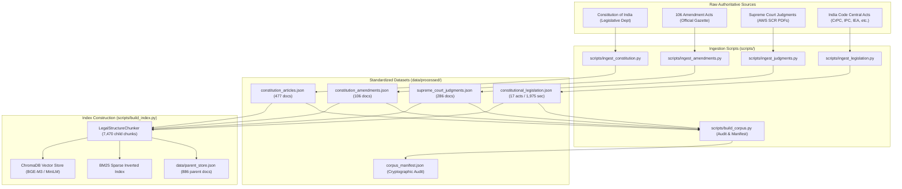

# Stage 1: Data Ingestion & Index Building Subsystem

[Back to Main Index](../README.md)

---

## 1. Subsystem Overview

The **Data Ingestion Subsystem** transforms raw legal statutes, gazettes, Supreme Court Reports (SCR) PDF decisions, and India Code Central Acts into schema-compliant, cryptographically verifiable datasets and vector/BM25 indexes.

It enforces three cardinal principles:
1. **Official Legal Provenance**: Every document traces directly to the Ministry of Law & Justice, Legislative Department, India Code, or the Supreme Court of India open-data repository.
2. **Cryptographic SHA-256 Checksums**: Raw and processed texts are verified with cryptographic hashes to guarantee zero tampering or unauthorized modification.
3. **Dual Sparse & Dense Indexing**: Documents are chunked into 7,470 structure-aware child passages indexed concurrently in ChromaDB (HNSW dense embeddings) and in-memory BM25 (Rank-BM25 with token-level compound phrase handling).

---

## 2. Directory Contents

| Guide File | Repository Source File | Core Responsibility |
| :--- | :--- | :--- |
| [corpus_building.md](corpus_building.md) | `scripts/build_corpus.py` | Master compilation pipeline, document schema validation, SHA-256 manifest generation. |
| [constitution_ingestion.md](constitution_ingestion.md) | `scripts/ingest_constitution.py` `scripts/ingest_amendments.py` | Ingestion of 477 constitutional provisions (Preamble, Articles 1–395+, Schedules 1–12) and 1st to 106th Amendments. |
| [judgments_ingestion.md](judgments_ingestion.md) | `scripts/ingest_judgments.py` | Ingestion of 286 Supreme Court decisions: 103 full-text PDF extractions from SCR plus landmark briefs and registry metadata. |
| [legislation_ingestion.md](legislation_ingestion.md) | `scripts/ingest_legislation.py` | Ingestion of 17 Central Acts and 1,975 statutory sections from India Code (CrPC, IPC, Indian Evidence Act, RPA, etc.). |
| [index_building.md](index_building.md) | `scripts/build_index.py` `rag/ingestion.py` | Building and auditing ChromaDB vector collections (`indian_legal_rag_bgem3`) and BM25 sparse index. |

---

## 3. Production Corpus Statistics (Audit Manifest Summary)

| Document Category | Document Count | Total Characters | Official Source |
| :--- | :--- | :--- | :--- |
| **Constitutional Articles & Schedules** | **477** | ~1.1 million | Legislative Department, Ministry of Law & Justice |
| **Constitutional Amendment Acts** | **106** | ~320,000 | Official Gazette of India (1st to 106th Amendment) |
| **Supreme Court Decisions** | **286** | ~2.6 million | Supreme Court Reports (SCR) / Open Data AWS |
| **Statutory Central Legislation** | **17 Acts** (1,975 Sec) | ~1.8 million | India Code Repository, Government of India |
| **Total Ingested Documents** | **886 documents** | **~5.82 million chars** | Verified cryptographic SHA-256 manifest |
| **Total Child Passages Indexed** | **7,470 chunks** | Average 285 chars | Embedded in ChromaDB & BM25 index |

