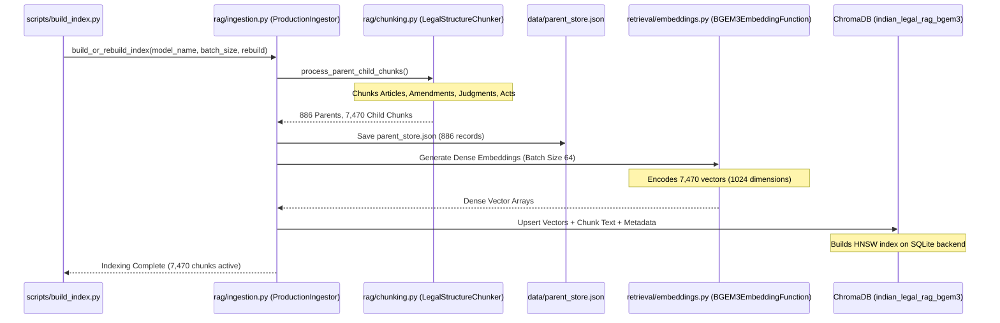

# Vector & Sparse Index Construction: `scripts/build_index.py` & `rag/ingestion.py`

[Back to Ingestion Overview](README.md) • [Back to Main Index](../README.md)

---

## 1. Basic Introduction

### What are these files?
- **`scripts/build_index.py`**: The command-line utility for building, verifying, inspecting, and safely rebuilding the vector store and BM25 index.
- **`rag/ingestion.py`** (and root `ingestion.py`): The core indexing engine implementing `ProductionIngestor`. It converts the 886 raw legal documents into 7,470 structure-aware child chunks, generates 1024-dimensional BGE-M3 dense embeddings, upserts vectors to ChromaDB, saves `parent_store.json`, and constructs the BM25 inverted index.

### Why do we need dual indexing?
Dense semantic vector search and sparse lexical search have complementary strengths:
- **Dense Embeddings (BGE-M3)**: Understand conceptual synonyms (*"right to clean environment"* $\to$ *Article 21*).
- **Sparse BM25**: Excels at exact statutory anchors, alphanumeric section codes (*"Section 41A"*, *"Article 324"*), and proper case names (*"Puttaswamy"*).

The ingestion pipeline builds both indexes simultaneously over the identical set of 7,470 child passages to enable Reciprocal Rank Fusion (RRF) at query time.

---

## 2. Ingestion Pipeline Flow: `ProductionIngestor`



---

## 3. Class: `ProductionIngestor` (`rag/ingestion.py`)

### 3.1 `process_parent_child_chunks() -> Tuple[Dict, List[Dict]]`
1. **Loads All 4 Datasets**:
   - `constitution_articles.json` (477 docs)
   - `constitution_amendments.json` (106 docs)
   - `supreme_court_judgments.json` (286 docs)
   - `constitutional_legislation.json` (17 acts)
2. **Executes `LegalStructureChunker`**:
   - Chunks constitutional articles into clauses and legal analysis.
   - Chunks amendments into Summary and Statement of Objects.
   - Chunks judgments into Facts, Issues, Ratio Decidendi, and Verdict.
   - Chunks Central Acts into statutory sections.
3. **Populates `parent_store`**:
   Maps `parent_id` (e.g. `parent_const_art_021`) to the complete parent record.
4. **Outputs**:
   - `parent_store`: 886 complete documents.
   - `child_chunks`: 7,470 granular passages.

---

### 3.2 `build_chroma_index(child_chunks, rebuild=False)`
1. **Determines Collection Name**:
   - If using `BAAI/bge-m3` $\to$ `indian_legal_rag_bgem3` (1024-dim).
   - If using `all-MiniLM-L6-v2` $\to$ `indian_legal_rag` (384-dim).
2. **Dimension Safeguard**:
   Validates collection dimension against model dimension to prevent vector corruption.
3. **Batch Upserting**:
   Splits 7,470 chunks into batches of 64 or 128 chunks:
   ```python
   for i in range(0, len(child_chunks), batch_size):
       batch = child_chunks[i:i + batch_size]
       collection.add(
           ids=[c["child_id"] for c in batch],
           documents=[c["text"] for c in batch],
           metadatas=[c["metadata"] for c in batch]
       )
   ```
4. **HNSW Vector Graph**: ChromaDB automatically builds a Hierarchical Navigable Small World (HNSW) graph for sub-millisecond approximate nearest neighbor (ANN) retrieval.

---

## 4. CLI Tool: `scripts/build_index.py`

### 4.1 Index Inspection Mode (`--inspect`)
Quickly audits the current state of ChromaDB and `parent_store.json` without modifying any data:
```bash
python -m scripts.build_index --inspect
```
**Sample Output:**
```text
=================================================================
CHROMA DB & BM25 INDEX HEALTH AUDIT
=================================================================
[*] Available Collections: ['indian_legal_rag_bgem3', 'indian_legal_rag']
[*] Target Collection: indian_legal_rag_bgem3 (Model: BAAI/bge-m3)
[+] Active Indexed Chunks: 7470
[+] Parent Documents in Store: 886
[+] Status: HEALTHY
=================================================================
```

---

### 4.2 Safe Rebuild Mode (`--rebuild`)
If new acts or judgments are added to the corpus, rebuilds the vector index cleanly:
```bash
python -m scripts.build_index --rebuild --model BAAI/bge-m3 --batch-size 64
```
- Drops the existing collection to prevent duplicate vectors.
- Re-chunks all 886 documents.
- Regenerates embeddings and writes an updated `parent_store.json`.

---

## 5. Viva Presentation & Defense Q&A

### Q1: Why are there two collections in ChromaDB (`indian_legal_rag_bgem3` and `indian_legal_rag`)?
> **Student Answer**:
> *"They correspond to our two embedding models used during experimental ablation studies: `BAAI/bge-m3` produces 1024-dimensional embeddings (collection `indian_legal_rag_bgem3`), while `sentence-transformers/all-MiniLM-L6-v2` produces 384-dimensional embeddings (collection `indian_legal_rag`). ChromaDB strictly prohibits mixing vectors of different dimensions in the same collection. Separating collections allows us to toggle between the lightweight MiniLM model and the high-accuracy BGE-M3 model seamlessly without re-indexing."*

### Q2: How does the system ensure zero data loss during indexing?
> **Student Answer**:
> *"First, `validate_document_records()` asserts that every parent document has non-empty text, a valid ID, and a SHA-256 hash. Second, child chunk generation preserves complete provenance by attaching `parent_id` to every child. Third, before vector upserting, `parent_store.json` is atomically serialized to disk. Finally, ChromaDB's persistent client commits all HNSW vector nodes and SQLite metadata tables safely to `data/chroma_db/`."*

