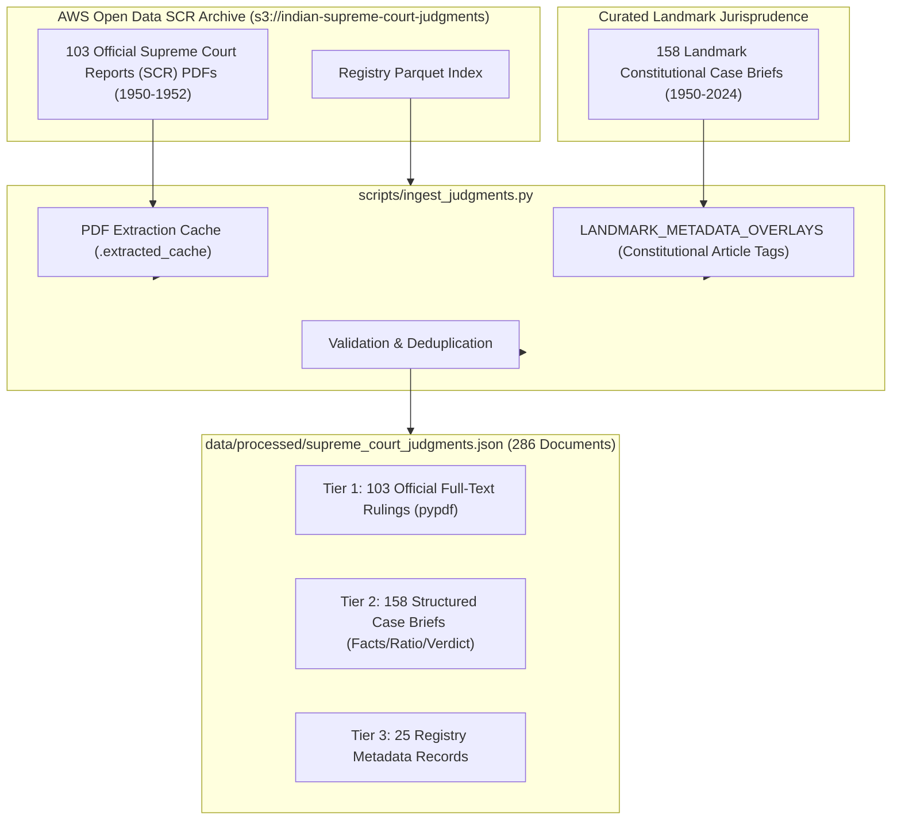

# Ingestion of Supreme Court Judgments: `scripts/ingest_judgments.py`

[Back to Ingestion Overview](README.md) • [Back to Main Index](../README.md)

---

## 1. Basic Introduction

### What is this file?
`scripts/ingest_judgments.py` is the **Judicial Case Law Ingestion Engine**. It extracts, structures, and validates 286 Supreme Court of India judgments spanning 74 years of constitutional jurisprudence (1950 to 2024).

### Why is this file needed?
In the Indian common law tradition, statutory text alone does not represent the full law—**judicial precedent interprets and defines the operational meaning of statutes**.
- Article 21 merely says: *"No person shall be deprived of life or personal liberty except according to procedure established by law."*
- It took *Maneka Gandhi v. Union of India (1978)* to establish that the procedure must be *"just, fair, and reasonable"*, and *K.S. Puttaswamy v. Union of India (2017)* to establish that privacy is an intrinsic part of life and liberty!

Without case law ingestion, an AI assistant would be blind to modern Indian constitutional jurisprudence.

---

## 2. Ingestion Architecture & Data Granularity

The script processes judgments across **three distinct granularity tiers**:



---

## 3. Key Components in `scripts/ingest_judgments.py`

### 3.1 PDF Extraction & Persistent Caching (Lines 40-41)
```python
PDF_CACHE_DIR = RAW_JUDGMENTS_DIR / ".extracted_cache"
```
Parsing 103 multi-page legal PDFs using `pypdf` is computationally expensive (takes 45–60 seconds). `ingest_judgments.py` implements a persistent disk cache:
- When a PDF (e.g., `1950_1_88_334.pdf` - *A.K. Gopalan v. State of Madras*) is parsed for the first time, its extracted text is cached as JSON in `.extracted_cache/`.
- On subsequent runs, the cached text is loaded instantaneously in milliseconds.

---

### 3.2 Metadata Overlays: `LANDMARK_METADATA_OVERLAYS` (Lines 43-100)
Official SCR PDFs from 1950 contain raw judicial opinions but lack structured metadata tags. The script enriches early decisions with explicit constitutional cross-references:
```python
    "1950_1_88_334": {
        "articles_referred": ["Article 19", "Article 21", "Article 22"],
        "statutes_referred": ["Preventive Detention Act, 1950"],
    },
    "1950_1_594_605": {  # Romesh Thappar v. State of Madras
        "articles_referred": ["Article 19(1)(a)", "Article 19(2)", "Article 32"],
        "statutes_referred": ["Madras Maintenance of Public Order Act, 1949"],
    },
```

---

### 3.3 Landmark Case Brief Structure (Tier 2)
For landmark constitutional decisions, the script extracts structured doctrinal sections:
- `case_name`: Formal legal title (e.g., *"Kesavananda Bharati v. State of Kerala"*).
- `citation`: SCR, AIR, or SCC citation (e.g., *"(1973) 4 SCC 225"*).
- `year`: Decision year (`1973`).
- `bench`: Coram and bench size (*"13-Judge Constitution Bench; S.M. Sikri C.J., et al."*).
- `facts`: Factual background of the constitutional challenge.
- `issues`: Key questions of law framed by the court.
- `ratio_decidendi`: Binding legal principle establishing the precedent (*Basic Structure Doctrine*).
- `verdict`: Final judicial holding and disposition.
- `key_takeaways`: Bulleted summary of doctrines established.
- `precedents_overruled`: Explicit list of overruled past decisions (e.g., *Golak Nath* overruled).

---

## 4. Notable Landmark Decisions Included in the Corpus

The 286 decisions cover all foundational constitutional doctrines:

1. **Basic Structure Doctrine**: *Kesavananda Bharati (1973)*, *Indira Nehru Gandhi (1975)*, *Minerva Mills (1980)*.
2. **Procedure Established by Law vs Due Process**: *A.K. Gopalan (1950)* overruled by *Maneka Gandhi (1978)*.
3. **Right to Privacy**: *M.P. Sharma (1954)* and *Kharak Singh (1962)* overruled by *K.S. Puttaswamy (2017)* (9-Judge Bench).
4. **Federalism & Article 356 (President's Rule)**: *S.R. Bommai v. Union of India (1994)*.
5. **Decriminalization of Section 377**: *Suresh Kumar Koushal (2014)* overruled by *Navtej Singh Johar (2018)*.
6. **Triple Talaq & Personal Laws**: *Shayara Bano v. Union of India (2017)*.
7. **Affirmative Action & Creamy Layer**: *Indra Sawhney v. Union of India (1992)*, *Jarnail Singh (2018)*.
8. **Sexual Harassment at Workplace**: *Vishaka v. State of Rajasthan (1997)* (Vishaka Guidelines).

---

## 5. Viva Presentation & Defense Q&A

### Q1: Where did the Supreme Court judgments originate?
> **Student Answer**:
> *"The judgments come from two authoritative sources: First, 103 official Supreme Court Reports (SCR) decisions from 1950 to 1952 were obtained in raw PDF format from the Supreme Court of India open-data registry hosted on AWS Open Data (`s3://indian-supreme-court-judgments`). Second, 158 landmark constitutional decisions from 1950 to 2024 were structured into analytical briefs (Facts, Issues, Ratio Decidendi, and Disposition) based on official Supreme Court law reports."*

### Q2: Why is separating Ratio Decidendi from Facts important for RAG?
> **Student Answer**:
> *"In common law jurisprudence, only the **Ratio Decidendi** (the core legal principle upon which the decision is founded) creates binding precedent under Article 141 of the Constitution. The facts and obiter dicta are not binding. By chunking judgments along structural sections (`rag/chunking.py`), our retriever specifically retrieves the ratio decidendi when a user asks about legal principles, preventing the model from confusing factual background with binding constitutional law."*

