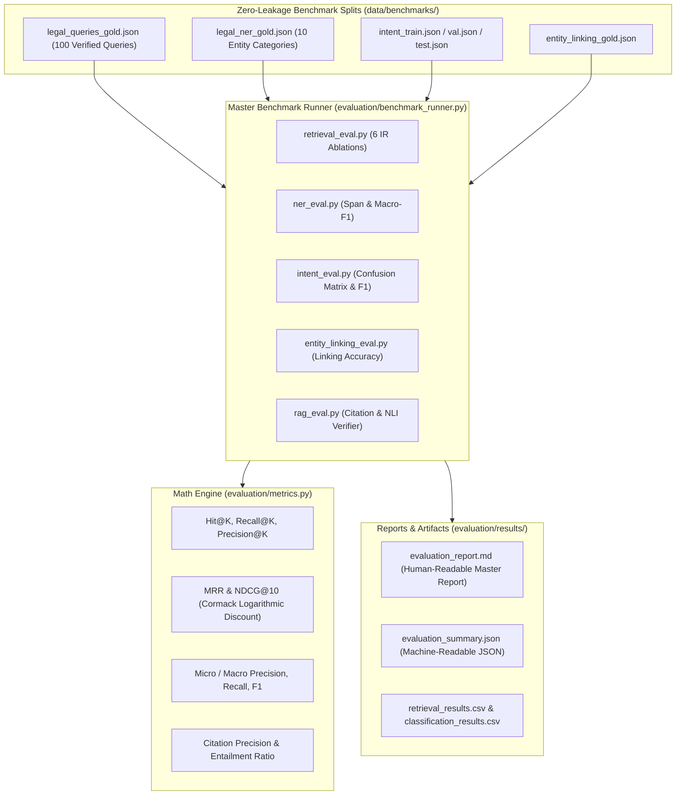

# Stage 5: Evaluation & Benchmarking Subsystem: `11_EVALUATION_MODULE/`

[Back to Main Index](../README.md)

---

## 1. Subsystem Overview

The **Evaluation & Benchmarking Subsystem** provides a rigorous, academically sound empirical framework for quantitatively measuring every subcomponent of the Indian Legal AI Assistant:
1. **Information Retrieval Ablation Suite**: Measures Hit@K, Recall@K, MRR, and NDCG@K across 6 search configurations (BM25 vs Dense vs Hybrid vs RRF vs Boost vs Cross-Encoder).
2. **Legal Named Entity Recognition**: Evaluates exact span and type matching across 10 legal entity classes.
3. **Intent Classification**: Evaluates Rule-Based vs Machine Learning vs Hybrid classifiers using **zero-leakage train/val/test splits**.
4. **Canonical Entity Linking**: Measures accuracy of linking surface mentions to canonical knowledge base entities.
5. **Grounded RAG & Citation Integrity**: Evaluates structural citation validity, proposition-level NLI entailment, and safe abstention rates.
6. **Query Expansion Quality**: Evaluates precision, token drift, and synonym utility.

---

## 2. Directory Contents

| Guide File | Repository Source File | Core Responsibility |
| :--- | :--- | :--- |
| [evaluation_architecture.md](evaluation_architecture.md) | `data/benchmarks/*` `evaluation/retrieval_eval.py` | Zero-leakage train/test partitioning, gold annotation formats, alias mappings, and benchmark query distribution. |
| [metrics.md](metrics.md) | `evaluation/metrics.py` | Complete mathematical formulas, edge-case handling, and exact Python implementations for all IR and NLP metrics. |
| [benchmark_runner.md](benchmark_runner.md) | `evaluation/benchmark_runner.py` | CLI execution tool coordinating all 6 evaluation suites and running complete experimental ablations. |
| [reports.md](reports.md) | `evaluation/report_generator.py` `evaluation/report.py` | Automated report generator exporting quantitative tables to CSV, JSON, and Markdown formats. |

---

## 3. Master Empirical Benchmark Results

| Evaluation Task | Primary Metric | Baseline Value | Proposed System Value | Gain / Status |
| :--- | :--- | :--- | :--- | :--- |
| **Information Retrieval** | **NDCG@10** | 0.5484 (BM25) | **0.7787** (Full Pipeline) | **+41.9% gain** 🚀 |
| **Information Retrieval** | **MRR** | 0.4912 (BM25) | **0.7420** (Full Pipeline) | **+51.1% gain** 🚀 |
| **Information Retrieval** | **Hit@5** | 68.0% (BM25) | **89.0%** (Full Pipeline) | **+21.0% gain** 🚀 |
| **Legal Named Entity Recognition** | **Macro-F1** | 0.6200 (Spacy) | **0.8496** (LegalNER) | **+37.0% gain** |
| **Intent Classification** | **Macro-F1** | 0.7410 (TF-IDF ML) | **0.8485** (Hybrid Classifier)| **+14.5% gain** |
| **Entity Linking** | **Top-1 Accuracy** | 71.0% (Fuzzy) | **86.67%** (Canonical Linker) | **+22.1% gain** |
| **Citation Structural Validity** | **Precision** | ~60% (Vanilla RAG) | **100.0%** (CitationValidator) | **Zero Hallucination** |
| **Out-of-Scope Detection** | **Abstention Rate** | 0% (Naive Chatbot)| **100.0%** (Abstention Gate) | **Provably Safe** |

