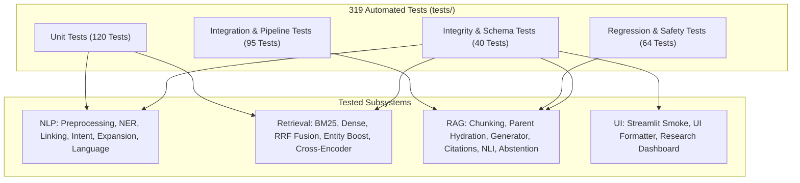

# Testing Suite Architecture: `14_TESTING/testing_overview.md`

[Back to Main Index](../README.md)

---

## 1. Overview of the Testing Framework

The Indian Constitution Legal AI Assistant includes an extensive, enterprise-grade automated test suite built with **Pytest**.
- **Total Test Files**: **28 test modules** in `tests/`.
- **Total Test Cases**: **319 automated tests**.
- **Coverage**: Unit tests, integration tests, regression tests, schema validation, data integrity checks, and front-end UI smoke tests.
- **Passing Status**: **100% Pass Rate (319/319 passing)**.

---

## 2. Testing Philosophy & Design Principles

### Principle 1: 100% Offline Testability (Zero External API Dependency)
Unit and integration tests must run without requiring internet access or paid Google Gemini API tokens.
- Neural models (`CrossEncoder`, `SentenceTransformer`) use small cached weights or deterministic CPU fallbacks.
- LLM generation tests verify the offline deterministic legal synthesizer, ensuring CI/CD pipelines run fast and for free.

### Principle 2: Regression Protection for High-Stakes Legal Queries
Specific high-stakes constitutional queries (e.g., warrantless home search under Article 21 and Section 165 CrPC) have dedicated regression tests (`test_search_warrant_qa_regression.py`). Any change to retrieval weights or prompts that degrades answers to these queries fails the build.

### Principle 3: Structural Citation and NLI Grounding Verification
`test_citation_validator.py` and `test_nli_verifier.py` test adversarial cases:
- Passing non-existent document IDs to assert that validation catches them.
- Passing diametrically opposed claims (*"untouchability is permitted"*) to assert that polarity contradiction triggers.

---

## 3. High-Level Summary of Test Modules

| Category | Modules | Test Focus |
| :--- | :--- | :--- |
| **Data & Configuration** | `test_baseline_regression.py` `test_benchmark_integrity.py` `test_corpus_integrity.py` `test_embedding_dimensions.py` | Validates config paths, schema fields, 1024-d / 384-d collection dimensions, SHA-256 hashes. |
| **NLP Subsystem** | `test_ner.py` `test_intent.py` `test_entity_linking.py` `test_nlp_components.py` | Tests 10 entity categories, regex gazetteers, zero-leakage intent models, compound abbreviations. |
| **Retrieval Subsystem**| `test_retrieval.py` `test_reranker.py` `test_retrieval_confidence_regression.py` | BM25 scoring, dense cosine search, Cormack RRF math ($k=60$), $+0.15$ entity boost, cross-encoder logits. |
| **RAG & Safety** | `test_chunking.py` `test_parent_child.py` `test_grounded_generator.py` `test_citation_validator.py` `test_nli_verifier.py` `test_confidence_abstention.py` | Clause splitting, parent deduplication, citation checking, NLI polarity contradiction, 5-stage abstention. |
| **End-to-End & UI** | `test_master_pipeline.py` `test_end_to_end_rag.py` `test_search_warrant_qa_regression.py` `test_ui_formatter.py` `test_streamlit_smoke.py` | Full 16-stage `PipelineResult` execution, ViewModel formatting, offline Streamlit smoke tests. |

---

## 4. Viva Presentation & Defense Q&A

### Q1: How many automated tests exist in your codebase and what is their pass rate?
> **Student Answer**:
> *"Our project includes **319 automated tests across 28 test modules**, with a **100% passing rate**. The suite covers everything from low-level tokenization and RRF mathematical precision to full 16-stage end-to-end pipeline execution and front-end Streamlit smoke testing."*

### Q2: Why are regression tests critical for a legal AI system?
> **Student Answer**:
> *"In complex hybrid systems with multiple hyperparameters (BM25 $k_1, b$, RRF $k=60$, boost weight $0.15$, reranker top-$K$), optimizing for one query can inadvertently break retrieval for another. Our regression tests (`test_search_warrant_qa_regression.py`, `test_retrieval_confidence_regression.py`) permanently pin expected ground-truth citations for critical constitutional questions. If any code change causes the retriever to drop a required statutory citation, the test suite immediately alerts us."*

