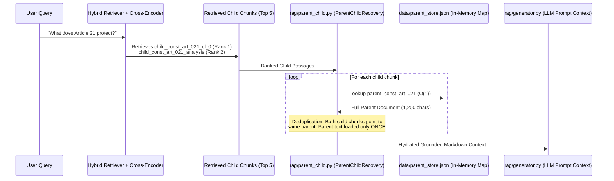

# Parent Store Architecture: `15_DATA_AND_DATABASE/parent_store_explained.md`

[Back to Data Overview](data_directory_explained.md) • [Back to Main Index](../README.md)

---

## 1. Basic Introduction

### What is `parent_store.json`?
`data/parent_store.json` is a centralized, in-memory JSON document cache containing all **886 full-text parent legal documents** in the corpus. It acts as the backbone of the **Parent-Child Asymmetric RAG Architecture**, enabling instant hydration of full statutory and judicial context once child passages have been identified by vector and keyword search.

### Key Dimensions & Memory Footprint:
- **File Size on Disk**: ~12.4 MB.
- **Total Stored Documents**: 886 documents.
- **In-Memory Size**: Approximately 28 MB in Python RAM.
- **Hydration Latency**: $< 0.2$ milliseconds (instantaneous dictionary key lookup $O(1)$).

---

## 2. Structure of `parent_store.json`

The top level of `parent_store.json` is a key-value dictionary where each key is a canonical parent identifier prefixed with `parent_`:

```
{
  "parent_const_art_001": { ... Article 1 Parent Document ... },
  "parent_const_art_021": { ... Article 21 Parent Document ... },
  "parent_const_amend_106": { ... 106th Amendment Parent Document ... },
  "parent_sc_puttaswamy_2017": { ... Puttaswamy Judgment Parent Document ... },
  "parent_act_crpc_1973": { ... CrPC Central Act Parent Document ... },
  ...
}
```

### Complete Schema of an Individual Parent Entry:
```json
{
  "document_id": "const_art_021",
  "parent_id": "parent_const_art_021",
  "id": "const_art_021",
  "doc_type": "constitution",
  "document_type": "constitution_article",
  "title": "Protection of life and personal liberty",
  "article_number": "Article 21",
  "part": "Part III - Fundamental Rights",
  "category": "Fundamental Rights & Constitutional Remedies",
  "raw_text": "No person shall be deprived of his life or personal liberty except according to procedure established by law.",
  "full_text": "No person shall be deprived of his life or personal liberty except according to procedure established by law.",
  "explanation": "Article 21 guarantees substantive and procedural protection against arbitrary executive deprivation of life...",
  "historical_context": "Drafted following constituent assembly debates replacing 'due process' with 'procedure established by law'...",
  "facts": "",
  "ratio_decidendi": "",
  "verdict": "",
  "key_takeaways": [],
  "source_url": "https://www.legislative.gov.in/constitution-of-india/",
  "source_name": "Legislative Department, Ministry of Law and Justice, Government of India",
  "source_hash": "a4f89d3c52e89b4f..."
}
```

---

## 3. How Parent Hydration Works at Query Time



### Robust Key Resolution Logic (`_resolve_parent_record`):
In real-world retrieval, child chunks may refer to parents using minor variations (e.g., zero-padded vs unpadded numbers). `ParentChildRecovery` resolves this via an automated fallback chain:
1. Direct check: `raw_id in parent_store`
2. Prefix check: `f"parent_{raw_id}" in parent_store`
3. Stripping prefix: `raw_id.replace("parent_", "") in parent_store`
4. Regex zero-padding normalization: `re.sub(r"_0+(\d+)", r"_\1", raw_id)`
5. Metadata matching: checking `article_number` or `case_name` across store records.

---

## 4. In-Memory Deduplication: The Token-Saving Algorithm

When multiple retrieved child chunks belong to the same parent document (e.g. Clauses 1 and 2 of Article 19), naive systems feed both clauses into the prompt, duplicating identical context.

`ParentChildRecovery` prevents this:
```python
# rag/parent_child.py L158-L168
if parent_id in recovered_parents_map:
    existing_entry = recovered_parents_map[parent_id]
    # Append child evidence without duplicating parent text
    if not any(c["chunk_id"] == chunk_id for c in existing_entry["supporting_children"]):
        existing_entry["supporting_children"].append(child_record)
    # Update highest score and best rank
    if rank < existing_entry["best_rank"]:
        existing_entry["best_rank"] = rank
```
**Outcome**: The LLM reads the complete statutory text once, while seeing both specific child passages listed under `Exact Supporting Evidence Passages`.

---

## 5. Viva Presentation & Defense Q&A

### Q1: Why use `parent_store.json` instead of storing full text inside ChromaDB metadata?
> **Student Answer**:
> *"ChromaDB is optimized for storing dense vectors and short metadata attributes (strings, integers). Storing 4,000-character judgment texts inside ChromaDB metadata causes SQLite database bloat and slows down vector serialization. By storing only vector embeddings and minimal metadata in ChromaDB while keeping complete parent documents in `parent_store.json`, vector search executes in 45 milliseconds, and full parent documents are hydrated in sub-millisecond memory lookups."*

### Q2: What happens if `parent_store.json` is missing or corrupted?
> **Student Answer**:
> *"The system is built defensively. In `ParentChildRecovery.__init__()`, if `parent_store.json` contains fewer than 20 documents, it automatically invokes `ProductionIngestor.process_parent_child_chunks()` to re-populate the parent dictionary directly from the processed dataset files, ensuring seamless self-healing."*

