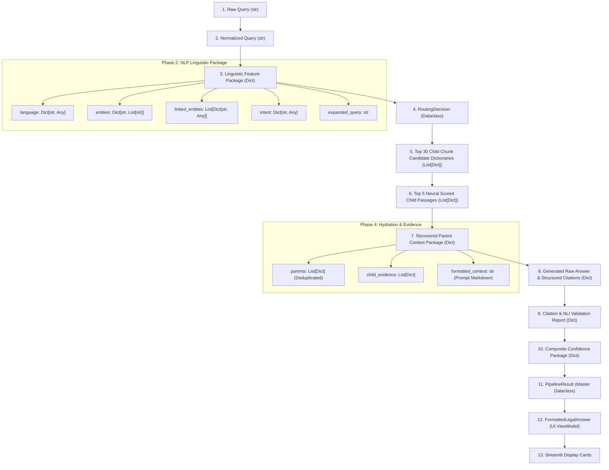

# Data Transformation and Lifecycle Pipeline: `16_CODE_CONNECTIONS/data_flow_map.md`

[Back to Main Index](../README.md)

---

## 1. Data Transformation Overview

This document illustrates how information mutates and transforms across data structures throughout the application lifecycle: from an unstructured raw user query string, through intermediate linguistic dictionaries and vector arrays, into strongly-typed execution dataclasses (`RoutingDecision`, `PipelineResult`), and finally into presentation ViewModels (`FormattedLegalAnswer`).



---

## 2. Step-by-Step Data Mutation Details

### Step 1: Raw Query $\to$ Normalized Query
- **Input**: `str` (e.g. `“Can police search house without warrant under Art. 21 and CrPC?”`)
- **Transformation**: `normalize_legal_text()` converts curly quotes to standard ASCII, expands `"Art."` to `"Article"`, and strips excessive whitespace.
- **Output**: `str`: `"can police search house without warrant under article 21 and crpc"`

---

### Step 2: Normalized Query $\to$ NLP Linguistic Feature Package
The query is analyzed by parallel Stage 2 NLP extractors:
- **`language` (`Dict`)**: `{"language": "en", "script": "latin", "is_supported": True}`
- **`entities` (`Dict`)**: `{"ARTICLE": ["Article 21"], "ACT": ["CrPC"]}`
- **`linked_entities` (`List[Dict]`)**:
  ```python
  [
      {"entity_id": "art_21", "canonical_name": "Article 21", "entity_type": "ARTICLE"},
      {"entity_id": "act_crpc_1973", "canonical_name": "Code of Criminal Procedure, 1973", "entity_type": "ACT"}
  ]
  ```
- **`intent` (`Dict`)**: `{"intent": "CONSTITUTIONAL_PROCEDURE", "confidence": 0.88}`
- **`expanded_query` (`str`)**: `"can police search house without warrant under article 21 and crpc inspection seizure magistrate"`

---

### Step 3: NLP Package $\to$ `RoutingDecision` Dataclass
`QueryRouter.route()` evaluates the linguistic package and outputs an immutable dataclass:
```python
RoutingDecision(
    strategy="PROCEDURE_SEARCH",
    retrieval_query="can police search house without warrant under article 21 and crpc...",
    filter_doc_type=None,               # Cross-corpus search across Constitution & CrPC
    use_bm25=True,
    use_dense=True,
    use_rrf=True,
    use_entity_boost=True,
    entity_boost_weight=0.15,
    top_k_candidates=30,
    final_top_k=5,
    recommended_agent="explanation_agent",
    requires_comparison=False,
    is_out_of_scope=False,
    reasons=["Procedural constitutional query targeting governing state mechanisms."]
)
```

---

### Step 4: `RoutingDecision` $\to$ Candidate Chunks $\to$ Reranked Passages
- **BM25 Search**: Returns 30 candidates with lexical `bm25_score`.
- **Dense Vector Search**: Returns 30 candidates with vector `dense_score`.
- **RRF Fusion**: Combines candidates into single list with Cormack `rrf_score`.
- **Entity Boost**: Matches metadata against `art_21` and `act_crpc_1973`, adding `boost_applied = +0.150` to `score`.
- **Cross-Encoder Reranking**: Re-scores top 30 pairs with neural logits. Outputs top 5 candidates with `reranker_score` and `rank = 1..5`.

---

### Step 5: Winning Chunks $\to$ Recovered Context Package
`ParentChildRecovery.recover()` takes the 5 child passages and resolves their parents from `parent_store.json`:
```python
{
    "parents": [
        {
            "document_id": "act_crpc_1973",
            "title": "Code of Criminal Procedure, 1973",
            "doc_type": "statute",
            "full_text": "Code of Criminal Procedure, 1973 (Act No. 2 of 1974)...",
            "supporting_children": [ ... Section 165 Child Passage ... ]
        },
        {
            "document_id": "const_art_021",
            "title": "Protection of life and personal liberty",
            "doc_type": "constitution",
            "full_text": "No person shall be deprived of his life or personal liberty...",
            "supporting_children": [ ... Clause 1 Child Passage ... ]
        }
    ],
    "child_count": 5,
    "parent_count": 2,                  # Deduplicated from 5 chunks to 2 parents!
    "formatted_context": "=== SOURCE DOCUMENT 1 [DocID: act_crpc_1973] ===\n..."
}
```

---

### Step 6: Grounded Generation $\to$ Verification & Confidence
- **`GroundedGenerator`**: Parses model generation into 3 sections:
  `{"evidence": "...", "analysis": "...", "citations": [...]}`
- **`CitationValidator`**: Verifies that `[Doc: act_crpc_1973]` and `[Doc: parent_const_art_021]` exist in retrieved context.
- **`NLIVerifier`**: Decomposes analysis into 8 sentences, asserts 0 contradictions. Returns `nli_status = "VERIFIED_ENTAILED"`.
- **`ConfidenceEstimator`**: Calculates composite score across 6 signals $\to 0.84$ (`HIGH`).

---

### Step 7: Encapsulation into `PipelineResult` Master Dataclass
All intermediate state is encapsulated in `PipelineResult`:
```python
PipelineResult(
    original_query=...,
    normalized_query=...,
    language=...,
    intent=...,
    entities=...,
    linked_entities=...,
    expanded_query=...,
    routing_decision=...,
    retrieved_chunks=...,
    reranked_chunks=...,
    parent_context=...,
    citations=...,
    generated_answer=...,
    citation_validation=...,
    confidence=...,
    abstained=False,
    abstention_reason=None
)
```

---

### Step 8: `PipelineResult` $\to$ `FormattedLegalAnswer` ViewModel
`rag/ui_formatter.py` isolates display concerns:
- Extracts executive summary.
- Builds `List[FormattedProvision]` (Section 165 CrPC and Article 21).
- Builds `List[FormattedJudgment]`.
- Extracts exceptions (warrantless search permitted only under urgent Section 165 conditions with written recorded grounds).
- Packs confidence level and badge into `FormattedLegalAnswer`.

---

## 3. Viva Presentation & Defense Q&A

### Q1: Why is separating the ViewModel (`FormattedLegalAnswer`) from `PipelineResult` important?
> **Student Answer**:
> *"It enforces the separation of concerns principle in software engineering. `PipelineResult` is an immutable, scientific data structure containing all 17 raw technical audit fields needed for benchmark logging and automated evaluation. `FormattedLegalAnswer` is a UI-specific ViewModel containing clean display strings, structured provision cards, and pre-parsed exception lists. If the Streamlit UI is ever replaced with a React dashboard or REST API, the core execution pipeline remains completely decoupled from presentation logic."*

