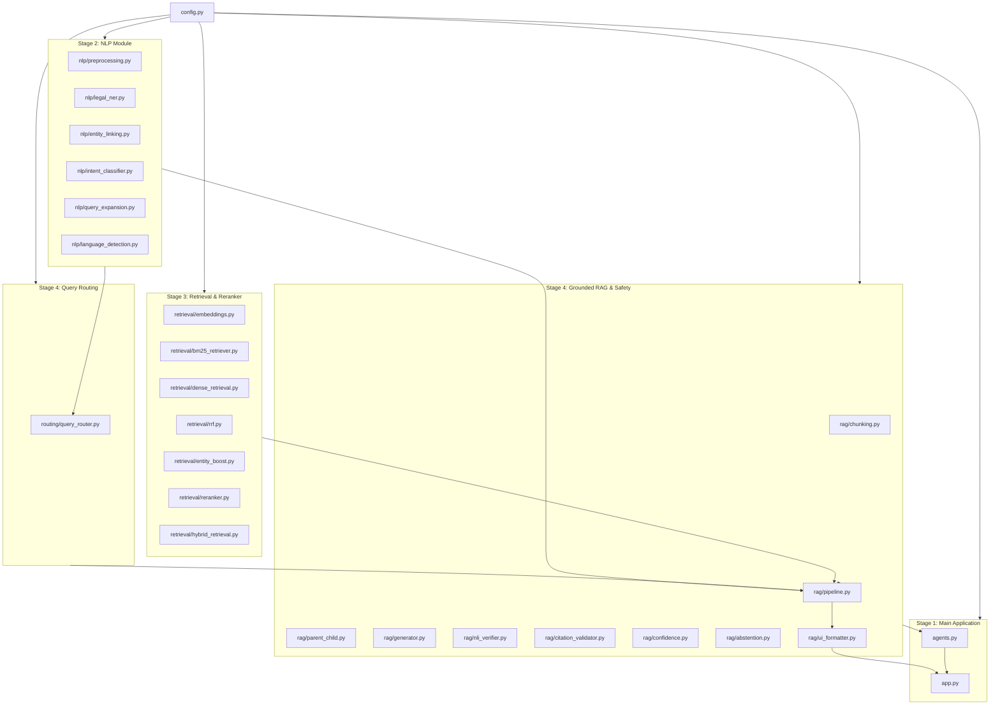

# File Dependency and Import Matrix: `16_CODE_CONNECTIONS/file_dependency_map.md`

[Back to Main Index](../README.md)

---

## 1. System Dependency Overview

This document maps the inter-file dependencies and module import relationships across the entire codebase. It helps examiners and developers understand how code changes in one file propagate across the application.

---

## 2. Detailed File Dependency Matrix

| File | Depends On (Imports) | Depended On By (Imported By) |
| :--- | :--- | :--- |
| **`config.py`** | *None* (Standard library `os`, `pathlib`) | Every single module in the repository. |
| **`nlp/preprocessing.py`** | `re`, `unicodedata` | `nlp/legal_ner.py`, `nlp/intent_classifier.py`, `retrieval/bm25_retriever.py`, `rag/pipeline.py` |
| **`nlp/language_detection.py`**| `re` | `routing/query_router.py`, `rag/pipeline.py` |
| **`nlp/legal_ner.py`** | `re`, `json`, `config.py`, `nlp/preprocessing.py` | `nlp/entity_linking.py`, `nlp/intent_classifier.py`, `routing/query_router.py`, `rag/pipeline.py` |
| **`nlp/entity_linking.py`** | `json`, `re`, `config.py` | `routing/query_router.py`, `retrieval/entity_boost.py`, `rag/pipeline.py` |
| **`nlp/intent_classifier.py`**| `re`, `json`, `config.py`, `nlp/preprocessing.py` | `routing/query_router.py`, `rag/pipeline.py`, `agents.py` |
| **`nlp/query_expansion.py`** | `re`, `json`, `config.py` | `routing/query_router.py`, `rag/pipeline.py` |
| **`routing/query_router.py`** | `config.py` | `rag/pipeline.py`, `rag/generator.py` |
| **`retrieval/embeddings.py`** | `sqlite3`, `hashlib`, `config.py`, `sentence_transformers` | `retrieval/dense_retrieval.py`, `scripts/build_index.py`, `rag/ingestion.py` |
| **`retrieval/bm25_retriever.py`**| `math`, `re`, `config.py`, `rank_bm25` | `retrieval/hybrid_retrieval.py`, `retriever.py`, `evaluation/retrieval_eval.py` |
| **`retrieval/dense_retrieval.py`**| `chromadb`, `config.py`, `retrieval/embeddings.py`| `retrieval/hybrid_retrieval.py`, `retriever.py`, `evaluation/retrieval_eval.py` |
| **`retrieval/rrf.py`** | `config.py` | `retrieval/hybrid_retrieval.py`, `retriever.py` |
| **`retrieval/entity_boost.py`**| `re`, `config.py` | `retrieval/hybrid_retrieval.py`, `retriever.py`, `rag/pipeline.py` |
| **`retrieval/reranker.py`** | `config.py`, `sentence_transformers.CrossEncoder` | `retrieval/hybrid_retrieval.py`, `retriever.py`, `rag/pipeline.py` |
| **`retrieval/hybrid_retrieval.py`**| All `retrieval/*` components | `rag/pipeline.py`, `retriever.py`, `evaluation/benchmark_runner.py` |
| **`rag/chunking.py`** | `re`, `config.py` | `rag/ingestion.py`, `ingestion.py`, `scripts/build_index.py` |
| **`rag/parent_child.py`** | `json`, `re`, `config.py` | `rag/pipeline.py`, `agents.py` |
| **`rag/generator.py`** | `re`, `config.py`, `langchain_google_genai` | `rag/pipeline.py` |
| **`rag/nli_verifier.py`** | `re` | `rag/citation_validator.py` |
| **`rag/citation_validator.py`**| `re`, `json`, `config.py`, `rag/nli_verifier.py` | `rag/pipeline.py` |
| **`rag/confidence.py`** | `math`, `re`, `config.py` | `rag/pipeline.py` |
| **`rag/abstention.py`** | `config.py` | `rag/pipeline.py` |
| **`rag/pipeline.py`** | All `nlp/*`, `routing/*`, `retrieval/*`, and `rag/*` | `app.py` |
| **`rag/ui_formatter.py`** | `re` | `app.py` |
| **`agents.py`** | `config.py`, `retriever.py`, `rag/parent_child.py` | `app.py` |
| **`app.py`** | `streamlit`, `rag/pipeline.py`, `rag/ui_formatter.py`, `agents.py` | *User Interface Entry Point* |

---

## 3. Key Observations for Code Explanations

1. **Acyclic Directed Graph (DAG)**: There are **zero circular imports** in the repository. Dependencies strictly flow downwards from foundational modules (`config.py` $\to$ `nlp/*` $\to$ `retrieval/*` $\to$ `rag/*` $\to$ `app.py`).
2. **Lazy Loading**: Heavy neural modules (`sentence_transformers.CrossEncoder`, `ChatGoogleGenerativeAI`) are loaded lazily inside class methods rather than at module top-level. This prevents Streamlit import stalls and enables instant CLI start times.
3. **Pluggable Architecture**: `rag/pipeline.py` accepts pre-instantiated instances of retriever, parent store, and generator in its constructor, making it trivial to inject mock instances during unit testing.

