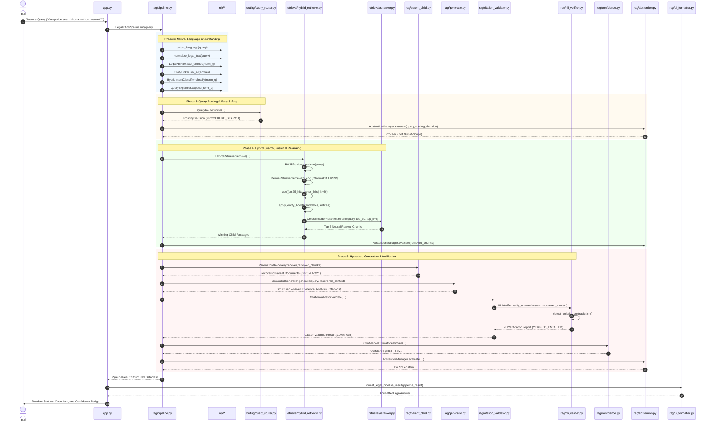

# End-to-End Function Call Trace: `16_CODE_CONNECTIONS/function_call_map.md`

[Back to Main Index](../README.md)

---

## 1. Overview

This document traces the complete execution call tree of the Indian Constitution Legal AI Assistant from the exact instant the user presses **Enter** in the Streamlit UI to the moment the final verified legal cards appear on the screen.

---

## 2. Step-by-Step Function Execution Hierarchy

### Root Invocation:
- **`app.py:main()`**
  - **`app.py:render_active_tab()`**
    - **`rag.pipeline:LegalRAGPipeline.run(query)`** (Line 109)

---

### Phase 2: Natural Language Understanding Sub-tree:
1. `nlp.language_detection:detect_language(query)`
   - `_detect_script(query)`: Checks Unicode ranges (`0x0900`–`0x097F` for Devanagari).
   - `_detect_hinglish(query)`: Checks Romanized Hindi markers.
2. `nlp.preprocessing:normalize_legal_text(query)`
   - `clean_unicode_and_quotes(text)`: Converts curly quotes and typographic dashes.
   - `expand_legal_abbreviations(text)`: Converts `"Art."` $\to$ `"Article"`, `"v."` $\to$ `"versus"`.
3. `nlp.legal_ner:LegalNER.extract_entities(norm_q)`
   - Matches regex patterns across 10 classes (`ARTICLE`, `CASE`, `SECTION`, `ACT`, etc.).
   - Matches dynamic gazetteer registries from `parent_store.json`.
   - `_resolve_span_collisions()`: Longest entity span wins.
4. `nlp.entity_linking:EntityLinker.link_all(entities)`
   - `link_entity(mention, entity_type)`: Matches `alias_index.json` to canonical IDs (`art_21`).
5. `nlp.intent_classifier:HybridIntentClassifier.classify(norm_q)`
   - `RuleBasedIntentClassifier.classify(norm_q)`: Immediate statutory match.
   - `MLIntentClassifier.predict(norm_q)`: TF-IDF Logistic Regression fallback.
6. `nlp.query_expansion:QueryExpander.expand(norm_q)`
   - Injects domain synonyms from `legal_synonyms.json` (max 3 terms to prevent drift).

---

### Phase 3: Routing & Early Abstention Sub-tree:
1. `routing.query_router:QueryRouter.route(...)`
   - Evaluates 7 deterministic decision rules $\to$ returns `RoutingDecision`.
2. `rag.abstention:AbstentionManager.evaluate(...)`
   - Gate 0: `EMPTY_QUERY` check.
   - Gate 1: `OUT_OF_SCOPE` check.

---

### Phase 4: Retrieval & Reranker Sub-tree:
1. `retrieval.hybrid_retriever:HybridRetriever.retrieve(...)`
   - `retrieval.bm25_retriever:BM25Retriever.retrieve(query, top_k=30)`:
     - `simple_tokenize(query)`: Compound phrase handling.
     - `BM25Okapi.get_scores()`: Rank-BM25 scoring.
   - `retrieval.dense_retriever:DenseRetriever.retrieve(query, top_k=30)`:
     - `retrieval.embeddings:BGEM3EmbeddingFunction.__call__(query)`: Checks SQLite cache $\to$ runs Transformer encoder.
     - `chromadb.Collection.query()`: HNSW approximate nearest neighbor search.
     - Inverts distance to similarity: $s = 1.0 - d$.
   - `retrieval.rrf:fuse(rank_lists=[bm25_hits, dense_hits], k=60)`:
     - Combines ranks via Cormack SIGIR formula.
     - Note: `retriever.py` wraps this via `HybridRetriever.reciprocal_rank_fusion()`.
   - `retrieval.entity_boost:apply_entity_boost(candidates, entities)`:
     - Awards $+0.150$ for Article/Case match; $+0.075$ for concept match.
   - `retrieval.reranker:CrossEncoderReranker.rerank(query, candidates, top_k=5)`:
     - Creates (query, passage) pairs.
     - `CrossEncoder.predict()`: Evaluates joint cross-attention logits.
     - Slices to top 5 candidates.
2. `rag.abstention:AbstentionManager.evaluate(...)`
   - Gate 2: Checks candidate count $> 0$ and top score $\ge \text{threshold}$.

---

### Phase 5: Generation, Verification & Safety Sub-tree:
1. `rag.parent_child:ParentChildRecovery.recover(reranked_chunks)`
   - `_resolve_parent_record(raw_id, chunk)`: Resolves zero-padded/prefix keys.
   - Deduplicates identical parent IDs while aggregating child evidence.
   - `format_context_for_prompt()`: Renders markdown context with `[Doc: <id>]` headers.
2. `rag.generator:GroundedGenerator.generate(...)`
   - Online Branch: `ChatGoogleGenerativeAI(temperature=0.0).invoke()` with `GROUNDED_RAG_PROMPT`.
   - Offline Branch: `_synthesize_grounded_offline()` pulls full verified records from `parent_store.json`.
3. `rag.citation_validator:CitationValidator.validate(...)`
   - Checks metadata completeness, document existence in `parent_store.json`, and presence in retrieved pool.
   - Detects ungrounded inline articles and case mentions.
   - `rag.nli_verifier:NLIVerifier.verify_answer()`:
     - `split_into_claims()`: Sentence boundary segmentation.
     - `evaluate_claim()` $\to$ `_detect_polarity_contradiction()`: Tests positive vs negative modal clashes.
4. `rag.confidence:ConfidenceEstimator.estimate(...)`
   - Computes weighted sum of 6 signals (Retrieval, Count, Entity, Agreement, Citation, Coverage).
5. `rag.abstention:AbstentionManager.evaluate(...)`
   - Gates 4 & 5: Verifies citation validity and asserts `confidence_score >= 0.30`.
6. Encapsulates all state into `PipelineResult` dataclass.

---

### Phase 6: Presentation Sub-tree:
1. `rag.ui_formatter:format_legal_pipeline_result(pipeline_result)`
   - Transforms `PipelineResult` into `FormattedLegalAnswer`, `FormattedProvision`, `FormattedJudgment`.
2. `app.py:display_answer()`
   - Renders badges, expandable full texts, and diagnostic tabs.

