# Progressive Study Roadmap: `18_LEARNING_CHECKLIST/learning_roadmap.md`

[Back to Main Index](../README.md)

---

## 1. Study Plan Overview

This 8-stage progressive learning roadmap prepares you to master the Indian Constitution Legal AI Assistant codebase from scratch. It assumes basic knowledge of Python and guides you systematically from architectural mental models to advanced code-level defense.

```mermaid
flowchart LR
    D1["Day 1: Mental Models & Architecture"] --> D2["Day 2: Application & Storage"]
    D2 --> D3["Day 3: NLP Subsystem"]
    D3 --> D4["Day 4: Retrieval & RRF Math"]
    D4 --> D5["Day 5: RAG & NLI Verification"]
    D5 --> D6["Day 6: Evaluation & Metrics"]
    D6 --> D7["Day 7: Testing & Code Connections"]
    D7 --> D8["Day 8: Viva Simulation & Live Demo"]
```

---

## 2. Day-by-Day Study Plan

### Day 1: Orientation, Problem Statement & Mental Models
- **Goal**: Understand *why* the project exists, the 3 legal AI failure modes, and the 4-tier architecture.
- **Reading List**:
  1. [`00_START_HERE.md`](../00_START_HERE.md) (The Public Library Analogy, Master Metrics).
  2. [`01_PROJECT_OVERVIEW.md`](../01_PROJECT_OVERVIEW.md) (Vocabulary Mismatch, Anchor Confusion, RAG vs Fine-Tuning).
  3. [`02_PROJECT_ARCHITECTURE.md`](../02_PROJECT_ARCHITECTURE.md) (4-Tier System Flow, Storage Layout).
  4. [`03_COMPLETE_EXECUTION_FLOW.md`](../03_COMPLETE_EXECUTION_FLOW.md) (16-stage trace of the search warrant query).
- **Check-off Task**: Can you explain the difference between a bi-encoder and a cross-encoder to a peer in plain English?

---

### Day 2: Main Application & Storage Layer
- **Goal**: Understand how the Streamlit UI works and how data is stored.
- **Reading List**:
  1. [`05_MAIN_APPLICATION/app_py.md`](../05_MAIN_APPLICATION/app_py.md) (Streamlit session state, caching, card rendering).
  2. [`05_MAIN_APPLICATION/config_py.md`](../05_MAIN_APPLICATION/config_py.md) (Paths, model constants, dimension validation).
  3. [`15_DATA_AND_DATABASE/data_directory_explained.md`](../15_DATA_AND_DATABASE/data_directory_explained.md) (Raw vs processed data).
  4. [`15_DATA_AND_DATABASE/parent_store_explained.md`](../15_DATA_AND_DATABASE/parent_store_explained.md) (886 parent documents hydration).
  5. [`15_DATA_AND_DATABASE/vector_database_explained.md`](../15_DATA_AND_DATABASE/vector_database_explained.md) (ChromaDB HNSW graph, dual collections).
- **Check-off Task**: Run `streamlit run app.py` and inspect `data/parent_store.json` in VS Code.

---

### Day 3: Natural Language Processing (Stage 2)
- **Goal**: Master legal text preprocessing, 10-class NER, entity linking, and intent classification.
- **Reading List**:
  1. [`06_NLP_MODULE/preprocessing.md`](../06_NLP_MODULE/preprocessing.md) (Unicode cleaning, abbreviation expansion).
  2. [`06_NLP_MODULE/entity_recognition.md`](../06_NLP_MODULE/entity_recognition.md) (LegalNER, 10 categories, span collision resolution).
  3. [`06_NLP_MODULE/entity_linking.md`](../06_NLP_MODULE/entity_linking.md) (Canonical alias indexing).
  4. [`06_NLP_MODULE/intent_classification.md`](../06_NLP_MODULE/intent_classification.md) (Rule-based vs ML Logistic Regression vs Hybrid).
  5. [`06_NLP_MODULE/language_detection.md`](../06_NLP_MODULE/language_detection.md) (Devanagari, Latin, Hinglish).
- **Check-off Task**: Run `pytest tests/test_ner.py tests/test_intent.py -v`.

---

### Day 4: Information Retrieval & RRF Math (Stage 3)
- **Goal**: Master sparse BM25, dense BGE-M3 vectors, Cormack RRF fusion, entity boost, and neural reranking.
- **Reading List**:
  1. [`07_RETRIEVAL_MODULE/bm25_retrieval.md`](../07_RETRIEVAL_MODULE/bm25_retrieval.md) (Compound legal tokenization).
  2. [`07_RETRIEVAL_MODULE/dense_retrieval.md`](../07_RETRIEVAL_MODULE/dense_retrieval.md) (ChromaDB vector search, distance inversion).
  3. [`07_RETRIEVAL_MODULE/reciprocal_rank_fusion.md`](../07_RETRIEVAL_MODULE/reciprocal_rank_fusion.md) (Cormack SIGIR 2009 formula, $k=60$).
  4. [`07_RETRIEVAL_MODULE/entity_boosting.md`](../07_RETRIEVAL_MODULE/entity_boosting.md) (Additive $+0.150$ boost math).
  5. [`07_RETRIEVAL_MODULE/reranking.md`](../07_RETRIEVAL_MODULE/reranking.md) (Cross-Encoder joint attention).
  6. [`09_QUERY_ROUTING/query_router.md`](../09_QUERY_ROUTING/query_router.md) (7 deterministic routing rules).
- **Check-off Task**: Write out the RRF formula on a piece of paper and calculate the score of a document ranked #1 in BM25 and #3 in Dense.

---

### Day 5: Grounded RAG, Verification & Safety (Stage 4)
- **Goal**: Understand asymmetric parent hydration, citation validation, NLI checking, and 5-stage abstention.
- **Reading List**:
  1. [`08_RAG_MODULE/chunking.md`](../08_RAG_MODULE/chunking.md) (Clause splitting, judgment sections).
  2. [`08_RAG_MODULE/parent_child_retrieval.md`](../08_RAG_MODULE/parent_child_retrieval.md) (In-memory parent deduplication).
  3. [`08_RAG_MODULE/answer_generation.md`](../08_RAG_MODULE/answer_generation.md) (Prompt constraints, dual online/offline execution).
  4. [`08_RAG_MODULE/citation_validation.md`](../08_RAG_MODULE/citation_validation.md) (Unretrieved evidence detection).
  5. [`08_RAG_MODULE/verification.md`](../08_RAG_MODULE/verification.md) (Proposition NLI polarity clashes).
  6. [`08_RAG_MODULE/confidence_scoring.md`](../08_RAG_MODULE/confidence_scoring.md) (6-signal weighted composite).
  7. [`08_RAG_MODULE/abstention.md`](../08_RAG_MODULE/abstention.md) (5-stage defensive gating).
- **Check-off Task**: Run `pytest tests/test_citation_validator.py tests/test_nli_verifier.py -v`.

---

### Day 6: Evaluation, Benchmarks & Metrics (Stage 5)
- **Goal**: Understand zero-data-leakage protocols and how the +41.9% NDCG@10 gain was measured.
- **Reading List**:
  1. [`11_EVALUATION_MODULE/evaluation_architecture.md`](../11_EVALUATION_MODULE/evaluation_architecture.md) (Train/val/test splits, alias map).
  2. [`11_EVALUATION_MODULE/metrics.md`](../11_EVALUATION_MODULE/metrics.md) (Hit@K, MRR, DCG, NDCG, Macro-F1 formulas).
  3. [`11_EVALUATION_MODULE/benchmark_runner.md`](../11_EVALUATION_MODULE/benchmark_runner.md) (CLI options).
  4. [`12_EXPERIMENTS/experiments_explained.md`](../12_EXPERIMENTS/experiments_explained.md) (Experiments 01 through 08).
- **Check-off Task**: Run `python -m evaluation.benchmark_runner --quick` and inspect `evaluation/results/evaluation_report.md`.

---

### Day 7: Testing, Scripts & Code Connections
- **Goal**: Master the codebase connections, test suite, and operational utility scripts.
- **Reading List**:
  1. [`13_SCRIPTS/scripts_explained.md`](../13_SCRIPTS/scripts_explained.md) (`diagnose_query.py`, `build_index.py`, `audit_intent_leakage.py`).
  2. [`14_TESTING/testing_overview.md`](../14_TESTING/testing_overview.md) & [`how_to_run_tests.md`](../14_TESTING/how_to_run_tests.md).
  3. [`16_CODE_CONNECTIONS/file_dependency_map.md`](../16_CODE_CONNECTIONS/file_dependency_map.md) (Import matrix).
  4. [`16_CODE_CONNECTIONS/function_call_map.md`](../16_CODE_CONNECTIONS/function_call_map.md) (End-to-end call tree).
  5. [`16_CODE_CONNECTIONS/important_classes_and_functions.md`](../16_CODE_CONNECTIONS/important_classes_and_functions.md).
- **Check-off Task**: Run `python -m scripts.diagnose_query "Can police arrest without warrant?"` in the terminal.

---

### Day 8: Viva Simulation & Live Demo Practice
- **Goal**: Rehearse your presentation and practice answering tough questions.
- **Reading List**:
  1. Rehearse [`17_VIVA_PREPARATION/project_explanation_2_minutes.md`](../17_VIVA_PREPARATION/project_explanation_2_minutes.md) aloud with a timer.
  2. Rehearse [`17_VIVA_PREPARATION/project_explanation_5_minutes.md`](../17_VIVA_PREPARATION/project_explanation_5_minutes.md).
  3. Study [`17_VIVA_PREPARATION/viva_questions_and_answers.md`](../17_VIVA_PREPARATION/viva_questions_and_answers.md) (80+ Q&As).
  4. Study [`17_VIVA_PREPARATION/difficult_questions.md`](../17_VIVA_PREPARATION/difficult_questions.md) (Tough questions).
  5. Review [`17_VIVA_PREPARATION/troubleshooting_during_demo.md`](../17_VIVA_PREPARATION/troubleshooting_during_demo.md).
  6. Complete the self-test quiz in [`18_LEARNING_CHECKLIST/self_assessment.md`](self_assessment.md).
- **Check-off Task**: Perform a mock demonstration in front of a mirror or friend following [`code_demonstration_script.md`](../17_VIVA_PREPARATION/code_demonstration_script.md).

