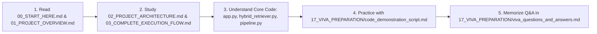

# Indian Constitution Legal AI Assistant — Code Explanation & Learning Guide 📚

Welcome to the **Complete Code Explanation and Project Learning Guide** for the **Indian Constitution Legal AI Assistant** (*Entity-Aware Hybrid Retrieval and Reranking Framework for Indian Constitutional Question Answering*).

This guide is designed as a **comprehensive, beginner-friendly textbook** to help you master every single file, class, algorithm, database, and function in this repository. Whether you are opening the codebase in VS Code for a professor demonstration, preparing for a viva voce defense, or seeking to understand every line of Python code from scratch, this documentation contains everything you need.

---

## 🧭 Master Navigation Map

Click any link below to jump directly into that module's dedicated textbook guide:

### 🌟 Part I: Orientation & Foundational Knowledge
- [**`00_START_HERE.md`**](00_START_HERE.md): Quick-start orientation guide. How to use this textbook, mental models for the project, and a 10-minute crash summary.
- [**`01_PROJECT_OVERVIEW.md`**](01_PROJECT_OVERVIEW.md): Problem statement, vocabulary mismatch, legal hallucinations, core objectives, and empirical achievements.
- [**`02_PROJECT_ARCHITECTURE.md`**](02_PROJECT_ARCHITECTURE.md): Multi-layer system architecture, 16-stage pipeline flowchart, and component breakdown.
- [**`03_COMPLETE_EXECUTION_FLOW.md`**](03_COMPLETE_EXECUTION_FLOW.md): Step-by-step lifecycle of a user query from raw keystrokes in Streamlit to final verified legal output.
- [**`04_TECHNOLOGY_STACK.md`**](04_TECHNOLOGY_STACK.md): Exhaustive breakdown of libraries, algorithms, frameworks, vector databases, and models used.

---

### 💻 Part II: Deep Codebase Walkthroughs (File by File)

#### 05. Main Application Layer
- [**`05_MAIN_APPLICATION/app_py.md`**](05_MAIN_APPLICATION/app_py.md): Streamlit web application interface, session state, UI layout, and caching.
- [**`05_MAIN_APPLICATION/agents_py.md`**](05_MAIN_APPLICATION/agents_py.md): Agentic prompt router, specialized legal personas (Article, Case-Law, Explanation), and heuristic offline synthesis.
- [**`05_MAIN_APPLICATION/config_py.md`**](05_MAIN_APPLICATION/config_py.md): Centralized project configuration, paths, hyperparameters, and dimension validation.
- [**`05_MAIN_APPLICATION/ingestion_py.md`**](05_MAIN_APPLICATION/ingestion_py.md): Backward-compatible ingestion facade, parent document preservation, and chunking bridges.
- [**`05_MAIN_APPLICATION/retriever_py.md`**](05_MAIN_APPLICATION/retriever_py.md): Legacy hybrid retriever facade, regex entity extraction, and RRF backward compatibility.

#### 06. Natural Language Processing (NLP) Module (`nlp/`)
- [**`06_NLP_MODULE/README.md`**](06_NLP_MODULE/README.md): Overview of Stage 2 Query Understanding.
- [**`06_NLP_MODULE/preprocessing.md`**](06_NLP_MODULE/preprocessing.md): Unicode cleaning, abbreviation expansion, legal tokenization (`nlp/preprocessing.py`).
- [**`06_NLP_MODULE/intent_classification.md`**](06_NLP_MODULE/intent_classification.md): Rule-based vs. Scikit-learn TF-IDF + Logistic Regression dual-tier intent classification (`nlp/intent_classifier.py`).
- [**`06_NLP_MODULE/entity_recognition.md`**](06_NLP_MODULE/entity_recognition.md): 10-class legal named entity recognition engine combining regex and dynamic gazetteers (`nlp/legal_ner.py`).
- [**`06_NLP_MODULE/entity_linking.md`**](06_NLP_MODULE/entity_linking.md): Canonical entity resolver mapping surface mentions to statutory IDs (`nlp/entity_linking.py`).
- [**`06_NLP_MODULE/query_expansion.md`**](06_NLP_MODULE/query_expansion.md): Controlled synonym graph expansion preventing vocabulary mismatch and semantic drift (`nlp/query_expansion.py`).
- [**`06_NLP_MODULE/language_detection.md`**](06_NLP_MODULE/language_detection.md): Unicode script analyzer and Hinglish indicator detector (`nlp/language_detection.py`).

#### 07. Retrieval & Ranking Module (`retrieval/`)
- [**`07_RETRIEVAL_MODULE/README.md`**](07_RETRIEVAL_MODULE/README.md): Architecture of Stage 3 Hybrid Information Retrieval.
- [**`07_RETRIEVAL_MODULE/embeddings.md`**](07_RETRIEVAL_MODULE/embeddings.md): `BAAI/bge-m3` (1024-d) and MiniLM (384-d) dense embeddings with SQLite disk caching (`retrieval/embeddings.py`).
- [**`07_RETRIEVAL_MODULE/dense_retrieval.md`**](07_RETRIEVAL_MODULE/dense_retrieval.md): ChromaDB persistent vector search, cosine distance inversion (`retrieval/dense_retrieval.py`).
- [**`07_RETRIEVAL_MODULE/bm25_retrieval.md`**](07_RETRIEVAL_MODULE/bm25_retrieval.md): BM25Okapi sparse retrieval with compound statutory tokenization (`retrieval/bm25_retriever.py`).
- [**`07_RETRIEVAL_MODULE/hybrid_retrieval.md`**](07_RETRIEVAL_MODULE/hybrid_retrieval.md): Master hybrid search orchestrator with full ablation switches (`retrieval/hybrid_retriever.py`).
- [**`07_RETRIEVAL_MODULE/reciprocal_rank_fusion.md`**](07_RETRIEVAL_MODULE/reciprocal_rank_fusion.md): Mathematical rank reciprocity fusion ($k=60$) combining disparate score distributions (`retrieval/rrf.py`).
- [**`07_RETRIEVAL_MODULE/entity_boosting.md`**](07_RETRIEVAL_MODULE/entity_boosting.md): Legal entity-aware additive ranking boost with audit logs (`retrieval/entity_boost.py`).
- [**`07_RETRIEVAL_MODULE/reranking.md`**](07_RETRIEVAL_MODULE/reranking.md): Cross-Encoder neural joint-attention reranker (`retrieval/reranker.py`).

#### 08. Retrieval-Augmented Generation (RAG) Module (`rag/`)
- [**`08_RAG_MODULE/README.md`**](08_RAG_MODULE/README.md): Overview of Stage 4 Grounding, Context Recovery, and Verification.
- [**`08_RAG_MODULE/chunking.md`**](08_RAG_MODULE/chunking.md): Structure-aware statutory chunker respecting Articles, Clauses, and Judgment sections (`rag/chunking.py`).
- [**`08_RAG_MODULE/parent_child_retrieval.md`**](08_RAG_MODULE/parent_child_retrieval.md): Hierarchical Parent-Child context recovery engine (`rag/parent_child.py`).
- [**`08_RAG_MODULE/rag_pipeline.md`**](08_RAG_MODULE/rag_pipeline.md): Unified 16-stage `LegalRAGPipeline` orchestrator (`rag/pipeline.py`).
- [**`08_RAG_MODULE/answer_generation.md`**](08_RAG_MODULE/answer_generation.md): Grounded answer synthesis via Google Gemini API and offline deterministic fallback (`rag/generator.py`).
- [**`08_RAG_MODULE/citation_validation.md`**](08_RAG_MODULE/citation_validation.md): Deterministic structural citation and evidence existence validator (`rag/citation_validator.py`).
- [**`08_RAG_MODULE/confidence_scoring.md`**](08_RAG_MODULE/confidence_scoring.md): 6-signal explainable heuristic confidence estimator (`rag/confidence.py`).
- [**`08_RAG_MODULE/abstention.md`**](08_RAG_MODULE/abstention.md): Multi-stage automated safe abstention guardrail (`rag/abstention.py`).
- [**`08_RAG_MODULE/verification.md`**](08_RAG_MODULE/verification.md): Natural Language Inference (NLI) proposition-level polarity checker (`rag/nli_verifier.py`).
- [**`08_RAG_MODULE/ui_formatting_and_schemas.md`**](08_RAG_MODULE/ui_formatting_and_schemas.md): UI formatting adapter (`rag/ui_formatter.py`) and Pydantic schemas (`rag/schema.py`).

#### 09. Specialized Query Routing (`routing/`)
- [**`09_QUERY_ROUTING/README.md`**](09_QUERY_ROUTING/README.md): Overview of deterministic routing.
- [**`09_QUERY_ROUTING/query_router.md`**](09_QUERY_ROUTING/query_router.md): NLP query routing decisions, strategy selection, candidate pool sizing, and doc filtering (`routing/query_router.py`).

---

### 📦 Part III: Data, Ingestion, & Scripts

- [**`10_DATA_INGESTION/README.md`**](10_DATA_INGESTION/README.md): Data ingestion architecture and provenance.
- [**`10_DATA_INGESTION/corpus_building.md`**](10_DATA_INGESTION/corpus_building.md): End-to-end corpus builder and SHA-256 manifest generator (`scripts/build_corpus.py`).
- [**`10_DATA_INGESTION/constitution_ingestion.md`**](10_DATA_INGESTION/constitution_ingestion.md): Parsing official Constitution of India JSON (`scripts/ingest_constitution.py`).
- [**`10_DATA_INGESTION/judgments_ingestion.md`**](10_DATA_INGESTION/judgments_ingestion.md): Landmark Supreme Court judgment ingestion and PDF scraper (`scripts/ingest_judgments.py`).
- [**`10_DATA_INGESTION/legislation_ingestion.md`**](10_DATA_INGESTION/legislation_ingestion.md): Central Acts and statutory legislation parser (`scripts/ingest_legislation.py`).
- [**`10_DATA_INGESTION/index_building.md`**](10_DATA_INGESTION/index_building.md): Vector database and BM25 index generator (`scripts/build_index.py`).
- [**`12_EXPERIMENTS/experiments_explained.md`**](12_EXPERIMENTS/experiments_explained.md): Detailed explanation of all 8 standalone research ablation scripts (`experiments/experiment_01_bm25.py` through `experiment_08_intent.py`).
- [**`13_SCRIPTS/scripts_explained.md`**](13_SCRIPTS/scripts_explained.md): Complete guide to all 26 maintenance, evaluation, and diagnostic scripts in `scripts/`.
- [**`15_DATA_AND_DATABASE/data_directory_explained.md`**](15_DATA_AND_DATABASE/data_directory_explained.md): Structure, file layout, and storage of `data/`.
- [**`15_DATA_AND_DATABASE/json_schemas.md`**](15_DATA_AND_DATABASE/json_schemas.md): Exact JSON schemas for articles, judgments, legislation, and benchmarks.
- [**`15_DATA_AND_DATABASE/parent_store_explained.md`**](15_DATA_AND_DATABASE/parent_store_explained.md): How `parent_store.json` stores 886 documents and dynamically hydrates child chunks.
- [**`15_DATA_AND_DATABASE/vector_database_explained.md`**](15_DATA_AND_DATABASE/vector_database_explained.md): ChromaDB SQLite architecture, collection naming conventions, HNSW index, and dimension mismatch safety.

---

### 🧪 Part IV: Evaluation, Benchmarks, & Testing

- [**`11_EVALUATION_MODULE/README.md`**](11_EVALUATION_MODULE/README.md): Stage 5 Evaluation Framework architecture.
- [**`11_EVALUATION_MODULE/evaluation_architecture.md`**](11_EVALUATION_MODULE/evaluation_architecture.md): Zero-leakage train/validation/test splits and evaluation design.
- [**`11_EVALUATION_MODULE/metrics.md`**](11_EVALUATION_MODULE/metrics.md): Mathematical formulas and Python implementations for Hit@K, MRR, NDCG@K, Precision, Recall, F1, and Citation Validity.
- [**`11_EVALUATION_MODULE/benchmark_runner.md`**](11_EVALUATION_MODULE/benchmark_runner.md): The master evaluation runner (`evaluation/benchmark_runner.py`).
- [**`11_EVALUATION_MODULE/reports.md`**](11_EVALUATION_MODULE/reports.md): Evaluation reports, Markdown tables, and CSV audit generators (`evaluation/report_generator.py`).
- [**`14_TESTING/testing_overview.md`**](14_TESTING/testing_overview.md): Architecture of the 319-test automated test suite.
- [**`14_TESTING/test_files_explained.md`**](14_TESTING/test_files_explained.md): Detailed walkthrough of all 28 pytest test files in `tests/`.
- [**`14_TESTING/how_to_run_tests.md`**](14_TESTING/how_to_run_tests.md): Commands, flags, and troubleshooting tips for running pytest on Windows/Linux.

---

### 🗺️ Part V: System Connections & Architectural Maps

- [**`16_CODE_CONNECTIONS/file_dependency_map.md`**](16_CODE_CONNECTIONS/file_dependency_map.md): Visual and tabular mapping of which file imports and depends on which other files.
- [**`16_CODE_CONNECTIONS/function_call_map.md`**](16_CODE_CONNECTIONS/function_call_map.md): Step-by-step function invocation sequence from `app.py` down to raw vector math.
- [**`16_CODE_CONNECTIONS/data_flow_map.md`**](16_CODE_CONNECTIONS/data_flow_map.md): Data transformation lifecycle from raw legal text to embeddings to RAG context.
- [**`16_CODE_CONNECTIONS/important_classes_and_functions.md`**](16_CODE_CONNECTIONS/important_classes_and_functions.md): Master reference directory of all 45+ core classes and functions across the repository.

---

### 🎓 Part VI: Professor Demonstration & Viva Voce Preparation

- [**`17_VIVA_PREPARATION/project_explanation_2_minutes.md`**](17_VIVA_PREPARATION/project_explanation_2_minutes.md): 2-minute elevator pitch for committee introduction.
- [**`17_VIVA_PREPARATION/project_explanation_5_minutes.md`**](17_VIVA_PREPARATION/project_explanation_5_minutes.md): 5-minute technical briefing covering motivation, hybrid retrieval, and results.
- [**`17_VIVA_PREPARATION/project_explanation_10_minutes.md`**](17_VIVA_PREPARATION/project_explanation_10_minutes.md): 10-minute comprehensive academic presentation script.
- [**`17_VIVA_PREPARATION/code_demonstration_script.md`**](17_VIVA_PREPARATION/code_demonstration_script.md): Step-by-step live VS Code and Streamlit demo script. Exactly what to click, type, and show.
- [**`17_VIVA_PREPARATION/important_code_to_show.md`**](17_VIVA_PREPARATION/important_code_to_show.md): Top 10 high-impact code snippets with file paths and line numbers to highlight in VS Code.
- [**`17_VIVA_PREPARATION/viva_questions_and_answers.md`**](17_VIVA_PREPARATION/viva_questions_and_answers.md): Over 80+ categorized examiner questions with short memorization formulas and detailed technical answers.
- [**`17_VIVA_PREPARATION/difficult_questions.md`**](17_VIVA_PREPARATION/difficult_questions.md): Deep-dive defense on hard conceptual questions (RAG vs fine-tuning, RRF math, NLI verification, hallucination mitigation).
- [**`17_VIVA_PREPARATION/troubleshooting_during_demo.md`**](17_VIVA_PREPARATION/troubleshooting_during_demo.md): Emergency contingency guide if Streamlit freezes, ChromaDB locks, or network drops during the defense.

---

### 📋 Part VII: Study Checklist & Self-Assessment

- [**`18_LEARNING_CHECKLIST/learning_roadmap.md`**](18_LEARNING_CHECKLIST/learning_roadmap.md): 8-stage progressive study plan with concrete tasks and milestone checklists.
- [**`18_LEARNING_CHECKLIST/self_assessment.md`**](18_LEARNING_CHECKLIST/self_assessment.md): Interactive diagnostic quiz with answer key to verify presentation readiness.

---

## 💡 Recommended Study Sequence for You

If you have limited time before your viva, follow this prioritized learning path:

Enjoy studying! You have built a sophisticated, empirically verified legal intelligence system. This textbook will give you the complete confidence to showcase and defend every single aspect of it.
