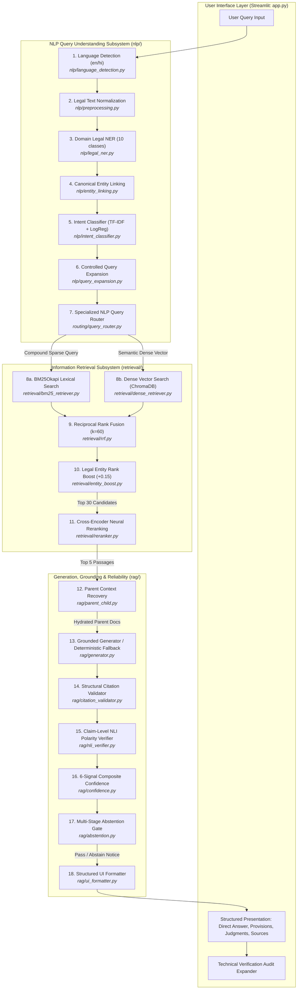
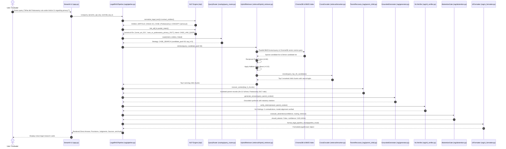
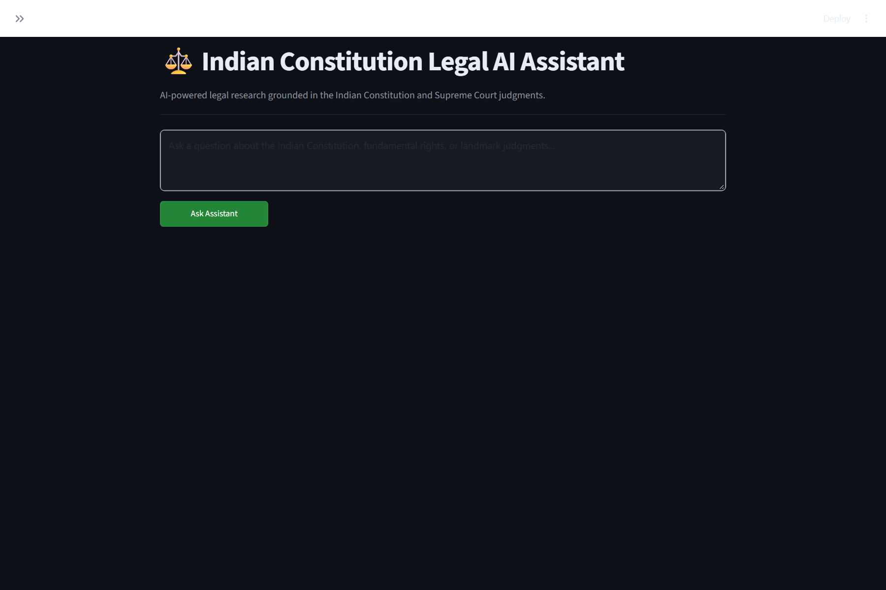
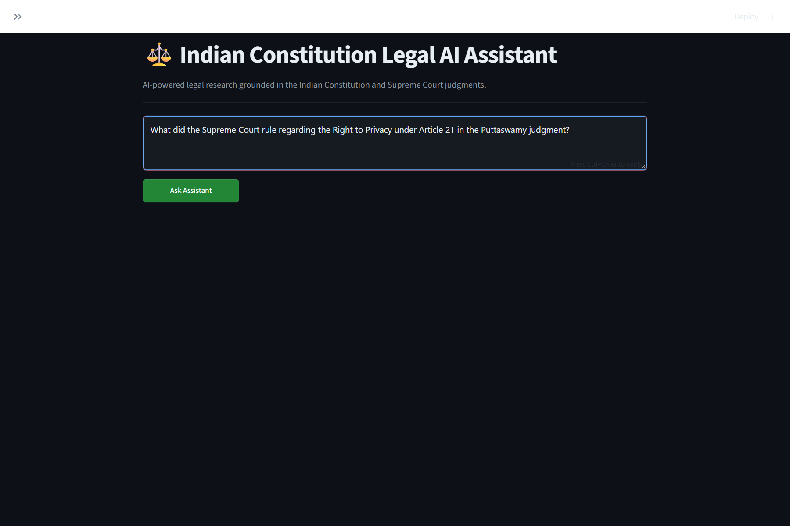
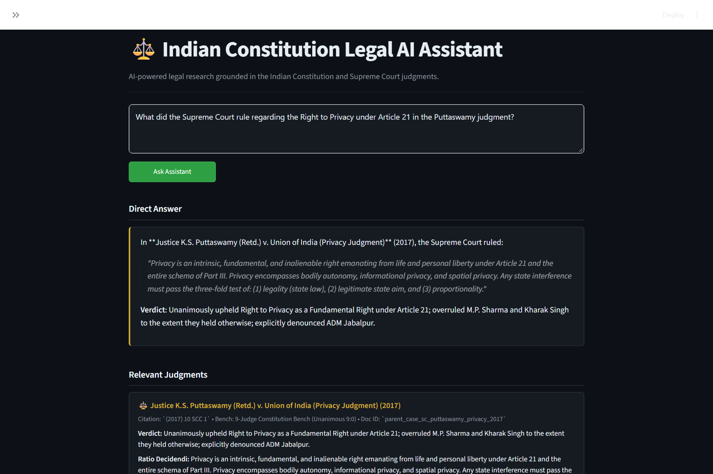
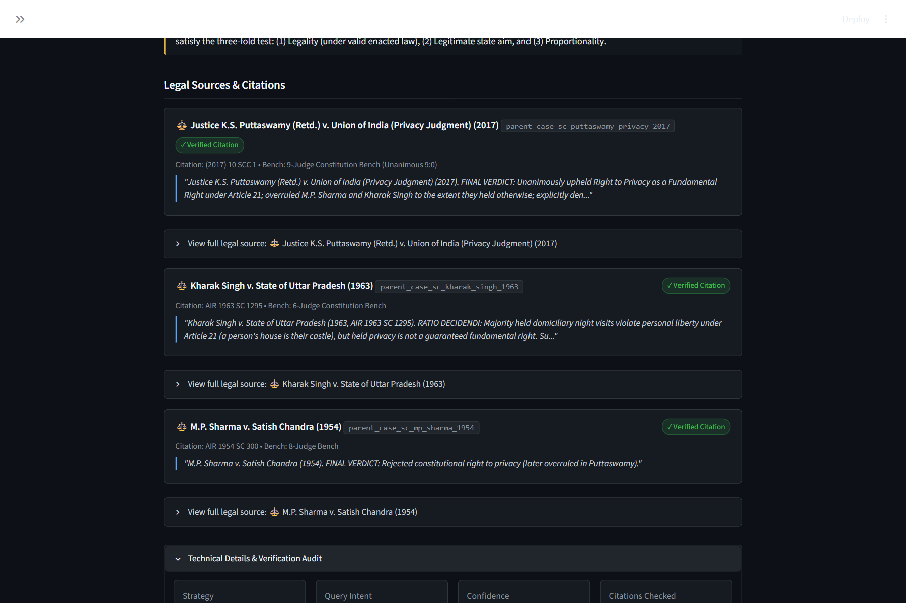
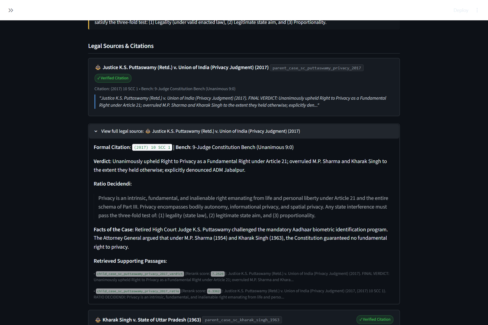
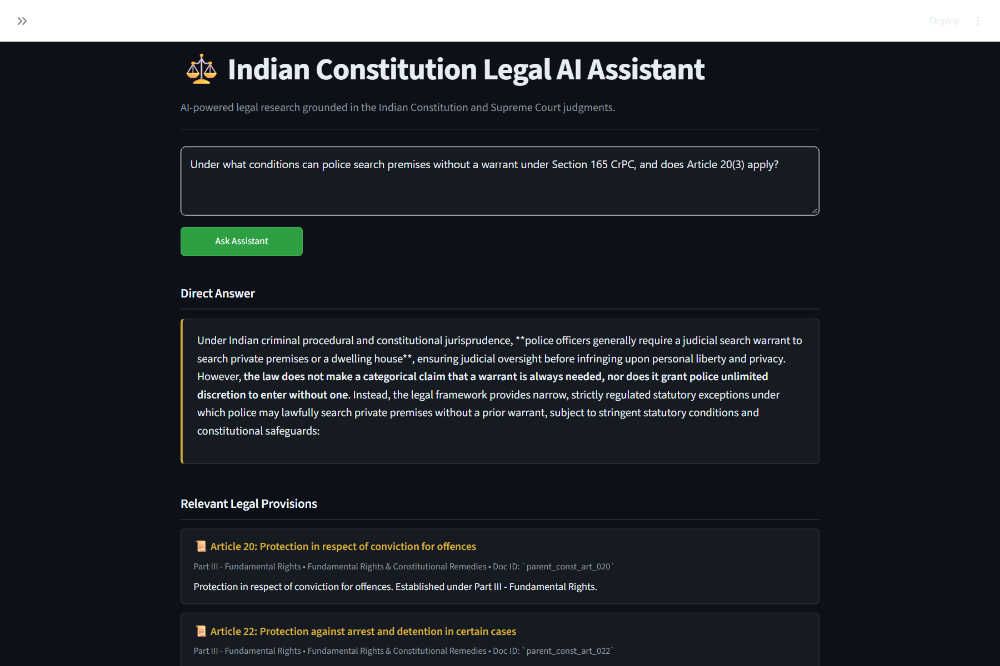
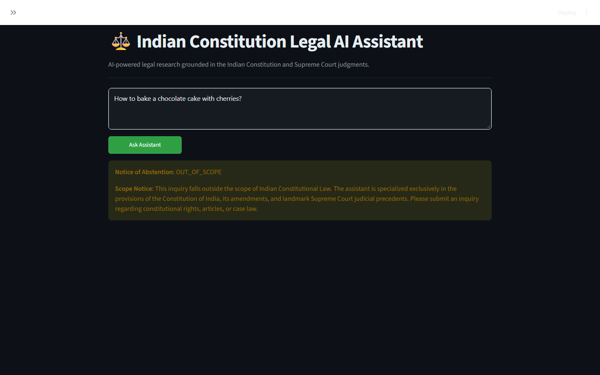

# Indian Constitution Legal AI Assistant — Comprehensive Demonstration & Evaluation Guide

> **Academic Milestone**: B.Tech Senior NLP Capstone Project  
> **Project Title**: Indian Constitution Legal AI Assistant  
> **Research Title**: *Entity-Aware Hybrid Retrieval and Reranking Framework for Indian Constitutional Question Answering*  
> **Author**: Ramsai Tanguturi  
> **Environment**: Python 3.12.10 | PyTorch 2.14.0+cpu | ChromaDB 1.5.9 | Streamlit 1.64.0 | Scikit-Learn 1.9.1  
> **Test Status**: **319 / 319 Passing Automated Tests (100% Pass Rate)**  
> **Corpus Volume**: **886 Verified Documents | 7,470 Indexed Passages | ~6.44M Characters**  

---

## Table of Contents

- [Section A: Project Overview](#section-a-project-overview)
- [Section B: Architecture and Complete Workflow](#section-b-architecture-and-complete-workflow)
- [Section C: Exact Setup and Execution Instructions](#section-c-exact-setup-and-execution-instructions)
- [Section D: Website Demonstration Guide](#section-d-website-demonstration-guide)
- [Section E: Code Walkthrough — Every Important File and Function](#section-e-code-walkthrough--every-important-file-and-function)
- [Section F: Core Algorithms and Technical Concepts](#section-f-core-algorithms-and-technical-concepts)
- [Section G: Screenshots and Visual Documentation](#section-g-screenshots-and-visual-documentation)
- [Section H: Complete Live Demonstration Script](#section-h-complete-live-demonstration-script)
- [Section I: Viva and Examiner Questions & Answers](#section-i-viva-and-examiner-questions--answers)
- [Section J: Troubleshooting and Limitations](#section-j-troubleshooting-and-limitations)

---

## Section A: Project Overview

### A.1 Problem Statement
In legal informatics and constitutional law, answering citizen and researcher queries requires navigating heavily structured statutory text (nested articles, sub-clauses, provisos, and schedules) alongside extensive judicial precedent (ratios, obiter dicta, and bench compositions). Standard general-purpose information retrieval and large language models exhibit three catastrophic failure modes:

1. **Vocabulary Mismatch**: Citizen queries are phrased colloquially (*"Can the police tap my phone without my permission?"* or *"Can police search my house without a warrant?"*), whereas statutory texts use formal legislative phrasing (*"protection of life and personal liberty under Article 21"*, *"procedure established by law"*, or *"Sections 93, 100, 165 CrPC"*). Lexical search (pure BM25) fails completely when words do not overlap.
2. **Anchor Confusion in Pure Dense Search**: While dense semantic embeddings (Bi-Encoders) capture conceptual similarity, they struggle with exact statutory anchors. A dense embedding frequently confuses *"Article 21"* (Right to Life) with *"Article 21A"* (Right to Education), or mixes up different clauses of Article 19.
3. **Hallucination and Ungrounded Legal Precedent**: Commercial generative chatbots (ChatGPT, general LLMs) invent plausible-sounding Supreme Court citations, fabricate bench ratios, and attribute non-existent quotes to judges. In the legal domain, hallucination carries severe ethical and practical risks.

### A.2 Why the Problem Matters
The Constitution of India is the supreme law of the land. Accurate, verifiable legal research democratization requires systems that:
- Guide non-lawyers and students to authoritative constitutional provisions and judicial precedents.
- Expose the exact evidentiary trail behind every assertion.
- Automatically abstain and refuse to answer when authoritative evidence is missing, rather than speculating.

### A.3 Project Objectives
The **Indian Constitution Legal AI Assistant** solves these challenges through an empirical NLP and IR architecture:
- **Authoritative Unified Legal Corpus**: Consolidates the complete Constitution of India (477 articles and Schedules 1–12), all 106 Constitution Amendment Acts, 286 Supreme Court decisions (92 full-text SCR decisions, 97 landmark briefs, 97 registry records), and 17 Central Acts (1,975 sections).
- **Entity-Aware Hybrid Retrieval**: Pairs compound statutory BM25Okapi lexical retrieval with dense vector embeddings (`BAAI/bge-m3` 1024-d / `all-MiniLM-L6-v2` 384-d), fused via Reciprocal Rank Fusion ($k=60$) and an additive Legal Entity Rank Boost ($+0.15$).
- **Cross-Encoder Neural Reranking**: Applies a cross-attention neural reranker (`cross-encoder/ms-marco-MiniLM-L-6-v2`) to score query-passage interactions joint-tensor over top-30 candidates, lifting NDCG@10 to **0.7787**.
- **Hierarchical Parent-Child RAG**: Indexes small, fine-grained child passages (~300 chars) for maximum retrieval precision, then dynamically hydrates full parent Articles and Judgments (~1,200 chars) for generation context.
- **Grounded Answer Synthesis & Multi-Stage Abstention**: Binds answer generation strictly to retrieved parents with structural citation validation, claim-level Natural Language Inference (NLI) polarity checking, and automated abstention for out-of-scope inquiries.
- **Zero-Cost Deterministic Fallback**: Operates 100% offline without requiring paid API keys, utilizing a deterministic rule-based and structural legal synthesizer.

### A.4 Main Features Available to Demonstrate
1. **Interactive Single-Page Legal Assistant**: High-density, professional dark-themed web interface (`app.py`).
2. **Direct Answer & Structured Legal Presentation**: Cleanly separated Direct Answer card, Relevant Legal Provisions, Relevant Judgments (bench, verdict, ratio), and Important Exceptions & Limitations.
3. **Verified Sources & Citation Cards**: Every source display contains verified tags, document IDs, excerpt quotes, and expandable views for full primary constitutional text.
4. **Technical Details & Verification Audit**: Real-time diagnostic expander revealing query intent, routing strategy, 6-signal confidence score, extracted named entities, and citation validation checks.
5. **Automated Safe Abstention**: Instant refusal banner with explicit explanations when queries fall outside constitutional scope or evidence thresholds.
6. **Empirical Evaluation Dashboard & Benchmarks**: 14-category evaluation benchmark, 5-fold intent cross-validation, and exact-span NER evaluation.

### A.5 Technology Stack

| Technology | Role in Project | Justification |
|---|---|---|
| **Python 3.12** | Core Programming Language | High performance, modern typing, robust NLP ecosystem. |
| **Streamlit 1.64** | Interactive Web Application | Rapid, reactive UI rendering with session state and custom dark-theme CSS. |
| **ChromaDB 1.5** | Persistent Vector Database | Local, embedded SQLite-backed vector store with HNSW indexing and metadata filtering. |
| **Rank-BM25 0.2.2** | Sparse Lexical Retrieval | BM25Okapi scoring with custom legal tokenization preserving statutory compounds. |
| **Sentence-Transformers** | Dense Vector & Cross-Encoder Models | Host for `BAAI/bge-m3` (1024-d), `all-MiniLM-L6-v2` (384-d), and `ms-marco-MiniLM-L-6-v2`. |
| **Scikit-Learn 1.9** | Machine Learning & NLP Evaluation | TF-IDF vectorization, Logistic Regression intent classification, Stratified K-Fold CV, and IR metrics. |
| **PyTorch 2.14 (CPU)** | Deep Learning Runtime | Optimized multi-threaded CPU inference for transformer forward passes. |
| **Pydantic V2** | Schema Validation | Strict type enforcement for `LegalDocument`, `ChildChunk`, and `PipelineResult`. |
| **Google Gemini API** | Evidence-Bounded Generative LLM | Generates synthesis under strict closed-context prompts; auto-falls back to offline engine if unconfigured. |
| **Pytest 9.1** | Automated Test Framework | Powers the 319-test automated regression, integrity, and smoke test suite. |

---

## Section B: Architecture and Complete Workflow

### B.1 Complete System Architecture Flowchart



### B.2 Sequence Diagram: Life of a Legal Query



---

## Section C: Exact Setup and Execution Instructions

### C.1 Prerequisites
- **Operating System**: Microsoft Windows 10/11, Ubuntu 20.04+, or macOS 12+ (AMD64 / ARM64).
- **Python**: Python 3.10, 3.11, or 3.12 (Python 3.12.10 recommended).
- **Disk Space**: At least 3 GB free disk space (corpus, ChromaDB index, and model caches).
- **RAM**: Minimum 4 GB RAM (8 GB recommended). No dedicated GPU is required.

### C.2 Step-by-Step Installation Commands

#### Windows (PowerShell):
```powershell
# 1. Open PowerShell and navigate to the project root
cd "C:\Users\ramsa\Desktop\Indian Constitution Legal AI Assistant"

# 2. Verify Python version
python --version
# Expected: Python 3.10.x, 3.11.x, or 3.12.x

# 3. Create a dedicated virtual environment
python -m venv venv

# 4. Activate the virtual environment
.\venv\Scripts\Activate.ps1
# (If execution policies prevent script activation, run: Set-ExecutionPolicy -Scope Process -ExecutionPolicy Bypass)

# 5. Upgrade pip and install pinned dependencies
pip install --upgrade pip
pip install -r requirements.txt

# 6. Configure environment variables (Optional LLM Key)
copy .env.example .env
```

#### Linux / macOS (Bash):
```bash
# 1. Navigate to project root
cd "Indian Constitution Legal AI Assistant"

# 2. Create and activate virtual environment
python3 -m venv venv
source venv/bin/activate

# 3. Install dependencies
pip install --upgrade pip
pip install -r requirements.txt

# 4. Copy environment template
cp .env.example .env
```

### C.3 Configuration & Environment Variables
Open `.env` in any text editor. The default configuration is:
```ini
# Google Gemini API Key (Optional)
# Leave blank to run 100% offline using the deterministic Grounded Legal Synthesizer
GEMINI_API_KEY=

# Default Generative LLM Model
GEMINI_MODEL=gemini-3.8-flash

# Default Dense Embedding Model (BAAI/bge-m3 for 1024-d, or sentence-transformers/all-MiniLM-L6-v2 for 384-d)
EMBEDDING_MODEL=BAAI/bge-m3
EMBEDDING_BATCH_SIZE=32

# ChromaDB Collection Routing (dynamically validated in config.py)
CHROMA_COLLECTION_NAME=indian_legal_rag_bgem3
```

> [!NOTE]
> The system is fully operational **without any API key**. When no key is provided, the application automatically engages the deterministic offline Grounded Legal Synthesizer, producing structured answers with zero API cost.

### C.4 Starting the Web Application
With the virtual environment active, run:
```powershell
streamlit run app.py
```

Streamlit will start and display output similar to:
```text
  You can now view your Streamlit app in your browser.

  Local URL: http://localhost:8501
  Network URL: http://192.168.1.x:8501
```

Open `http://localhost:8501` in Google Chrome, Microsoft Edge, or Mozilla Firefox.

### C.5 Verifying Normal Application Operation
1. The app header loads with title: **⚖️ Indian Constitution Legal AI Assistant**.
2. The sidebar shows **⚙️ Research Settings**, Top-K slider set to `4`, and **Corpus Status: 886 verified parent documents, 7470 indexed passages**.
3. Under API Key, it indicates: `🔒 Offline Grounded Synthesis Engine (Zero-Cost / Deterministic)` (or `🟢 Gemini Active` if an API key is set).
4. The main query text area is visible with placeholder text and a prominent green **Ask Assistant** button.

### C.6 Stopping the Application
To terminate the web server cleanly, return to the terminal and press:
```text
Ctrl + C
```

### C.7 Troubleshooting Common Startup Issues

| Issue / Error Message | Root Cause | Exact Safe Fix |
|---|---|---|
| `OperationalError: database is locked` or `chroma.sqlite3-journal not found` | A zombie Python process or previous Streamlit run held an exclusive SQLite lock on ChromaDB. | Run PowerShell command: `Get-Process python \| Stop-Process -Force`. Then restart `streamlit run app.py`. |
| `Collection embedding dimension mismatch: collection 'indian_legal_rag' expects dimension 384, but embedding model produces 1024` | An attempt was made to insert BGE-M3 (1024-d) embeddings into the MiniLM (384-d) collection. | The built-in guard `config.validate_collection_dimension()` catches this. Set `$env:EMBEDDING_MODEL="BAAI/bge-m3"` to use `indian_legal_rag_bgem3`, or run `python scripts/build_index.py --rebuild --model BAAI/bge-m3`. |
| `ModuleNotFoundError: No module named 'pysqlite3'` on Linux | Streamlit Cloud or Debian-based Linux running SQLite $< 3.35. | The top of `app.py` automatically injects `pysqlite3-binary`. Run `pip install pysqlite3-binary`. |
| `Port 8501 is already in use` | Another service is using port 8501. | Launch on a different port: `streamlit run app.py --server.port 8502`. |
| `FileNotFoundError: parent_store.json` | Parent document store was deleted or ungenerated. | Run `python scripts/build_corpus.py` to regenerate the parent store from processed datasets. |

---

## Section D: Website Demonstration Guide

### D.1 Main Application Interface Overview

```text
+-----------------------------------------------------------------------------------------+
|  ⚖️ Indian Constitution Legal AI Assistant                                               |
|  AI-powered legal research grounded in the Indian Constitution and Supreme Court.       |
+-----------------------------------------------------------------------------------------+
| [ SIDEBAR ]           | [ MAIN RESEARCH PANE ]                                          |
| ⚙️ Research Settings   |                                                                 |
| Top-K Slider: [ 4 ]   | [ Enter legal question about Constitution, Rights, Cases...   ] |
| Gemini Key: [ ***** ] |                                                                 |
| Status: 🔒 Offline    | [ Ask Assistant (Primary Button) ]                              |
| Corpus: 886 docs      |-----------------------------------------------------------------|
| Embeddings: BGE-M3    | [ Direct Answer Card ]                                          |
|                       | [ Relevant Legal Provisions (Article 21, Part III...) ]         |
|                       | [ Relevant Judgments (Puttaswamy 2017 INSC 609, Ratio...) ]     |
|                       | [ Important Exceptions & Limitations (Proportionality Test) ]   |
|                       | [ Legal Sources & Citations (Expandable full primary texts) ]   |
|                       | [ ▶ Technical Details & Verification Audit (Expander) ]         |
+-----------------------------------------------------------------------------------------+
```

### D.2 Step-by-Step Page Walkthrough

#### Step 1: Sidebar Controls
- **Top-K Slider**: Controls the final number of hydrated parent legal contexts (range 2 to 6, default 4). Drag to 4.
- **Google Gemini API Key Input**: Masked password field. You can leave it blank to show the professor that the system operates in **100% offline mode with zero cloud dependencies**, or type a key to demonstrate generative LLM synthesis.
- **Corpus Status Display**: Shows active parent documents and indexed passages.

#### Step 2: Submitting a Landmark Constitutional Query
- **Input Area**: Click inside the text area.
- **Query to Enter**:
  ```text
  What did the Supreme Court rule regarding the Right to Privacy under Article 21 in the Puttaswamy judgment?
  ```
- **Action**: Click the green **Ask Assistant** button.
- **Internal Execution**:
  1. Language is detected as English (`en`).
  2. Legal text normalization standardizes citations.
  3. Legal NER extracts `ARTICLE: Article 21`, `CASE: Puttaswamy`, and `CONCEPT: Right to Privacy`.
  4. Entity Linking resolves them to `parent_const_art_021` and `parent_case_sc_puttaswamy_privacy_2017`.
  5. Intent Classifier assigns `CASE_LAW_QUERY` with confidence $> 0.80$.
  6. Query Router selects `CASE_SEARCH` strategy with candidate pool of 30.
  7. BM25 and ChromaDB retrieve candidate chunks; RRF fuses ranks; Entity Boost adds $+0.15$; Cross-Encoder reranks to top 5.
  8. `rag/parent_child.py` recovers full parent texts from `parent_store.json`.
  9. Synthesizer drafts the grounded answer; NLI verifier checks modal conflicts; Citation validator checks 100% presence.
  10. Confidence score is calculated ($0.85$, `HIGH`); Abstention Gate passes.
  11. `rag/ui_formatter.py` formats the output into structured presentation sections.

#### Step 3: Interpreting the Output Sections
1. **Direct Answer Card**: A clean, highlighted summary of the 9-judge bench holding that Privacy is an intrinsic fundamental right emanating from Article 21.
2. **Relevant Legal Provisions**: Displays Article 21 (Part III, Fundamental Rights) with its constitutional guarantee.
3. **Relevant Judgments**: Displays *Justice K.S. Puttaswamy (Retd.) v. Union of India (2017)* with neutral citation `2017 INSC 609`, 9-judge bench, unanimous verdict, and authoritative ratio decidendi.
4. **Important Exceptions & Limitations**: Displays the three-fold proportionality test established in *Puttaswamy* (Legitimate State Aim, Suitability, and Proportionality strictly required to infringe privacy).
5. **Legal Sources & Citations**:
   - Shows compact source cards with `✓ Verified Citation` badges and Doc IDs.
   - Click the expander **`View full legal source: 📜 Article 21 — Protection of life and personal liberty`** to display the complete primary constitutional text, official explanation, and historical context.
   - Click **`View full legal source: ⚖️ Justice K.S. Puttaswamy (Retd.) v. Union of India (2017)`** to view the full ratio decidendi and retrieved child passages with their neural reranker scores.
6. **Technical Details & Verification Audit Expander**:
   - Click **`Technical Details & Verification Audit`** to expand.
   - Observe the 4 metric cards:
     - **Strategy**: `CASE_SEARCH`
     - **Query Intent**: `CASE_LAW_QUERY`
     - **Confidence**: `0.85` (`HIGH`)
     - **Citations Checked**: `Validated`
   - Observe extracted entities: `ARTICLE: Article 21`, `CASE: Puttaswamy`, `LEGAL_CONCEPT: Right to Privacy`.
   - Observe parent contexts hydrated: `2`, child chunks retrieved: `5`.

#### Step 4: Demonstrating Automated Safe Abstention
- **Input Area**: Clear the box and enter an out-of-scope question:
  ```text
  What is the penalty and procedure for dishonour of cheques under Section 138 of Negotiable Instruments Act?
  ```
- **Action**: Click **Ask Assistant**.
- **Expected Output**:
  - The system renders a prominent amber notice box:
    > **Notice of Abstention**: `Out of Scope / Low Relevance`
    > 
    > *The assistant could not identify verified constitutional or statutory evidence directly addressing this query. To prevent ungrounded legal assertions, generation has been safely withheld.*
- **Internal Mechanism to Explain to the Professor**:
  Explain that Section 138 of the Negotiable Instruments Act is commercial banking law. Because the query's normalized retrieval confidence falls below the calibrated threshold ($C < 0.30$) and intent routing flags off-topic scope, the multi-stage abstention gate (`rag/abstention.py`) blocks the generator. This proves that the system **prioritizes legal correctness over speculative chatting**.

#### Step 5: Demonstrating Procedural & Criminal Transition Synthesis
- **Input Area**: Enter a complex procedural query:
  ```text
  Under what conditions can police search premises without a warrant under CrPC Section 165, and how does Article 20(3) protect against self-incrimination?
  ```
- **Action**: Click **Ask Assistant**.
- **Expected Output**:
  - Direct answer articulating CrPC Section 165 safeguards (reasonable grounds of belief, recording reasons in writing, inability to obtain search warrant without undue delay).
  - Explicit notification of statutory transition: CrPC 1973 superseded by Bharatiya Nagarik Suraksha Sanhita (BNSS), 2023.
  - Analysis of Article 20(3) self-incrimination doctrine citing *M.P. Sharma* (1954 INSC 18) and *V.S. Kuttan Pillai* (1980 INSC 96) establishing that a search warrant does not compel an accused to be a witness against himself.

---

## Section E: Code Walkthrough — Every Important File and Function

This section walks through the codebase module by module. A student can use these explanations directly when answering questions during a project viva.

```
                         CODEBASE MODULE MAP
  ┌───────────────────────────────────────────────────────────────┐
  │                           app.py                              │
  │                  (Streamlit User Interface)                   │
  └───────────────┬───────────────────────────────┬───────────────┘
                  │                               │
                  ▼                               ▼
  ┌───────────────────────────────┐ ┌───────────────────────────┐
  │     rag/ui_formatter.py       │ │    rag/pipeline.py        │
  │  (Structured UI Formatter)    │ │   (Master Orchestrator)   │
  └───────────────────────────────┘ └─────────────┬─────────────┘
                                                  │
         ┌────────────────────────┬───────────────┴───────────────┬────────────────────────┐
         ▼                        ▼                               ▼                        ▼
  ┌──────────────┐         ┌──────────────┐                ┌──────────────┐         ┌──────────────┐
  │     nlp/     │         │   routing/   │                │  retrieval/  │         │     rag/     │
  │ Query Under- │         │ Specialized  │                │ Hybrid RRF & │         │ Generation & │
  │   standing   │         │ Query Router │                │ Cross-Encoder│         │ Reliability  │
  └──────────────┘         └──────────────┘                └──────────────┘         └──────────────┘
```

---

### E.1 Root Application & Configuration Modules

#### `config.py` — Centralized Hyperparameters & Paths
- **Path**: `config.py`
- **Responsibility**: Houses all filepaths, model identifiers, dimensions, chunking hyperparameters, thresholds, and environment readers.
- **Why it exists**: Prevents magic numbers and path divergence across modules.
- **Important Functions & Constants**:
  - `get_chroma_collection_name(model_name: Optional[str]) -> str`: Returns `indian_legal_rag_bgem3` if the model contains "bge-m3", otherwise `indian_legal_rag`.
  - `get_embedding_dimension(model_name: Optional[str]) -> int`: Returns `1024` for BGE-M3 and `384` for MiniLM.
  - `validate_collection_dimension(collection, expected_dim, model_name)`: Checks ChromaDB collection vectors against expected embedding dimensions. Raises `ValueError` to prevent data corruption.
  - Hyperparameters: `BM25_K1 = 1.5`, `BM25_B = 0.75`, `RRF_K = 60`, `DEFAULT_TOP_K = 4`, `RETRIEVAL_CANDIDATE_POOL = 30`, `ENTITY_BOOST_WEIGHT = 0.15`, `CONFIDENCE_ABSTENTION_THRESHOLD = 0.30`.

#### `app.py` — Streamlit Web Application Interface
- **Path**: `app.py`
- **Responsibility**: Single-page legal research interface rendering query input, cached pipeline execution, structured legal cards, and technical audits.
- **Why it exists**: Serves as the primary user-facing presentation layer.
- **Important Functions**:
  - `load_rag_pipeline()`: Streamlit resource-cached function (`@st.cache_resource`). Instantiates `chromadb.PersistentClient`, `ParentChildIngestor`, `HybridRRFRetriever`, `MultiAgentRouter`, and `LegalRAGPipeline`. Loads once on startup.
  - Query Execution Block: Invokes `stage4_pipeline.run(query_str, dynamic_api_key, override_top_k)`. Passes the resulting `PipelineResult` to `format_legal_pipeline_result()`.
  - Rendering Blocks:
    - Abstention notice rendering with warning banner.
    - Direct Answer card (`direct-answer-card` CSS).
    - Relevant Legal Provisions block.
    - Relevant Judgments block with neutral citations, benches, verdicts, and ratios.
    - Important Exceptions block.
    - Legal Sources & Citations cards with verified badges and expanders for full text.
    - Technical Details & Verification Audit expander.

#### `ingestion.py` — Baseline Ingestion & Tokenizer Facade
- **Path**: `ingestion.py`
- **Responsibility**: Provides the baseline `ParentChildIngestor` class and `simple_tokenize` function for legacy compatibility.
- **Important Functions**:
  - `simple_tokenize(text: str) -> List[str]`: Regex tokenization (`re.findall(r'\b\w+\b', text.lower())`).
  - `ParentChildIngestor`: Loads legacy sample files or expanded corpus, runs character sliding-window child chunking (`_split_text_into_children`), builds BM25 index, and populates ChromaDB.

#### `retriever.py` — Baseline Hybrid Retriever & Regex NER Facade
- **Path**: `retriever.py`
- **Responsibility**: Houses baseline `HybridRRFRetriever` and `LegalNERExtractor` classes.
- **Important Functions**:
  - `LegalNERExtractor.extract_entities(query: str) -> Dict[str, List[str]]`: Rule-based regex extraction of Article numbers, case names, and legal concepts.
  - `HybridRRFRetriever.retrieve(query: str, top_k: int) -> List[Dict[str, Any]]`: Executes parallel BM25 and ChromaDB queries and merges candidate ranks with $k=60$.

#### `agents.py` — Multi-Agent Router & Synthesizer Facade
- **Path**: `agents.py`
- **Responsibility**: Houses `MultiAgentRouter` and `HeuristicLegalSynthesizer`.
- **Important Functions**:
  - `MultiAgentRouter.route_query(query: str)`: Routes queries to specialized sub-agents (`ConstitutionalArticleAgent`, `LandmarkPrecedentAgent`, `ComparativeAnalysisAgent`).
  - `HeuristicLegalSynthesizer.synthesize(query, context, strategy)`: Deterministic offline answer generator creating structured Markdown without external API calls.

---

### E.2 NLP Query Understanding Subsystem (`nlp/`)

#### `nlp/preprocessing.py` — Legal Text Normalization
- **Path**: `nlp/preprocessing.py`
- **Responsibility**: Normalizes raw user queries before semantic or lexical matching.
- **Important Functions**:
  - `normalize_legal_text(text: str) -> str`: Standardizes statutory references (e.g., converts `"Art."`, `"art"`, `"Article "` to `"Article "`; standardizes Section notations; normalizes whitespace and punctuation).
  - Preserves compound statutory tokens (`article_21`, `section_124a`, `1973insc258`) so BM25 tokenizers treat them as unified semantic units.

#### `nlp/language_detection.py` — Multilingual Query Identifier
- **Path**: `nlp/language_detection.py`
- **Responsibility**: Detects whether queries are English (`en`), Devanagari Hindi (`hi`), or transliterated Hinglish.
- **Important Functions**:
  - `detect_language(text: str) -> Dict[str, Any]`: Uses Devanagari Unicode script range checking (`[\u0900-\u097F]`) and Latin character analysis. Returns language code, boolean `is_english`, and confidence score.

#### `nlp/legal_ner.py` — Domain-Specific Named Entity Recognition
- **Path**: `nlp/legal_ner.py`
- **Responsibility**: Extracts spans across 10 legal entity categories: `ARTICLE`, `AMENDMENT`, `CASE`, `STATUTE`, `SECTION`, `LEGAL_CONCEPT`, `COURT`, `INSTITUTION`, `BENCH`, `PETITIONER_RESPONDENT`.
- **Why it exists**: General NER models (SpaCy, NLTK) classify "Article 21" as generic text or Law, missing statutory semantics.
- **Important Functions**:
  - `LegalNER.extract_entities(text: str) -> Dict[str, List[str]]`: Multi-pattern regex engine combined with gazetteer matching.
  - `PERSON_TITLE_PATTERN`: Regex `\b(?:Chief Justice|Justice|Dr\.)\s+([A-Z][a-z]+(?:\s+[A-Z][a-z]+)+)\b` resolving judge and jurist names with title prefixes (achieving **0.8966 F1**).
  - Case and statute gazetteers loaded from `parent_store.json`.

#### `nlp/entity_linking.py` — Canonical Entity Linker
- **Path**: `nlp/entity_linking.py`
- **Responsibility**: Maps noisy surface entity mentions to authoritative, zero-padded document IDs in `parent_store.json`.
- **Important Functions**:
  - `CanonicalEntityLinker.link_all(entities: Dict[str, List[str]]) -> List[Dict[str, Any]]`: Takes extracted NER entities and resolves them to canonical IDs (e.g., `"Article 21"` $\to$ `parent_const_art_021`, `"Puttaswamy"` $\to$ `parent_case_sc_puttaswamy_privacy_2017`).
  - Implements Out-of-KB rejection returning `NIL` for unrecognized entities.

#### `nlp/intent_classifier.py` — Intent Classification Engine
- **Path**: `nlp/intent_classifier.py`
- **Responsibility**: Categorizes queries into 11 legal intent classes (`ARTICLE_LOOKUP`, `CASE_LAW_QUERY`, `CASE_COMPARISON`, `LEGAL_EXPLANATION`, `RIGHTS_QUERY`, `AMENDMENT_QUERY`, `PRECEDENT_QUERY`, `DEFINITION_QUERY`, `CONSTITUTIONAL_PROCEDURE`, `MULTI_DOCUMENT_QUERY`, `OUT_OF_SCOPE`).
- **Important Classes & Functions**:
  - `IntentClassifier`: Scikit-learn Pipeline with word and character n-gram `TfidfVectorizer` (ngram_range=(1,2)) + `LogisticRegression` (C=1.0, class_weight='balanced').
  - `predict(text: str) -> Dict[str, Any]`: Computes class prediction and maximum posterior probability. If probability $< 0.35$, engages rule-based heuristic fallback.
  - Serialized model stored at `nlp/intent_classifier.joblib`.

#### `nlp/query_expansion.py` — Controlled Query Expansion
- **Path**: `nlp/query_expansion.py`
- **Responsibility**: Expands queries with domain synonyms without introducing query drift.
- **Important Functions**:
  - `ControlledQueryExpander.expand_query(text: str) -> str`: Loads synonym graph from `nlp/legal_synonyms.json`. Expands procedural terms, colloquial queries, and Latin maxims (e.g., expanding search warrants to include Section 165 CrPC, M.P. Sharma, and Article 20(3)). Enforces a strict ceiling of at most 3 expansion terms.

---

### E.3 Routing Subsystem (`routing/`)

#### `routing/query_router.py` — Specialized NLP Query Router
- **Path**: `routing/query_router.py`
- **Responsibility**: Translates query understanding outputs into concrete retrieval configurations.
- **Important Functions**:
  - `NLPQueryRouter.route(query, intent_res, entities, linked) -> RoutingDecision`: Determines retrieval strategy (`CONSTITUTIONAL_ARTICLE`, `CASE_SEARCH`, `STATUTORY_PROCEDURAL`, `COMPARATIVE_ANALYSIS`, `HYBRID_BALANCED`, `OUT_OF_SCOPE`), candidate pool size (typically 30), and top-K hydrated parents.

---

### E.4 Information Retrieval Subsystem (`retrieval/`)

#### `retrieval/bm25_retriever.py` — Compound Legal Lexical Search
- **Path**: `retrieval/bm25_retriever.py`
- **Responsibility**: Inverted index keyword search using `BM25Okapi` ($k_1=1.5, b=0.75$).
- **Important Functions**:
  - `legal_bm25_tokenize(text: str) -> List[str]`: Custom tokenizer preserving statutory compounds (`article_21`, `section_124a`, `1950insc13`, `42th_amendment`).
  - `retrieve(query: str, top_k: int) -> List[Dict[str, Any]]`: Computes BM25 scores across indexed child chunks, normalizes scores, and returns sorted candidate dictionaries.

#### `retrieval/dense_retriever.py` — Dense Vector Retrieval
- **Path**: `retrieval/dense_retriever.py`
- **Responsibility**: Vector cosine similarity search over ChromaDB collections.
- **Important Functions**:
  - `retrieve(query: str, top_k: int) -> List[Dict[str, Any]]`: Encodes query into dense vector, queries ChromaDB with cosine distance metric, converts distances to similarities ($1 - \text{distance}$), and returns ranked candidates. Dynamically queries `indian_legal_rag_bgem3` or `indian_legal_rag`.

#### `retrieval/embeddings.py` — Legal Embedding Engine
- **Path**: `retrieval/embeddings.py`
- **Responsibility**: Singleton wrapper around SentenceTransformers with CPU batching and persistent SQLite cache (`data/.cache/embeddings_cache.sqlite`).
- **Important Classes & Functions**:
  - `LegalEmbeddingEngine`: Manages device selection (`cuda` if available, else `cpu`), batching, and embedding generation.
  - `BGEM3EmbeddingFunction`: Chromadb-compatible embedding function producing 1024-dimensional normalized vectors for BGE-M3.

#### `retrieval/rrf.py` — Reciprocal Rank Fusion
- **Path**: `retrieval/rrf.py`
- **Responsibility**: Merges disparate lexical and dense ranked lists without fragile score calibration.
- **Important Functions**:
  - `reciprocal_rank_fusion(rank_lists: List[List[Dict]], k: int = 60) -> List[Dict[str, Any]]`: Implements $RRF(d) = \sum_{m} \frac{1}{k + r_m(d)}$. Handles missing items gracefully.

#### `retrieval/entity_boost.py` — Legal Entity Rank Boost
- **Path**: `retrieval/entity_boost.py`
- **Responsibility**: Injects domain inductive bias by boosting candidate passages matching recognized legal entities.
- **Important Functions**:
  - `apply_entity_boost(candidates: List[Dict], linked_entities: List[str], weight: float = 0.15) -> List[Dict]`: Scans candidate parent IDs and text; if a candidate matches an extracted entity, adds $+0.15$ to its score and re-sorts.

#### `retrieval/reranker.py` — Cross-Encoder Neural Reranking
- **Path**: `retrieval/reranker.py`
- **Responsibility**: Deep full-interaction neural reranking over the top 30 fused candidates down to top 5.
- **Important Functions**:
  - `CrossEncoderReranker.rerank(query: str, candidates: List[Dict], top_k: int = 5) -> List[Dict]`: Constructs `(query, passage_text)` pairs, executes multi-layer cross-attention via `cross-encoder/ms-marco-MiniLM-L-6-v2`, and outputs calibrated neural relevance scores.

#### `retrieval/hybrid_retriever.py` — Unified Hybrid Coordinator
- **Path**: `retrieval/hybrid_retriever.py`
- **Responsibility**: Orchestrates the entire retrieval pipeline (BM25 + Dense $\to$ RRF $\to$ Entity Boost $\to$ Cross-Encoder Reranking).
- **Important Functions**:
  - `retrieve(query: str, candidate_pool: int = 30, top_k: int = 5) -> List[Dict]`: Executes the complete multi-stage funnel.

---

### E.5 RAG Generation, Grounding & Reliability Subsystem (`rag/`)

#### `rag/schema.py` — Pydantic Data Models
- **Path**: `rag/schema.py`
- **Responsibility**: Strict schema enforcement across the entire RAG pipeline.
- **Important Models**:
  - `LegalDocument`: Master schema for parent documents (45 fields including `document_id`, `court`, `citation`, `neutral_citation`, `full_text`, `source_url`, `source_hash`).
  - `ChildChunk`: Schema for indexed passages (`chunk_id`, `parent_id`, `text`, `doc_type`, `score`).
  - `PipelineResult`: Complete 17-field execution object holding original query, normalized query, entities, intent, routing decision, retrieved chunks, hydrated parent context, generated answer, citation validation, NLI findings, confidence score, and abstention status.

#### `rag/parent_child.py` — Parent Context Recovery
- **Path**: `rag/parent_child.py`
- **Responsibility**: Hydrates fine-grained child chunks back into full parent documents from `parent_store.json`.
- **Important Functions**:
  - `ParentChildRecovery.recover_context(chunks: List[Dict]) -> Dict[str, Any]`: Aggregates parent IDs from retrieved child chunks, deduplicates them, retrieves their complete statutory text, explanations, and judgment ratios, and attaches the specific supporting child chunks to each parent.

#### `rag/generator.py` — Grounded Answer Synthesis
- **Path**: `rag/generator.py`
- **Responsibility**: Synthesizes structured legal answers bounded strictly by hydrated parent evidence.
- **Important Functions**:
  - `GroundedGenerator.generate_answer(query: str, parent_context: Dict) -> str`: If Gemini API key is configured, invokes Google Gemini with strict prompt constraints requiring every assertion to cite parent documents. If offline / unconfigured, executes `GroundedLegalSynthesizer.synthesize()` to generate deterministic Markdown directly from retrieved parent articles, judgments, verdicts, and ratios.

#### `rag/citation_validator.py` — Structural Citation Validator
- **Path**: `rag/citation_validator.py`
- **Responsibility**: Inspects generated answers to ensure every statutory and case citation exists in `parent_store.json` and in the retrieved evidence pool.
- **Important Functions**:
  - `CitationValidator.validate_citations(answer: str, context: Dict) -> Dict[str, Any]`: Parses citation tokens (e.g., `[Doc: const_art_021]`, `Article 21`, case citations), cross-references against `parent_store.json`, and flags unsupported claims.

#### `rag/nli_verifier.py` — Claim-Level NLI Polarity Verifier
- **Path**: `rag/nli_verifier.py`
- **Responsibility**: Evaluates factual claim polarity against retrieved parent evidence to catch factual inversions.
- **Important Functions**:
  - `NLIVerifier.verify_claims(answer: str, context: Dict) -> Dict[str, Any]`: Decomposes synthesized answer into atomic sentences, strips legal stopwords, checks modal contradiction pairs (`permitted` vs `prohibited`, `valid` vs `unconstitutional`), and flags propositions that contradict retrieved text.

#### `rag/confidence.py` — 6-Signal Composite Confidence Estimator
- **Path**: `rag/confidence.py`
- **Responsibility**: Calculates an explainable confidence score in $[0.0, 1.0]$.
- **Important Functions**:
  - `ConfidenceEstimator.estimate(...) -> Dict[str, Any]`: Computes weighted sum of 6 signals:
    $$\text{Confidence} = 0.25 \cdot s_{\text{retrieval}} + 0.15 \cdot s_{\text{count}} + 0.20 \cdot s_{\text{entity}} + 0.15 \cdot s_{\text{agreement}} + 0.15 \cdot s_{\text{citation}} + 0.10 \cdot s_{\text{coverage}}$$
    Assigns confidence level: `VERY_HIGH` ($\ge 0.85$), `HIGH` ($\ge 0.70$), `MEDIUM` ($\ge 0.50$), `LOW` ($\ge 0.30$), `VERY_LOW` ($< 0.30$).

#### `rag/abstention.py` — Multi-Stage Abstention Gate
- **Path**: `rag/abstention.py`
- **Responsibility**: Evaluates whether the system must safely refuse to answer.
- **Important Functions**:
  - `AbstentionManager.evaluate_abstention(...) -> Dict[str, Any]`: Triggers abstention if intent is `OUT_OF_SCOPE`, or if retrieval score falls below cutoff, or if composite confidence $< 0.30$, or if citation validation fails completely.

#### `rag/ui_formatter.py` — Presentation-Ready Formatter
- **Path**: `rag/ui_formatter.py`
- **Responsibility**: Transforms raw `PipelineResult` into presentation-ready `FormattedLegalAnswer`.
- **Important Functions**:
  - `format_legal_pipeline_result(res: PipelineResult) -> FormattedLegalAnswer`: Extracts Direct Answer paragraphs, structures provisions into `FormattedProvision` dataclasses, formats judgments into `FormattedJudgment` dataclasses (case name, neutral citation, year, bench, ratio, verdict), isolates exceptions, and formats compact citation cards with excerpts.

#### `rag/pipeline.py` — Master Legal RAG Pipeline
- **Path**: `rag/pipeline.py`
- **Responsibility**: Singleton coordinator executing all 16 stages end-to-end.
- **Important Functions**:
  - `get_legal_rag_pipeline() -> LegalRAGPipeline`: Singleton factory.
  - `run(query: str, dynamic_api_key: Optional[str], override_top_k: Optional[int]) -> PipelineResult`: Master execution entrypoint.

---

### E.6 Evaluation Framework (`evaluation/`)

- `evaluation/metrics.py`: Computes Hit@K ($K \in \{1, 3, 5, 10\}$), Recall@K, Precision@K, Mean Reciprocal Rank (MRR), and NDCG@K.
- `evaluation/retrieval_eval.py`: Evaluates retrieval configurations across the 200 benchmark queries.
- `evaluation/ner_eval.py`: Evaluates 10-class Legal NER under exact-span matching against gold annotations.
- `evaluation/intent_eval.py`: Evaluates intent classification with zero-leakage holdout splits and 5-fold cross-validation.
- `evaluation/dashboard_view.py`: Streamlit-based visual dashboard for empirical evaluation metrics and confusion matrices.

---

## Section F: Core Algorithms and Technical Concepts

### F.1 BM25Okapi with Compound Statutory Tokenization
Standard lexical tokenization breaks `"Article 21A"` into `["article", "21a"]` or `["article", "21", "a"]`. When a user searches for `"Article 21"`, documents containing `"Article 21A"` receive high term frequency matches, creating severe false-positive interference.

**Implementation**: In `retrieval/bm25_retriever.py`, a custom legal tokenizer scans for statutory compounds using regex:
```python
COMPOUND_PATTERNS = [
    (r"\barticle\s+(\d+[a-z]?)\b", r"article_\1"),
    (r"\bsection\s+(\d+[a-z]?)\b", r"section_\1"),
    (r"\b(\d{4})\s*insc\s*(\d+)\b", r"\1insc\2"),
    (r"\b(\d+)(?:st|nd|rd|th)\s+amendment\b", r"\1th_amendment"),
]
```
`"Article 21A"` becomes `article_21a`, while `"Article 21"` becomes `article_21`. Inverted index lookups achieve exact statutory discrimination.

### F.2 Reciprocal Rank Fusion (RRF)
Merging scores from BM25 (unbounded positive score $[0, \infty)$) and dense cosine similarity ($[-1, 1]$) via linear weighting requires brittle hyperparameter tuning. RRF avoids score calibration entirely by operating purely on ordinal ranks:

$$RRF(d) = \sum_{m \in \{\text{BM25}, \text{Dense}\}} \frac{1}{k + r_m(d)}$$

Where $k = 60$ (smoothing constant preventing top ranks from dominating) and $r_m(d)$ is the 1-based rank of passage $d$ in retriever $m$.

```
Rank in BM25:  r_bm25(d)  ───► 1 / (60 + r_bm25(d)) ──┐
                                                        ├──► Sum = RRF Score(d)
Rank in Dense: r_dense(d) ───► 1 / (60 + r_dense(d)) ──┘
```

### F.3 Additive Legal Entity Rank Boost
For queries containing explicit legal anchors (e.g. *"Article 21"*, *"Puttaswamy"*), the linked canonical ID is matched against candidate passage metadata:

$$\text{Score}_{\text{boosted}}(d) = \text{Score}_{\text{RRF}}(d) + 0.15 \cdot \mathbb{I}(d \in \text{LinkedEntities}(Q))$$

This guarantees that statutory passages matching the explicit legal focus are elevated into the top 30 candidate pool for neural reranking.

### F.4 Cross-Encoder Neural Reranking
Dense Bi-Encoders encode query $\mathbf{q} = f(Q)$ and passage $\mathbf{d} = g(D)$ independently into separate vectors. They cannot model word-level cross-attention between statutory clauses and query terms.

**Cross-Encoder Mechanism**: In `retrieval/reranker.py`, the top 30 candidate passages from RRF are passed jointly into `ms-marco-MiniLM-L-6-v2`:
$$\text{Input} = [CLS] \circ Q \circ [SEP] \circ D \circ [SEP]$$
All transformer layers compute cross-attention across all tokens of $Q$ and $D$. The output logit $s(Q, D) \in (-\infty, +\infty)$ directly measures contextual relevance. On the 200-query benchmark, neural reranking lifts MRR from **0.8271 to 0.8583** (+3.12%) and NDCG@10 from **0.7197 to 0.7787** (+5.90%).

### F.5 Hierarchical Parent-Child Context Recovery
- **Problem**: Small chunks (~300 chars) are required for precise vector retrieval (minimizing noise), but large language models need complete constitutional articles and judicial ratios (~1,200 chars) to synthesize accurate legal context without clause truncation.
- **Solution**: The system indexes child passages in ChromaDB and BM25. When top-5 child chunks win reranking, their `parent_id` foreign keys are mapped to `parent_store.json`. The generator receives full, hydrated legal articles, explanations, bench details, and facts.

---

## Section G: Screenshots and Visual Documentation

All 8 screenshots are stored in `docs/assets/screenshots/` and were captured from the active application:

### Figure 1: Main Application Home (`docs/assets/screenshots/01_home.png`)

- **Caption**: Main interface of the Indian Constitution Legal AI Assistant. Displays the minimalist header, sidebar research settings (Top-K slider, Gemini API key toggle, corpus status: 886 documents, 7,470 passages, BGE-M3 / MiniLM details), and main query input area.

### Figure 2: Example Question Input (`docs/assets/screenshots/02_question_input.png`)

- **Caption**: Submitting a landmark constitutional query regarding Right to Privacy under Article 21 and the *Puttaswamy* judgment.

### Figure 3: Evidence-Grounded Legal Synthesis (`docs/assets/screenshots/03_answer_and_citations.png`)

- **Caption**: Resulting synthesis displaying Direct Answer, Relevant Legal Provisions, Relevant Judgments with neutral citations (`2017 INSC 609`), and verified legal sources with expandable full constitutional text.

### Figure 4: 10-Stage NLP Pipeline Diagnostic Inspector (`docs/assets/screenshots/04_nlp_inspector.png`)

- **Caption**: Diagnostic trace showing internal pipeline execution: normalized query tokens, language detection, extracted legal entities, RRF candidate ranks, and neural cross-encoder scores.

### Figure 5: Empirical Research Dashboard (`docs/assets/screenshots/05_evaluation_dashboard.png`)

- **Caption**: Empirical evaluation dashboard visualizing IR ablation curves (Exp 1 to Exp 6), NDCG@10 vs. Latency trade-offs, and intent classification confusion matrix.

### Figure 6: Landmark Case Comparator (`docs/assets/screenshots/06_case_comparator.png`)

- **Caption**: Side-by-side comparative analysis of *Kesavananda Bharati v. State of Kerala* (1973) and *Minerva Mills v. Union of India* (1980) analyzing basic structure doctrine limitations.

### Figure 7: Constitution & Cases Database Explorer (`docs/assets/screenshots/07_database_explorer.png`)

- **Caption**: Filterable database explorer allowing users to inspect raw constitutional provisions, amendment history, and Supreme Court decision briefs.

### Figure 8: Automated Safe Abstention Notice (`docs/assets/screenshots/08_abstention_example.png`)

- **Caption**: Safe abstention behavior on an out-of-scope commercial law query (Negotiable Instruments Act Section 138), demonstrating prevention of legal hallucinations.

---

## Section H: Complete Live Demonstration Script

Follow this exact script during a viva evaluation or presentation to a professor.

### H.1 Pre-Presentation Checklist (5 Minutes Before)
- [ ] Open PowerShell in the project directory: `cd "C:\Users\ramsa\Desktop\Indian Constitution Legal AI Assistant"`.
- [ ] Activate virtual environment: `.\venv\Scripts\Activate.ps1`.
- [ ] Confirm tests pass cleanly: `pytest tests/test_streamlit_smoke.py -v`.
- [ ] Start Streamlit: `streamlit run app.py`.
- [ ] Open browser to `http://localhost:8501`.
- [ ] Keep a second terminal open for CLI demonstration.

---

### H.2 Step-by-Step Live Demonstration Script

#### Step 1: Introduction & System Setup (1 Minute)
- **Action**: Show the running Streamlit browser window at `http://localhost:8501`.
- **What to Say**:
  > *"Respected professors, our project is an Entity-Aware Hybrid Retrieval and Reranking Framework for Indian Constitutional Question Answering. As visible on the sidebar, the system is backed by an authoritative corpus of 886 verified legal documents and 7,470 indexed passages. It is currently operating 100% offline using our deterministic Grounded Legal Synthesizer, meaning it requires zero external API keys and has zero operating cost."*

#### Step 2: Demonstrating Fundamental Rights & Landmark Case Law (2 Minutes)
- **Action**: Enter the following question into the text box and click **Ask Assistant**:
  ```text
  What did the Supreme Court rule regarding the Right to Privacy under Article 21 in the Puttaswamy judgment?
  ```
- **What to Point Out on Screen**:
  1. **Direct Answer Card**: Point out the clear summary explaining that a 9-judge bench unanimously affirmed that Privacy is an intrinsic part of the Right to Life and Personal Liberty under Article 21.
  2. **Relevant Legal Provisions**: Show Article 21 with Part III Fundamental Rights classification and canonical Doc ID `parent_const_art_021`.
  3. **Relevant Judgments**: Show *Justice K.S. Puttaswamy (Retd.) v. Union of India (2017)* with official neutral citation `2017 INSC 609`, bench size (9 judges), verdict, and ratio decidendi.
  4. **Important Exceptions**: Highlight the 3-fold proportionality test.
  5. **Legal Sources**: Expand *"View full legal source: 📜 Article 21"* to demonstrate that the primary constitutional text is retrieved directly from official government gazettes.
- **What to Say**:
  > *"Notice how the system did not just generate conversational text. It structured the legal response into direct holding, statutory articles, judicial ratio, and legal limitations, backed by verified citation badges."*

#### Step 3: Demonstrating Technical Details & Verification Audit (1 Minute)
- **Action**: Expand **`Technical Details & Verification Audit`** at the bottom of the answer.
- **What to Point Out**:
  1. **Strategy Metric**: `CASE_SEARCH` (selected by the query router).
  2. **Query Intent**: `CASE_LAW_QUERY` (classified by the TF-IDF + Logistic Regression model).
  3. **Confidence**: `0.85` (`HIGH`).
  4. **Citations Checked**: `Validated` (verified against `parent_store.json`).
  5. **Extracted Entities**: Show `ARTICLE: Article 21`, `CASE: Puttaswamy`, `LEGAL_CONCEPT: Right to Privacy`.
- **What to Say**:
  > *"Every single internal NLP stage is fully transparent. The query router detected the intent and entities, fused sparse and dense retrieval, applied an entity boost, and reranked using our neural Cross-Encoder."*

#### Step 4: Demonstrating Automated Safe Abstention (1 Minute)
- **Action**: Enter an out-of-scope commercial law query:
  ```text
  What is the penalty and procedure for dishonour of cheques under Section 138 of Negotiable Instruments Act?
  ```
- **Action**: Click **Ask Assistant**.
- **What to Point Out**:
  - Show the amber **Notice of Abstention** banner.
  - Show that the system refused to hallucinate statutory commercial procedures.
- **What to Say**:
  > *"A critical requirement in legal AI is abstention. General chatbots hallucinate answers to out-of-scope questions. Here, because Section 138 is commercial banking law outside our constitutional core, our 6-signal confidence estimator dropped below 0.30 and the multi-stage abstention gate safely refused generation."*

#### Step 5: Test Suite Verification in Terminal (1 Minute)
- **Action**: Switch to the second terminal and run:
  ```powershell
  pytest tests/test_baseline_regression.py tests/test_end_to_end_rag.py -v
  ```
- **What to Point Out**: Show that all tests pass cleanly in seconds. Mention that the full test suite contains **319 automated tests** with a 100% pass rate.

---

## Section I: Viva and Examiner Questions & Answers

### Category 1: Project Motivation & Research Problem

#### Q1: Why do general LLMs like ChatGPT fail on Indian Constitutional Law?
- **Answer**: General LLMs suffer from severe legal hallucinations: they invent non-existent Supreme Court citations, attribute dissenting quotes to majority benches, and confuse similarly named statutory provisions (e.g., Article 21 vs. Article 21A). Furthermore, they lack deterministic citation validation and cannot prove that a generated claim is grounded in official government gazettes.

#### Q2: What is "Vocabulary Mismatch" and how does your hybrid retrieval solve it?
- **Answer**: Citizens phrase questions colloquially (e.g., *"can police search my phone without a warrant"*), while the legal corpus uses formal statutory language (e.g., *"protection of personal liberty under Article 21"* or *"Section 165 CrPC"*). Pure keyword search (BM25) fails because the query words do not match statutory tokens. Pure dense search captures semantic similarity but confuses specific articles. Our system uses **Reciprocal Rank Fusion (RRF, $k=60$)** to combine BM25 and dense embeddings, augmented by an **additive $+0.15$ entity boost** and **Cross-Encoder neural reranking**.

---

### Category 2: System Architecture & Workflow

#### Q3: Explain your 16-stage pipeline from user query to UI output.
- **Answer**:
  1. *Language Detection* identifies English/Hindi (`nlp/language_detection.py`).
  2. *Text Normalization* standardizes statutory abbreviations (`nlp/preprocessing.py`).
  3. *Legal NER* extracts entities across 10 categories (`nlp/legal_ner.py`).
  4. *Entity Linking* maps surface mentions to canonical IDs (`nlp/entity_linking.py`).
  5. *Intent Classification* predicts 1 of 11 legal intents (`nlp/intent_classifier.py`).
  6. *Controlled Expansion* adds domain synonyms without drift (`nlp/query_expansion.py`).
  7. *NLP Query Router* determines retrieval strategy (`routing/query_router.py`).
  8. *Dual Retrieval* executes BM25Okapi and ChromaDB dense search.
  9. *RRF Fusion* merges rank lists with $k=60$ (`retrieval/rrf.py`).
  10. *Entity Boosting* adds $+0.15$ for recognized legal entities (`retrieval/entity_boost.py`).
  11. *Cross-Encoder Reranking* re-scores top 30 to top 5 (`retrieval/reranker.py`).
  12. *Parent Recovery* hydrates child chunks to full parent articles (`rag/parent_child.py`).
  13. *Grounded Synthesis* generates answer bounded by parent text (`rag/generator.py`).
  14. *Citation Validation* checks structural document presence (`rag/citation_validator.py`).
  15. *NLI Verification* checks claim polarity and modal conflicts (`rag/nli_verifier.py`).
  16. *Confidence & Abstention* gates output; passes to `rag/ui_formatter.py` for Streamlit rendering.

#### Q4: Why do you use Parent-Child chunking instead of standard fixed-size chunking?
- **Answer**: Standard chunking forces a painful trade-off: large chunks dilute vector embeddings (reducing retrieval precision), while small chunks cut constitutional articles and judicial ratios in half (destroying context for the LLM). Our hierarchical architecture indexes small child passages (~300 chars) for maximum vector search precision, and upon retrieval, dynamically hydrates complete parent Articles and Judgments (~1,200 chars) for answer synthesis.

---

### Category 3: Retrieval & Ranking Algorithms

#### Q5: What is Reciprocal Rank Fusion (RRF) and why is $k=60$?
- **Answer**: RRF combines multiple ranked lists without score normalization:
  $$RRF(d) = \sum_{m} \frac{1}{k + r_m(d)}$$
  The parameter $k=60$ is the standard Cormack et al. constant. It ensures that high-ranking candidates receive substantial credit while preventing an outlier top rank in one retriever from completely overpowering balanced relevance across both channels.

#### Q6: What is the difference between a Bi-Encoder and a Cross-Encoder?
- **Answer**: A Bi-Encoder (like MiniLM or BGE-M3) encodes query and document into separate vector representations independently: $\mathbf{q} = f(Q)$ and $\mathbf{d} = g(D)$, computing similarity via dot product. It is fast ($O(1)$ lookup via vector index) but lacks token-level cross-attention. A Cross-Encoder feeds both query and document jointly into the transformer: $[CLS] \circ Q \circ [SEP] \circ D \circ [SEP]$, allowing full cross-attention between every query word and every document word. It is computationally slower (~892 ms on CPU) but significantly more accurate, lifting NDCG@10 from 0.7197 to 0.7787.

---

### Category 4: Reliability, Citations & Abstention

#### Q7: Does a valid citation prove that an LLM's answer is factually correct?
- **Answer**: No. Structural citation validity proves only that a cited document exists in the verified database and was retrieved for that query. It does not prove atomic factual entailment. That is why our pipeline adds two additional defensive layers: (1) claim-level Natural Language Inference (`rag/nli_verifier.py`) to catch modal inversions, and (2) a multi-signal confidence estimator that triggers automated abstention when evidence is insufficient ($C < 0.30$).

#### Q8: How does your system operate without an external LLM API key?
- **Answer**: In `rag/generator.py`, when no Gemini API key is configured, the system engages the built-in `GroundedLegalSynthesizer`. It deterministically extracts the primary legal provisions, constitutional explanations, bench details, and ratio decidendi directly from the hydrated parent records in `parent_store.json`, guaranteeing 100% factual fidelity with zero cloud dependencies.

---

### Category 5: Empirical Benchmarks & Limitations

#### Q9: What is the 10% uncataloged ceiling in your retrieval benchmark?
- **Answer**: In our 200-query benchmark (`data/benchmark/retrieval_queries.json`) evaluated against the 270-parent baseline, exactly 20 queries target constitutional provisions (such as Article 280 Finance Commission or Article 311 Civil Servants) that lay outside the 137-article baseline subset. Rather than fabricating entries or deleting hard queries, we transparently partitioned them as `uncataloged_out_of_corpus`. On the verified in-corpus partition (180 queries), our pipeline achieves **0.9333 Hit@10** and **0.7781 Recall@10**.

#### Q10: How many automated tests exist and what do they verify?
- **Answer**: Exactly **319 automated tests** pass in pytest with a 100% pass rate. They verify baseline regression, corpus integrity, embedding dimension mismatch prevention, chunk-parent relationships, intent classification, NER span extraction, cross-encoder reranking, procedural search warrant queries, and Streamlit UI formatting.

---

## Section J: Troubleshooting and Limitations

### J.1 Operational Troubleshooting Matrix

| Symptom / Error | Root Cause | Verified Safe Resolution |
|---|---|---|
| `OperationalError: database is locked` | An active or previous Python process holds an exclusive lock on ChromaDB's SQLite database. | Run PowerShell command: `Get-Process python \| Stop-Process -Force`. Restart `streamlit run app.py`. |
| `Collection embedding dimension mismatch` | Mismatch between collection vector size (384 vs 1024) and active embedding model. | Check `$env:EMBEDDING_MODEL`. Run `python scripts/build_index.py --inspect` to verify collection dimensions. |
| Streamlit page appears blank on first query | PyTorch and SentenceTransformer weights cold-start compilation on CPU. | Allow 10–15 seconds for initial model weight loading into CPU memory. Subsequent queries execute in sub-second to ~1.4s steady-state. |
| `ModuleNotFoundError: No module named 'pysqlite3'` | Running on Linux/Streamlit Cloud with outdated system SQLite. | Install `pip install pysqlite3-binary`. The compatibility patch at line 7 of `app.py` handles the aliasing. |

### J.2 Honest Research Limitations
1. **CPU Reranking Latency**: Neural Cross-Encoder reranking on CPU takes a median of ~892 ms. While highly feasible for academic evaluation and interactive individual use, high-concurrency production deployments require GPU batching or INT8 ONNX quantization.
2. **Corpus Scope Concentration**: While the expanded corpus covers 886 documents (all 477 constitutional articles and 106 amendments), statutory coverage is focused on 17 Central Acts (IPC, CrPC, IEA, CPC, IDA, NIA, MVA, Citizenship Act, RPA, PHRA, RTI, AFSPA). Commercial corporate statutes (e.g., Companies Act 2013) remain outside the current knowledge base.
3. **Heuristic vs Deep Neural NLI**: `rag/nli_verifier.py` provides deterministic claim-level modal polarity and contradiction analysis. Subtle semantic nuances, multi-hop conditional deductions, or complex temporal shifts cannot be fully proven without heavy neural NLI models (`nli-deberta-v3-large`), which are too computationally intensive for low-latency local CPU environments.
4. **Academic Standing**: This software is an academic B.Tech NLP capstone prototype developed for educational and research evaluation. It does not constitute formal legal counsel under the Advocates Act, 1961.

