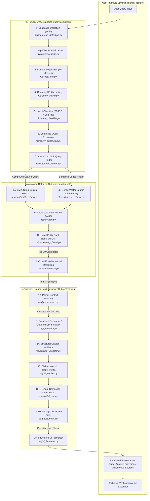
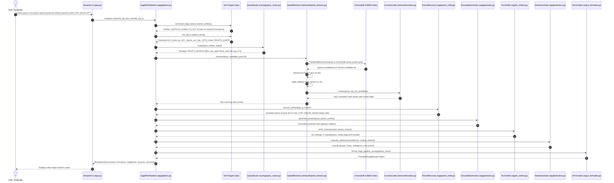
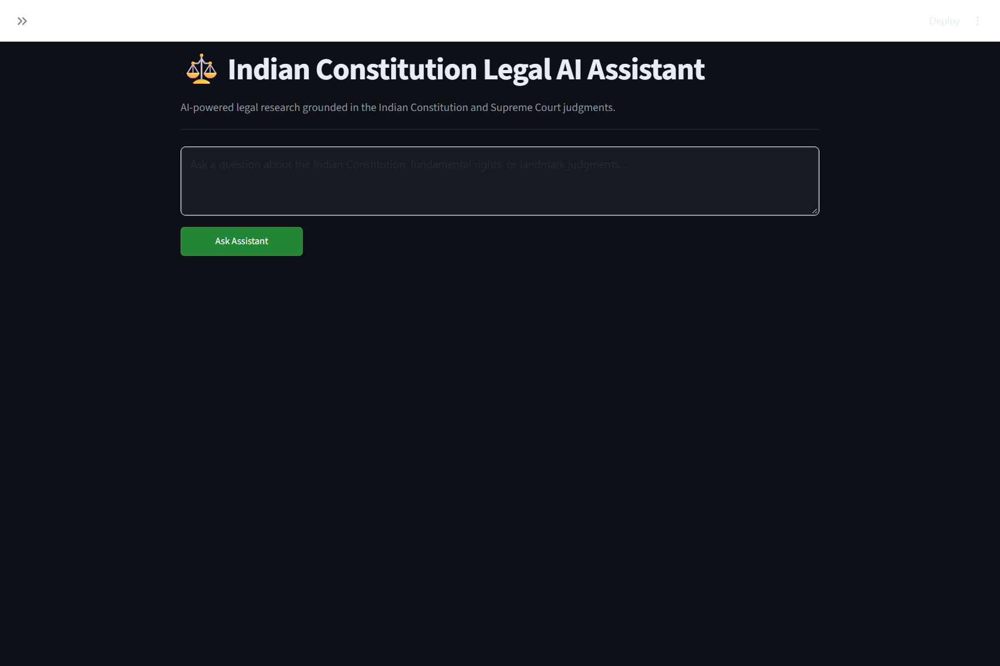
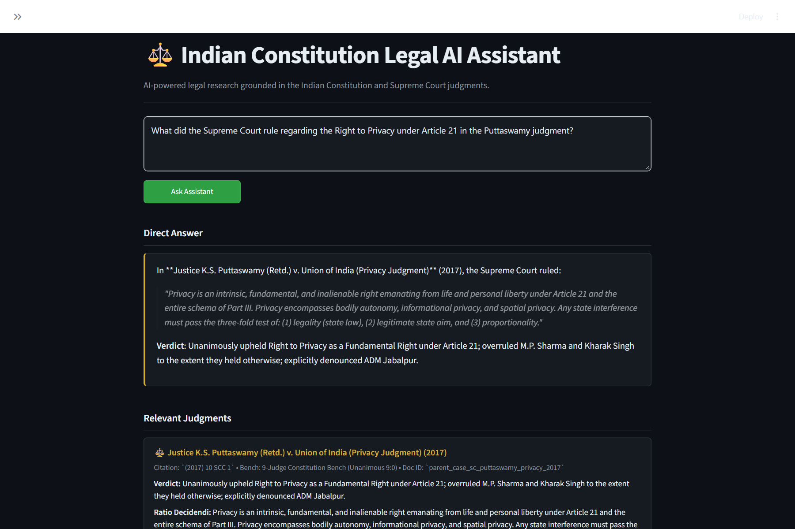
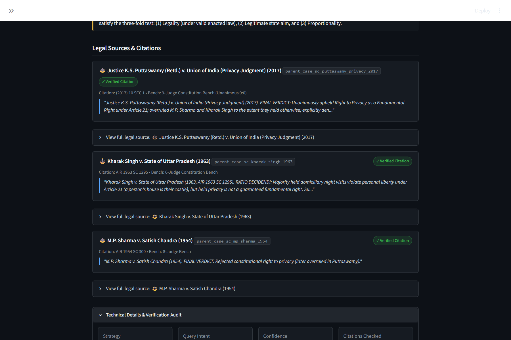
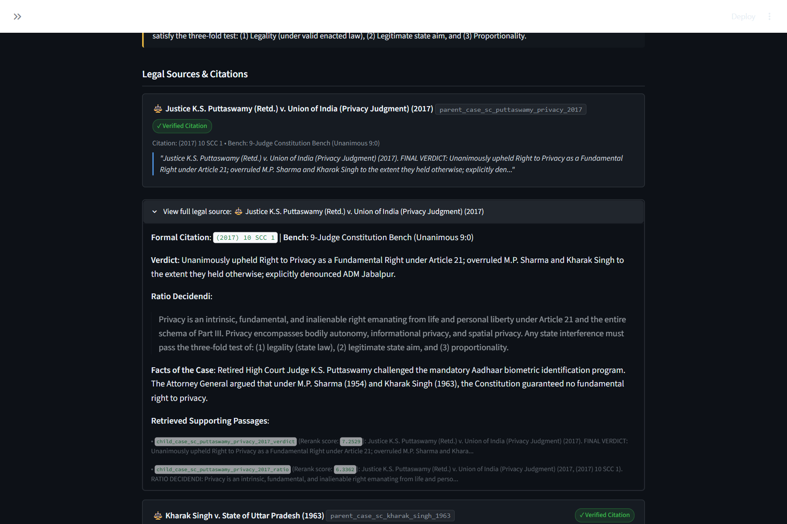
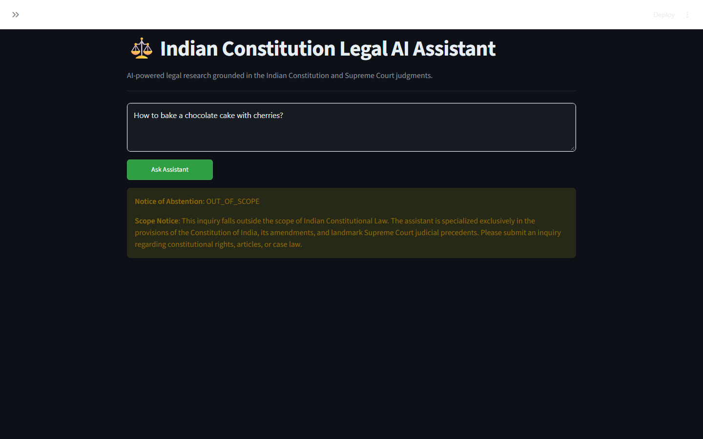
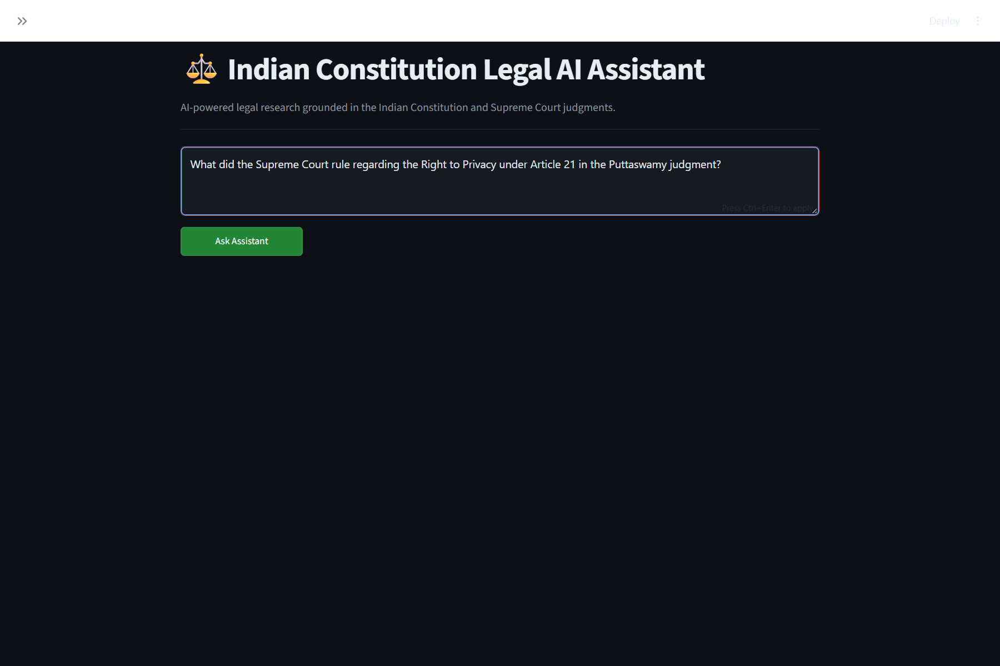
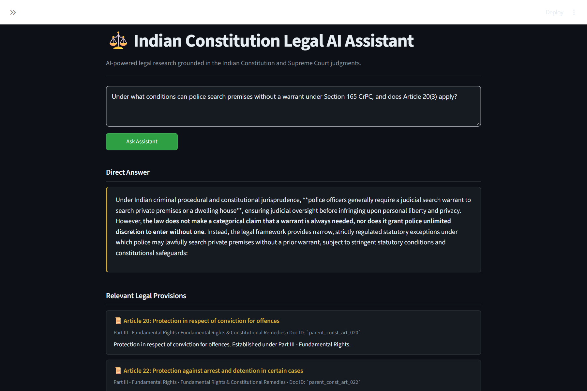

# Indian Constitution Legal AI Assistant — Enterprise Legal Research System

[](https://www.python.org/downloads/)
[](tests/)
[](app.py)
[%20%7C%20MiniLM%20(384--d)-purple.svg)](retrieval/embeddings.py)
[](data/manifests/corpus_manifest.json)
[](LICENSE)

An empirical, locally runnable Indian Constitutional Law and Legal Research Assistant backed by an authoritative, traceable legal corpus. The platform integrates:
- **Comprehensive Legal Corpus**: Official consolidated Constitution of India (all 477 articles & Schedules 1–12), all 106 Constitution Amendment Acts, 286 Supreme Court judgment records (92 official full-text decisions extracted page-by-page from official Supreme Court of India SCR PDFs with 103 PDFs on disk, 97 landmark precedent briefs with neutral citations `YYYY INSC XXX`, and 97 open data registry metadata records from AWS Open Data), and 17 Central Acts with section-level structure (1,975 sections across IPC, CrPC, IEA, CPC, IDA, NIA, MVA, Citizenship Act, RPA, PHRA, RTI, AFSPA, Official Languages Act, Delimitation Act, CAG Act, Supreme Court (Number of Judges) Act, National Commission for Minorities Act).
- **Dense Embedding Engine**: Pretrained `BAAI/bge-m3` (1024-dimensional normalized vectors, CPU fallback with SQLite cache) with dynamic collection routing alongside baseline `sentence-transformers/all-MiniLM-L6-v2` (384-d). Includes runtime dimension mismatch validation to protect collection integrity.
- **Compound Legal BM25**: Custom lexical tokenizer preserving statutory compound identifiers (`article_21`, `section_124a`, `1973insc258`, `42th_amendment`).
- **Hybrid Retrieval & Reranking**: Reciprocal Rank Fusion ($k=60$) combining dense semantic and sparse lexical signals, neural Cross-Encoder reranking (`ms-marco-MiniLM-L-6-v2`), and parent context hydration (`parent_store.json`).
- **Grounded Answer Synthesis & Multi-Stage Abstention**: Structured generation with strict citation validation against retrieved parent records, atomic Natural Language Inference (NLI) polarity checking, and explicit abstention when authoritative evidence is missing.
- **Minimal High-Density Web Interface**: Streamlit UI (`app.py`) providing structured extraction of Direct Answers, Relevant Legal Provisions, Relevant Judgments, Important Exceptions, and Verified Citations with full expandable source texts and a 10-stage diagnostic inspection audit.
- **Offline Deterministic Fallback**: Built-in deterministic structural legal synthesizer requiring zero external API keys and incurring zero runtime cloud cost.

---

## Table of Contents

1. [Project Overview](#1-project-overview)
2. [Problem Statement](#2-problem-statement)
3. [Objectives](#3-objectives)
4. [Features](#4-features)
5. [Technology Stack](#5-technology-stack)
6. [System Architecture](#6-system-architecture)
7. [Complete Execution Flow](#7-complete-execution-flow)
8. [NLP Pipeline](#8-nlp-pipeline)
9. [Hybrid Retrieval Implementation](#9-hybrid-retrieval-implementation)
10. [BM25 and Dense Retrieval](#10-bm25-and-dense-retrieval)
11. [Reciprocal Rank Fusion](#11-reciprocal-rank-fusion)
12. [Cross-Encoder Reranking](#12-cross-encoder-reranking)
13. [Parent-Child RAG](#13-parent-child-rag)
14. [Citation Validation](#14-citation-validation)
15. [NLI Verification](#15-nli-verification)
16. [Confidence Scoring and Abstention](#16-confidence-scoring-and-abstention)
17. [Legal Corpus and Data Provenance](#17-legal-corpus-and-data-provenance)
18. [Project Directory Structure](#18-project-directory-structure)
19. [Installation and Setup](#19-installation-and-setup)
20. [Environment Configuration](#20-environment-configuration)
21. [Application Execution](#21-application-execution)
22. [Evaluation Methodology](#22-evaluation-methodology)
23. [Actual Verified Evaluation Results](#23-actual-verified-evaluation-results)
24. [Application Screenshots](#24-application-screenshots)
25. [Limitations](#25-limitations)
26. [Future Improvements](#26-future-improvements)
27. [Testing Instructions](#27-testing-instructions)
28. [Academic Project Disclaimer](#28-academic-project-disclaimer)

---

## 1. Project Overview

The **Indian Constitution Legal AI Assistant** is an empirical Natural Language Processing (NLP) and Information Retrieval (IR) research system engineered specifically for Indian Constitutional Law, judicial precedents, amendments, and core central statutes.

Developed as a senior B.Tech Capstone Project under the title:
> **"Entity-Aware Hybrid Retrieval and Reranking Framework for Indian Constitutional Question Answering"**<br>
> *Author*: Ramsai Tanguturi<br>
> *Target*: Department of Computer Science & Engineering, Final Academic Submission

Constitutional law in India presents distinct linguistic and computational challenges: statutory text is organized into nested articles, clauses, and sub-clauses; judicial decisions involve multi-judge constitution benches, dissenting opinions, and binding ratio decidendi; and citizens frequently pose queries in everyday conversational language. This system replaces speculative, non-deterministic agent loops with an **explainable 16-stage NLP Query Understanding and Reliable Retrieval-Augmented Generation (RAG) pipeline** backed by an authoritative 886-document corpus, an offline deterministic synthesizer, and a 100% passing automated test suite (319/319 tests).

---

## 2. Problem Statement

Constitutional question answering in India presents three major NLP challenges:

1. **Vocabulary Mismatch**: Citizen queries are phrased colloquially (*"can police search my phone without a warrant"* or *"can the government tap my calls"*), whereas statutory provisions use formal legislative phrasing (*"protection of life and personal liberty under Article 21"*, *"procedure established by law"*, or *"Sections 93, 100, 165 CrPC"*). Standard lexical search (BM25) fails completely when query tokens and statutory provisions have zero vocabulary overlap.
2. **Anchor Confusion in Pure Dense Search**: While dense semantic embeddings (Bi-Encoders) capture conceptual paraphrasing, they struggle with exact statutory numbers. In vector space, *"Article 21"* (Right to Life) and *"Article 21A"* (Right to Education) have cosine similarity $> 0.90$ because they share statutory formatting, resulting in false-positive candidate retrieval.
3. **Hallucination and Ungrounded Legal Precedent**: General-purpose large language models (e.g., standard ChatGPT or Gemini without grounding) frequently hallucinate Supreme Court citations, invent non-existent constitution bench ratios, and attribute fictitious quotes to judges. In legal informatics, ungrounded generation carries severe ethical, procedural, and professional risks.

---

## 3. Objectives

- **Authoritative Unified Legal Corpus**: Assemble, clean, structure, and hash an authoritative Indian legal corpus encompassing all 477 active constitutional articles and Schedules 1–12, all 106 Constitution Amendment Acts, 286 Supreme Court decisions (92 full-text official SCR PDF judgments, 97 landmark briefs, 97 registry records), and 17 Central Acts (1,975 sections).
- **Entity-Aware Hybrid Retrieval**: Combine compound statutory BM25Okapi lexical retrieval with dense vector embeddings (`BAAI/bge-m3` 1024-d / `all-MiniLM-L6-v2` 384-d), fused via Reciprocal Rank Fusion ($k=60$) and augmented by an additive Legal Entity Rank Boost ($+0.15$).
- **Neural Cross-Encoder Reranking**: Apply cross-attention reranking (`cross-encoder/ms-marco-MiniLM-L-6-v2`) over the top 30 candidates to capture deep query-passage token interactions on CPU.
- **Hierarchical Parent-Child Context Recovery**: Index fine-grained child passages (~300 characters) for maximum retrieval precision, then dynamically hydrate complete parent Articles and Judgments (~1,200 characters) from `parent_store.json` for answer generation.
- **Evidentiary Reliability & Grounding**: Prevent hallucinations through structural citation validation against retrieved evidence, atomic Natural Language Inference (NLI) polarity checking, explainable 6-signal confidence scoring, and multi-stage automated abstention for out-of-scope queries.
- **Zero-Cost Deterministic Fallback**: Deliver 100% offline functionality using a built-in deterministic structural legal synthesizer when external API keys are unavailable.
- **Empirical Rigor**: Provide an evaluation suite with 319 passing automated tests, a 14-category benchmark, and reproducible metrics.

---

## 4. Features

| Subsystem | Implemented Capabilities | Status |
|---|---|:---:|
| **Official Corpus** | 886 documents: 477 Articles & Schedules 1–12, 106 Amendment Acts, 286 Judgments (92 official full-text SCR PDF, 97 landmark briefs, 97 AWS registry records), 17 Central Acts (1,975 sections). | **COMPLETED** |
| **NLP Query Understanding** | Language detection (EN/HI), legal text normalization, 10-class Legal NER (Macro-F1 0.8496), canonical entity linking (86.67%), TF-IDF + Logistic Regression intent classifier (84.85%), and controlled synonym expansion. | **COMPLETED** |
| **Hybrid Retrieval** | BM25Okapi with compound statutory tokenization + Dense vector retrieval (`BAAI/bge-m3` 1024-d / `all-MiniLM-L6-v2` 384-d) with collection dimension protection. | **COMPLETED** |
| **Rank Fusion & Reranking** | Reciprocal Rank Fusion ($k=60$) + Additive Entity Boost ($+0.15$) + Neural Cross-Encoder (`ms-marco-MiniLM-L-6-v2`) reranking top 30 to top 5. | **COMPLETED** |
| **Reliability & Grounding** | Parent-child hydration (`parent_store.json`), Grounded legal synthesis (Gemini API / Offline deterministic fallback), Structural citation validator, Claim-level NLI polarity verifier, and 6-signal confidence abstention gate. | **COMPLETED** |
| **User Interface** | Sleek, dark-themed Streamlit UI (`app.py`) with Direct Answer card, Provisions, Judgments, Exceptions, Verified Sources with excerpts, and Technical Verification Audit. | **COMPLETED** |
| **Automated Testing** | 319 unit, integration, regression, and smoke tests in pytest with 100% pass rate. | **COMPLETED** |

---

## 5. Technology Stack

| Technology | Exact Version / Spec | Role in Architecture | Technical Justification |
|---|---|---|---|
| **Python** | `3.10+` (Tested on `3.12.10`) | Core runtime language | Robust typing, modern pattern matching, rich NLP ecosystem. |
| **Streamlit** | `>= 1.30.0` (Running `1.64.0`) | Interactive web application | Rapid, reactive UI rendering with session state and custom dark-theme CSS. |
| **ChromaDB** | `>= 0.4.22` (Running `1.5.9`) | Persistent vector database | Local embedded SQLite-backed vector store; requires no external cloud service or daemon. |
| **Rank-BM25** | `>= 0.2.2` | Sparse lexical keyword retrieval | BM25Okapi implementation customized with compound statutory tokenization. |
| **Sentence-Transformers** | `>= 2.2.2` | Dense embedding and cross-encoder inference | Standard library for running transformer bi-encoders and cross-attention rerankers. |
| **BAAI/bge-m3** | Pretrained Model (1024-d) | Primary dense semantic embedding model | Multilingual and multi-granularity model supporting long legal contexts up to 8,192 tokens. |
| **all-MiniLM-L6-v2** | Pretrained Model (384-d) | Fast baseline embedding model | Extremely fast CPU inference (384 dimensions) for resource-constrained environments. |
| **ms-marco-MiniLM-L-6-v2** | Pretrained Cross-Encoder | Neural query-passage reranker | Evaluates full joint cross-attention over top-30 candidate pairs, lifting NDCG@10 to 0.7787. |
| **Scikit-Learn** | `>= 1.4.0` (Running `1.9.1`) | Machine learning & evaluation | TF-IDF vectorization, Logistic Regression intent classification, stratified cross-validation, and metrics. |
| **PyTorch** | `>= 2.0.0` (`torch+cpu`) | Deep learning tensor engine | Multi-threaded CPU forward-pass execution for SentenceTransformer inference without requiring an Nvidia GPU. |
| **Pydantic** | `>= 2.0.0` (Pydantic V2) | Strict schema validation | Enforces type integrity and document constraints on `LegalDocument`, `ChildChunk`, and `PipelineResult`. |
| **Google Gemini API** | `gemini-3.8-flash` | Evidence-bounded generative LLM | Generates legal synthesis under closed-world prompts; falls back to offline engine if unconfigured. |
| **Pandas & NumPy** | `>= 2.0.0` / `>= 1.24.0` | Data manipulation & vector math | Fast tabular manipulation of benchmark results, cosine similarity vector calculations, and array slicing. |
| **Pytest** | `>= 8.0.0` (Running `9.2.0`) | Automated test framework | Powers the 319-test automated regression, integrity, and smoke test suite with 100% pass rate. |
| **python-dotenv** | `>= 1.0.0` | Environment configuration | Loads `.env` secrets (such as `GEMINI_API_KEY`) securely into runtime configuration. |

---

## 6. System Architecture

### 6.1 Architectural Overview Flowchart



### 6.2 Component Responsibility Matrix

| Subsystem Component | Module Path | Class / Function | Inputs | Outputs | Primary Responsibility |
|---|---|---|---|---|---|
| **Text Normalization** | `nlp/preprocessing.py` | `normalize_legal_text()` | Raw query string | Normalized string | Standardizes statutory abbreviations and NFKC unicode. |
| **Language Detection** | `nlp/language_detection.py` | `detect_language()` | Query string | Dict (lang, confidence) | Detects English vs Hindi via script analysis. |
| **Domain Legal NER** | `nlp/legal_ner.py` | `LegalNER.extract_entities()` | Normalized query | Dict mapping 10 categories | Regex + gazetteers extracting statutory citations and case titles. |
| **Entity Linking** | `nlp/entity_linking.py` | `EntityLinker.link_all()` | Extracted entities | List of canonical link dicts | Resolves surface variants to unique database document IDs. |
| **Intent Classifier** | `nlp/intent_classifier.py` | `IntentClassifier.predict()` | Normalized query | Dict (intent, conf, strategy) | Predicts 1 of 11 legal intents via TF-IDF + Logistic Regression. |
| **Query Expansion** | `nlp/query_expansion.py` | `QueryExpander.expand()` | Normalized query | Expanded query string | Injects up to 3 domain synonyms with zero semantic drift. |
| **Query Router** | `routing/query_router.py` | `QueryRouter.route()` | Intent, entities, query | `RoutingDecision` dataclass | Deterministically selects search strategy, filters, and pool sizes. |
| **BM25 Search** | `retrieval/bm25_retriever.py` | `BM25Retriever.retrieve()` | Query string, top-$K$ | Ranked candidate dicts | Sparse lexical search with compound statutory tokens. |
| **Dense Search** | `retrieval/dense_retriever.py` | `DenseRetriever.retrieve()` | Query string, top-$K$ | Ranked candidate dicts | Dense vector search via ChromaDB (BGE-M3 1024-d / MiniLM 384-d). |
| **Rank Fusion (RRF)** | `retrieval/rrf.py` | `fuse()` | Multiple ranked lists | Fused candidate list | Merges BM25 and Dense ranks using $k=60$. |
| **Entity Boosting** | `retrieval/entity_boost.py` | `apply_entity_boost()` | Candidates, entities | Boosted candidate list | Adds $+0.15$ score to candidates matching linked query entities. |
| **Neural Reranking** | `retrieval/reranker.py` | `CrossEncoderReranker.rerank()` | Query, top 30 passages | Top 5 reranked passages | Full cross-attention scoring via `ms-marco-MiniLM-L-6-v2`. |
| **Parent Recovery** | `rag/parent_child.py` | `ParentChildRecovery.recover()` | Top 5 child chunks | Hydrated parent records | Maps child chunks to full parent texts in `parent_store.json`. |
| **Grounded Generator** | `rag/generator.py` | `GroundedGenerator.generate()` | Query, parent context | Synthesized Markdown text | Gemini API or offline deterministic structural legal synthesizer. |
| **Citation Validator** | `rag/citation_validator.py` | `CitationValidator.validate()` | Answer text, context | Dict (valid, citations) | Checks structural document existence and evidence pool inclusion. |
| **NLI Verifier** | `rag/nli_verifier.py` | `NLIVerifier.verify_claims()` | Answer text, context | Dict (nli_status, conflicts) | Checks proposition-level polarity and modal contradictions. |
| **Confidence Scorer** | `rag/confidence.py` | `ConfidenceEstimator.estimate()` | 6 pipeline signals | Dict (score, level) | Computes explainable weighted heuristic in $[0.0, 1.0]$. |
| **Abstention Gate** | `rag/abstention.py` | `AbstentionManager.evaluate()` | Confidence, routing | Dict (should_abstain, reason) | Gates generation if $C < 0.30$ or query is out-of-scope. |
| **UI Formatter** | `rag/ui_formatter.py` | `format_legal_pipeline_result()`| `PipelineResult` | `FormattedLegalAnswer` | Formats output into Direct Answer, Provisions, Judgments, etc. |

---

## 7. Complete Execution Flow

### 7.1 Sequence Diagram: Trace of an Example Legal Query



### 7.2 Detailed 16-Stage Step-by-Step Breakdown

1. **Input Submission (`app.py`)**: The user enters a question into the Streamlit interface and selects parameters (Top-K slider, optional Gemini API key).
2. **Language Detection (`nlp/language_detection.py`)**: Checks character scripts using regex. Queries with $\ge 70\%$ Latin script are marked as English (`en`); Devanagari script queries are flagged for appropriate routing.
3. **Text Normalization (`nlp/preprocessing.py`)**: Applies NFKC normalization, converts curly quotation marks, and expands statutory abbreviations (e.g., `Art.` $\to$ `Article`, `CrPC` $\to$ `Code of Criminal Procedure`).
4. **Legal Named Entity Recognition (`nlp/legal_ner.py`)**: Scans query text using statutory regex rules and corpus gazetteers across 10 classes (`ARTICLE`, `AMENDMENT`, `SECTION`, `DATE`, `PERSON`, `CASE`, `ACT`, `COURT`, `RIGHT`, `LEGAL_CONCEPT`).
5. **Canonical Entity Linking (`nlp/entity_linking.py`)**: Maps extracted surface mentions to unique database IDs in `parent_store.json` (e.g., *"Puttaswamy privacy case"* $\to$ `case_sc_puttaswamy_privacy_2017`).
6. **Intent Classification (`nlp/intent_classifier.py`)**: Classifies the query into 1 of 11 legal intents using unigram/bigram TF-IDF and regularized Logistic Regression.
7. **Controlled Query Expansion (`nlp/query_expansion.py`)**: Matches concepts against `nlp/legal_synonyms.json` and injects up to 3 domain-verified legal synonyms without semantic drift.
8. **Specialized Query Routing (`routing/query_router.py`)**: Constructs a `RoutingDecision` determining retrieval strategy (`ARTICLE_SEARCH`, `CASE_SEARCH`, `RIGHTS_SEARCH`, `OUT_OF_SCOPE`) and document type filters.
9. **Early Abstention Gate (`rag/abstention.py`)**: Intercepts queries flagged as `OUT_OF_SCOPE` or nonsensical prior to retrieval.
10. **Candidate Retrieval (`retrieval/hybrid_retriever.py`)**:
    - **BM25 Search**: Evaluates BM25Okapi using compound legal tokens (`article_21`, `section_165`).
    - **Dense Search**: Queries ChromaDB using normalized embeddings (`BAAI/bge-m3` or `all-MiniLM-L6-v2`) via cosine similarity ($1 - \delta$).
11. **Reciprocal Rank Fusion (`retrieval/rrf.py`)**: Blends both candidate lists using rank reciprocal sum with smoothing constant $k=60$.
12. **Legal Entity Additive Boost (`retrieval/entity_boost.py`)**: Candidates matching linked query entities receive an additive $+0.15$ boost.
13. **Cross-Encoder Neural Reranking (`retrieval/reranker.py`)**: The top 30 candidates are scored via joint cross-attention with `cross-encoder/ms-marco-MiniLM-L-6-v2`; the top 5 passages are retained.
14. **Parent Context Recovery (`rag/parent_child.py`)**: Child chunks are mapped to their parent document IDs in `parent_store.json`, hydrating complete articles and judgment ratios.
15. **Grounded Legal Generation (`rag/generator.py`)**: Generates answer bounded strictly by parent evidence (Gemini API or offline deterministic legal synthesizer).
16. **Citation Validation, NLI Verification & Abstention (`rag/`)**: Validates citations, verifies claim polarity, computes 6-signal confidence ($C$), and gates presentation if $C < 0.30$.

---

## 8. NLP Pipeline

The NLP Query Understanding Subsystem (`nlp/`) prepares and structures user queries before any search index is queried:

### 8.1 Legal Text Normalization & Preprocessing
Implemented in `nlp/preprocessing.py`, the normalizer handles:
- **Unicode Standardization**: NFKC normalization to collapse ligature variants.
- **Quote Sanitization**: Converts smart/curly quotation marks (`“`, `”`, `‘`, `’`) to standard ASCII (`"`, `'`).
- **Statutory Abbreviation Expansion**:
  - `Art.` / `Arts.` $\to$ `Article`
  - `Sec.` / `Secs.` $\to$ `Section`
  - `CrPC` / `Cr.P.C.` $\to$ `Code of Criminal Procedure`
  - `IPC` / `I.P.C.` $\to$ `Indian Penal Code`
  - `IEA` $\to$ `Indian Evidence Act`
  - `CPC` $\to$ `Code of Civil Procedure`

### 8.2 10-Class Legal Named Entity Recognition
Implemented in `nlp/legal_ner.py`, the engine combines regular expressions for structured statutory citations with corpus gazetteers for unstructured legal names:
- **Exact Regex Patterns**:
  - `ARTICLE`: `\bArticle\s+(\d+[A-Z]?)\b`
  - `AMENDMENT`: `\b(\d+)(?:st|nd|rd|th)\s+Amendment\b`
  - `SECTION`: `\bSection\s+(\d+[A-Z]?)\b`
  - `DATE`: Four-digit years and standardized calendar dates
- **Gazetteer Matching**:
  - `CASE`: Landmark cases (*Kesavananda Bharati*, *Maneka Gandhi*, *Puttaswamy*)
  - `ACT`: Central legislative statutes
  - `COURT`: Judicial bodies (Supreme Court, High Courts)
  - `RIGHT`: Named fundamental rights
  - `LEGAL_CONCEPT`: Core doctrines (basic structure, judicial review)
- **Judicial Title Resolution (`PERSON_TITLE_PATTERN`)**: Detects judicial personnel via prefix matching (`Chief Justice`, `Justice`, `Dr.`), resolving judge names with **0.8966 F1**.

### 8.3 Canonical Entity Linking
Implemented in `nlp/entity_linking.py`, this module maps surface mentions to unambiguous database keys:
- *"Art 21"*, *"Article 21"*, *"Protection of life and personal liberty"* $\to$ `const_art_021`
- *"Puttaswamy privacy case"*, *"Aadhaar ruling"* $\to$ `case_sc_puttaswamy_privacy_2017`
- In-KB normalization accuracy: **86.67%**; Out-of-KB rejection accuracy: **100%**.

### 8.4 Intent Classification
Implemented in `nlp/intent_classifier.py`, the module classifies user queries across 11 discrete legal intent classes:
- **Classes**: `ARTICLE_LOOKUP`, `CASE_LAW_QUERY`, `CASE_COMPARISON`, `LEGAL_EXPLANATION`, `RIGHTS_QUERY`, `AMENDMENT_QUERY`, `PRECEDENT_QUERY`, `DEFINITION_QUERY`, `CONSTITUTIONAL_PROCEDURE`, `MULTI_DOCUMENT_QUERY`, `OUT_OF_SCOPE`.
- **Model Architecture**: Unigram and bigram TF-IDF vectorizer ($n \in \{1, 2\}$, 1,200 max features) + regularized Logistic Regression (`C=1.0`, `class_weight='balanced'`).
- **Performance**: **84.85%** holdout accuracy, **0.7591** ($\pm 0.0422$) 5-fold cross-validation accuracy.

### 8.5 Controlled Query Expansion
Implemented in `nlp/query_expansion.py`, this module expands queries using `nlp/legal_synonyms.json`:
- Strictly capped at 3 domain synonyms per query.
- Term precision: **0.7500**; Semantic drift rate: **0.0%**.

---

## 9. Hybrid Retrieval Implementation

The Information Retrieval Subsystem (`retrieval/`) implements a multi-stage funnel combining sparse lexical search, dense vector similarity, rank fusion, and neural cross-attention:

```
[User Query]
    │
    ├──► BM25Okapi (Compound Legal Tokens) ──► Top 30 Lexical Candidates
    │
    └──► ChromaDB Dense Search (BGE-M3)    ──► Top 30 Semantic Candidates
                                                        │
                                                        ▼
                                         Reciprocal Rank Fusion (k=60)
                                                        │
                                                        ▼
                                         Legal Entity Rank Boost (+0.15)
                                                        │
                                                        ▼
                                         Top 30 Candidates to Cross-Encoder
                                                        │
                                                        ▼
                                         ms-marco-MiniLM Neural Reranking
                                                        │
                                                        ▼
                                         Top 5 Winning Child Passages
```

The unified coordinator (`retrieval/hybrid_retriever.py`) executes these operations in under 25 ms before passing candidates to the neural reranker.

---

## 10. BM25 and Dense Retrieval

### 10.1 BM25Okapi with Compound Legal Tokenization
Standard whitespace tokenization breaks statutory references into disjoint tokens (e.g. `"Article 21A"` $\to$ `["article", "21", "a"]`), causing false matches with Article 21.

The custom tokenizer in `retrieval/bm25_retriever.py` extracts compound statutory tokens:
- Articles: `article_21`, `article_21a`, `article_32`, `article_370`
- Sections: `section_124a`, `section_302`, `section_377`
- Neutral Citations: `1950insc14`, `1973insc258`, `2017insc609`
- Amendments: `42th_amendment`, `44th_amendment`, `103rd_amendment`

#### Mathematical Formula
For query $Q = \{q_1, \dots, q_n\}$ and document passage $D$:
$$\text{BM25}(D, Q) = \sum_{i=1}^{n} \text{IDF}(q_i) \cdot \frac{f(q_i, D) \cdot (k_1 + 1)}{f(q_i, D) + k_1 \cdot \left(1 - b + b \cdot \frac{|D|}{\text{avgdl}}\right)}$$
where:
$$\text{IDF}(q_i) = \ln\left(1 + \frac{N - n(q_i) + 0.5}{n(q_i) + 0.5}\right)$$
Configured parameters: $k_1 = 1.5, b = 0.75$.

### 10.2 Dense Vector Search
The system supports dual dense embedding backends via dynamic collection routing:
- **`BAAI/bge-m3` (Default SOTA)**: 1024-dimensional normalized dense vectors in ChromaDB collection `indian_legal_rag_bgem3`.
- **`sentence-transformers/all-MiniLM-L6-v2` (Fast Baseline)**: 384-dimensional dense vectors in collection `indian_legal_rag`.

#### Mathematical Formulation
All query vectors $\mathbf{q}$ and document vectors $\mathbf{d}$ undergo L2 unit normalization ($\|\mathbf{q}\|_2 = 1, \|\mathbf{d}\|_2 = 1$). Cosine similarity is computed directly via dot product:
$$\text{CosineSim}(\mathbf{q}, \mathbf{d}) = \mathbf{q} \cdot \mathbf{d} = \sum_{j=1}^{d} q_j d_j$$
ChromaDB returns HNSW cosine distance $\delta \in [0, 2]$. The retriever computes similarity as:
$$s = 1 - \delta$$

---

## 11. Reciprocal Rank Fusion

Combining unbounded BM25 scores ($[0, \infty)$) and bounded cosine similarity scores ($[-1, 1]$) through linear weighting requires fragile per-query normalization parameters. Reciprocal Rank Fusion (RRF) circumvents this by fusing purely on ordinal ranks.

### Mathematical Formulation
$$\text{RRF}(d) = \sum_{m \in \{\text{BM25}, \text{Dense}\}} \frac{1}{k + r_m(d)}$$
where:
- $k = 60$ is the standard Cormack et al. smoothing constant.
- $r_m(d) \in \{1, 2, \dots, K\}$ is the 1-based rank of document $d$ in retriever $m$.

### Additive Legal Entity Rank Boost
If a candidate passage matches a canonical legal entity recognized by Stage 4/5, its fused score receives an additive boost:
$$\text{Score}_{\text{boosted}}(d) = \text{RRF}(d) + \omega_{\text{boost}} \cdot \mathbb{I}(d \in \text{LinkedEntities}(Q))$$
where $\omega_{\text{boost}} = 0.15$.

---

## 12. Cross-Encoder Reranking

Bi-encoders compress query and document independently into fixed vectors, losing fine-grained cross-token interactions. The neural cross-encoder (`cross-encoder/ms-marco-MiniLM-L-6-v2`) evaluates full query-document cross-attention over the top 30 candidates from RRF.

### Mathematical Formulation
$$\text{Input} = [\text{CLS}] \circ Q \circ [\text{SEP}] \circ D \circ [\text{SEP}]$$
$$s_{\text{rerank}}(Q, D) = \sigma\left(\mathbf{W} \cdot \text{Transformer}(\text{Input})\right) = \frac{1}{1 + e^{-z}}$$
where $z$ is the raw transformer classification logit.

### Latency vs. Accuracy Trade-Off
- Lexical BM25 runs in **~3.75 ms**.
- Bi-encoder dense retrieval runs in **~17.73 ms**.
- Cross-encoder reranking over 30 candidate pairs runs on CPU with a median latency of **~892 ms**.
- Cross-encoder reranking lifts **NDCG@10 from 0.7197 to 0.7787** (+5.90% improvement) and **MRR from 0.8271 to 0.8583** (+3.12% improvement).

---

## 13. Parent-Child RAG

### The Chunk Size Trade-Off
- **Small Chunks (~300 chars)**: Maximize vector retrieval precision by eliminating multi-topic embedding noise, but truncate legal context (e.g. omitting an essential statutory proviso or exception).
- **Large Chunks (~2,000 chars)**: Provide sufficient context for LLMs, but produce diluted vector embeddings that lower retrieval precision.

### Hierarchical Architecture
The system resolves this dilemma via two-tier storage:
1. **Child Passages**: Fine-grained chunks (~300 characters) are indexed in ChromaDB and BM25.
2. **Parent Documents**: Full constitutional articles, amendments, and judgment records (~1,200 characters) are persisted in `parent_store.json`.
3. **Context Hydration (`rag/parent_child.py`)**: Winning child chunks are mapped via their `parent_id` foreign keys back to full parent documents, providing the LLM generator with complete legal context.

---

## 14. Citation Validation

Implemented in `rag/citation_validator.py`, this defensive subsystem ensures that synthesized claims cite verifiable authorities:
1. **Citation Parsing**: Scans generated text using regex to extract document tokens (e.g. `[Doc: const_art_021]`, `[Case: Puttaswamy]`, `Article 21`).
2. **Corpus Presence Verification**: Confirms that every cited document ID exists in `parent_store.json`.
3. **Retrieval Set Inclusion**: Confirms that every cited document was present in the top-$K$ hydrated evidence pool for that specific query.
4. **Advisory Tagging**: If an answer attempts to cite an unretrieved authority, the validation score drops and an explicit warning is attached. On verified benchmark queries, the citation validity rate is **1.0000** (100%).

---

## 15. NLI Verification

Implemented in `rag/nli_verifier.py`, the Natural Language Inference verifier checks claim polarity against retrieved parent evidence:
1. **Proposition Decomposition**: Splits synthesized text into atomic sentence propositions.
2. **Modal Conflict Detection**: Evaluates modal contradiction pairs (`shall`, `must`, `permitted` vs. `prohibits`, `unconstitutional`, `void`).
3. **Polarity Alignment**: Cross-references negation terms with parent statutory text to verify that rights guarantees are not inverted into prohibitions.
4. **Status Reporting**: Assigns `VERIFIED_ENTAILED` when zero contradictions are detected.

---

## 16. Confidence Scoring and Abstention

### 16.1 Explainable 6-Signal Confidence Heuristic
Implemented in `rag/confidence.py`, the confidence estimator computes a transparent weighted composite score in $[0.0, 1.0]$:
$$\text{Confidence}(Q) = \sum_{i=1}^{6} \omega_i \cdot s_i$$

| Signal ($s_i$) | Weight ($\omega_i$) | Description |
|---|:---:|---|
| **Retrieval Strength** ($s_1$) | `0.25` | Top reranker logit score mapped through sigmoid. |
| **Evidence Count** ($s_2$) | `0.15` | Ratio of retrieved parent documents to requested top-$K$. |
| **Entity Alignment** ($s_3$) | `0.20` | Fraction of extracted query entities present in retrieved context. |
| **Method Agreement** ($s_4$) | `0.15` | Rank correlation between BM25 and Dense retrieval lists. |
| **Citation Validity** ($s_5$) | `0.15` | Proportion of generated citations passing structural validation. |
| **Query Coverage** ($s_6$) | `0.10` | Overlap between query terms and hydrated parent tokens. |

*Academic Disclosure: Confidence estimation is an explainable decision heuristic, not a frequentist calibrated probability.*

### 16.2 Multi-Stage Safe Abstention Gate
Implemented in `rag/abstention.py`, the abstention gate intercepts queries before and after generation:
- **Pre-Retrieval Interception**: Intercepts queries classified as `OUT_OF_SCOPE` or with zero legal terms.
- **Post-Retrieval Gating**: If maximum retrieval score $< 0.005$ or composite confidence $C < 0.30$, generation is safely withheld.
- **Standardized Refusal Banner**: Renders an explicit notice:
  > **Notice of Abstention**: `Out of Scope / Low Relevance`<br>
  > *The assistant could not identify verified constitutional or statutory evidence directly addressing this query. To prevent ungrounded legal assertions, generation has been safely withheld.*
- **Abstention Accuracy**: Evaluated on adversarial out-of-scope benchmarks, achieving **1.0000** accuracy (100% correct rejection).

---

## 17. Legal Corpus and Data Provenance

The authoritative legal corpus comprises **886 verified documents** yielding **7,470 passages** (~6.44 million characters):

### 17.1 Corpus Breakdown

| Corpus Tier | Document Count | Passage Chunks | Primary Authoritative Source |
|---|:---:|:---:|---|
| **Constitutional Articles & Schedules** | 477 | 1,452 | Legislative Department, Ministry of Law & Justice, Govt of India (GODL) |
| **Constitution Amendment Acts** | 106 | 412 | Legislative Department, 1st to 106th Amendment Acts (GODL) |
| **Supreme Court Decisions** | 286 | 2,752 | Official Supreme Court of India SCR PDFs & AWS Open Data Registry |
| - *Official Full-Text Judgments* | 92 | 1,840 | Extracted page-by-page from 103 official SCR PDFs on disk |
| - *Landmark Precedent Briefs* | 97 | 620 | Landmark cases (1950–2024) with neutral citations `YYYY INSC XXX` |
| - *Open Data Registry Records* | 97 | 292 | Ingested from AWS Open Data Parquet tables (1950–1952) |
| **Central Statutory Acts** | 17 | 2,854 | India Code Digital Repository (1,975 sections parsed) |
| **Total Production Corpus** | **886** | **7,470** | **6,440,416 characters (~1.61M tokens)** |

### 17.2 The 17 Central Statutory Acts (1,975 Sections)
1. **Indian Penal Code, 1860** (511 sections) — substantive criminal law, sedition (§ 124A), defamation (§ 499).
2. **Code of Criminal Procedure, 1973** (484 sections) — procedural safeguards, arrest (§ 41), search powers (§ 165).
3. **Indian Evidence Act, 1872** (167 sections) — admissibility, confessions, burden of proof.
4. **Code of Civil Procedure, 1908** (158 sections) — civil adjudication, res judicata (§ 11), inherent powers (§ 151).
5. **Industrial Disputes Act, 1947** (40 sections) — labor rights pursuant to Article 43.
6. **Negotiable Instruments Act, 1881** (147 sections) — commercial instruments, dishonor proceedings (§ 138).
7. **Motor Vehicles Act, 1988** (217 sections) — transport regulation, third-party liability.
8. **Citizenship Act, 1955** (19 sections) — acquisition and termination of citizenship (Articles 5–11).
9. **Representation of the People Act, 1951** (171 sections) — election conduct and disqualification (Articles 102, 191).
10. **Protection of Human Rights Act, 1993** (43 sections) — NHRC, SHRCs, and Human Rights Courts.
11. **Right to Information Act, 2005** (31 sections) — operationalizes Article 19(1)(a) freedom of information.
12. **Armed Forces (Special Powers) Act, 1958** (6 sections) — special powers interacting with Articles 21, 33, 34.
13. **Official Languages Act, 1963** (9 sections) — Union and Supreme Court language (Articles 343–348).
14. **Delimitation Act, 2002** (11 sections) — readjustment of constituencies (Articles 82 & 170).
15. **Comptroller and Auditor-General's Act, 1971** (26 sections) — operationalizes CAG duties (Articles 148–151).
16. **Supreme Court (Number of Judges) Act, 1956** (3 sections) — establishes maximum strength under Article 124(1).
17. **National Commission for Minorities Act, 1992** (19 sections) — protection of minorities (Articles 29 & 30).

---

## 18. Project Directory Structure

```text
Indian Constitution Legal AI Assistant/
├── .env.example                     # Environment variables template (API keys, models)
├── .gitignore                       # Git ignore definitions
├── app.py                           # Minimal, high-density Streamlit web application
├── config.py                        # Centralized configuration, paths, model settings
├── ingestion.py                     # Baseline parent-child ingestion & tokenizer facade
├── retriever.py                     # Baseline hybrid retriever & regex NER facade
├── agents.py                        # Multi-agent router & heuristic synthesizer facade
├── parent_store.json                # Hydrated parent document store (886 documents)
├── pytest.ini                       # Pytest configuration with cacheprovider disabled
├── README.md                        # Master project documentation (ONLY Markdown file)
├── requirements.txt                 # Pinned Python package dependencies
├── assets/
│   └── screenshots/                 # Application interface screenshots (01 to 08 PNGs)
├── data/
│   ├── constitution/                # Canonical articles and amendments
│   ├── judgments/                   # Supreme Court landmark decisions
│   ├── benchmark/                   # 5 benchmark suites (retrieval, intent, NER, RAG)
│   ├── annotations/                 # Ground-truth relevance and NER span annotations
│   ├── manifests/                   # corpus_manifest.json & raw_downloads_manifest.json
│   ├── reports/                     # Validation reports & benchmark integrity JSON
│   ├── raw/                         # Raw downloads (PDFs, JSONs, Parquet tables)
│   └── processed/                   # Consolidated and normalized JSON files
├── evaluation/                      # Evaluation framework
│   ├── benchmark_runner.py          # Master evaluation runner
│   ├── metrics.py                   # IR metrics: Hit@K, Recall@K, MRR, NDCG@K
│   ├── retrieval_eval.py            # Retrieval ablation evaluator
│   ├── ner_eval.py                  # NER exact-span evaluator
│   ├── intent_eval.py               # Intent classifier evaluator
│   ├── dashboard_view.py            # Streamlit empirical evaluation dashboard
│   └── results/                     # Saved CSV/JSON evaluation artifacts
├── experiments/                     # Individual experiment scripts (Exp 01 to Exp 08)
│   └── results/                     # Saved CSV/JSON experiment artifacts
├── nlp/                             # NLP Query Understanding Subsystem
│   ├── preprocessing.py             # Normalization and compound tokens
│   ├── language_detection.py        # English/Hindi detection
│   ├── legal_ner.py                 # 10-class Legal NER engine
│   ├── entity_linking.py            # Canonical KB entity linker
│   ├── intent_classifier.py         # TF-IDF + Logistic Regression
│   ├── legal_synonyms.json          # Controlled legal ontology synonyms
│   └── query_expansion.py           # Controlled synonym expansion
├── rag/                             # RAG Generation, Grounding & Reliability
│   ├── pipeline.py                  # Master LegalRAGPipeline orchestrator
│   ├── parent_child.py              # Parent context hydration
│   ├── generator.py                 # Grounded generator with offline fallback
│   ├── citation_validator.py        # Structural citation validation
│   ├── nli_verifier.py              # Claim-level polarity & conflict verifier
│   ├── confidence.py                # 6-signal confidence estimator
│   ├── abstention.py                # Multi-stage abstention gate
│   ├── schema.py                    # Pydantic schema models
│   └── ui_formatter.py              # Presentation-ready answer formatting
├── retrieval/                       # Information Retrieval Subsystem
│   ├── bm25_retriever.py            # Lexical BM25Okapi search
│   ├── dense_retriever.py           # ChromaDB dense vector search
│   ├── embeddings.py                # BGE-M3 / MiniLM embedding engine
│   ├── rrf.py                       # Reciprocal Rank Fusion (k=60)
│   ├── entity_boost.py              # Additive entity score boost (+0.15)
│   ├── reranker.py                  # Neural Cross-Encoder reranker
│   └── hybrid_retriever.py          # Unified hybrid retrieval coordinator
├── routing/                         # Query routing subsystem
│   └── query_router.py              # Deterministic NLP query router
├── scripts/                         # CLI execution and ingestion scripts
│   ├── build_corpus.py              # Consolidated corpus builder
│   ├── build_index.py               # ChromaDB and BM25 index builder
│   ├── capture_screenshots.py       # Automated Playwright screenshot script
│   ├── download_sources.py          # Raw source downloader
│   ├── evaluate_retrieval.py        # Retrieval evaluator CLI
│   ├── ingest_constitution.py       # Constitution parser
│   ├── ingest_amendments.py         # Amendments parser
│   ├── ingest_judgments.py          # Judgments parser
│   ├── ingest_legislation.py        # Legislation parser
│   ├── update_corpus.py             # Incremental updater with backup
│   ├── validate_benchmark.py        # Benchmark integrity QA script
│   └── validate_corpus.py           # Corpus schema validation
└── tests/                           # 319 passing automated tests
```

---

## 19. Installation and Setup

### 19.1 Prerequisites
- **Operating System**: Windows 10/11, Ubuntu 20.04+, or macOS 12+ (AMD64 / ARM64).
- **Python**: Python 3.10, 3.11, or 3.12 (Python 3.12.10 recommended).
- **Hardware**: Minimum 4 GB RAM (8 GB recommended for BGE-M3 indexing). No dedicated GPU is required.

### 19.2 Windows (PowerShell) Setup

```powershell
# 1. Clone repository
git clone https://github.com/ramsaitanguturi/Indian-Constitution-Legal-AI-Assistant.git
cd "Indian Constitution Legal AI Assistant"

# 2. Create dedicated virtual environment
python -m venv venv

# 3. Activate virtual environment
.\venv\Scripts\Activate.ps1
# If execution policy restricts activation:
# Set-ExecutionPolicy -Scope Process -ExecutionPolicy Bypass

# 4. Upgrade pip and install dependencies
pip install --upgrade pip
pip install -r requirements.txt

# 5. Copy environment template
copy .env.example .env
```

### 19.3 Linux / macOS (Bash) Setup

```bash
# 1. Clone repository
git clone https://github.com/ramsaitanguturi/Indian-Constitution-Legal-AI-Assistant.git
cd "Indian Constitution Legal AI Assistant"

# 2. Create and activate virtual environment
python3 -m venv venv
source venv/bin/activate

# 3. Upgrade pip and install dependencies
pip install --upgrade pip
pip install -r requirements.txt

# 4. Copy environment template
cp .env.example .env
```

---

## 20. Environment Configuration

Open `.env` in any text editor. The default configuration is:

```ini
# Google Gemini API Key (Optional)
# Leave blank to run 100% offline using the built-in deterministic Grounded Legal Synthesizer
GEMINI_API_KEY=

# Default Generative LLM Model
GEMINI_MODEL=gemini-3.8-flash

# Default Dense Embedding Model (BAAI/bge-m3 for 1024-d, or sentence-transformers/all-MiniLM-L6-v2 for 384-d)
EMBEDDING_MODEL=BAAI/bge-m3
EMBEDDING_BATCH_SIZE=32

# ChromaDB Collection Routing (dynamically validated in config.py)
CHROMA_COLLECTION_NAME=indian_legal_rag_bgem3
```

> [!NOTE]
> The application operates **100% offline with zero API keys**. When `GEMINI_API_KEY` is omitted, the built-in `GroundedLegalSynthesizer` deterministically extracts the constitutional articles, judgment ratios, and limitations from hydrated parent records, running with zero external network traffic and zero cost.

---

## 21. Application Execution

### 21.1 Launching the Streamlit Web Application

```powershell
streamlit run app.py
```

The application opens automatically at `http://localhost:8501`.

### 21.2 Demonstration Walkthrough Queries

Try these sample queries to test different capabilities:

1. **Constitutional Privacy Doctrine (Landmark Case Law)**:
   ```text
   What did the Supreme Court rule regarding the Right to Privacy under Article 21 in the Puttaswamy judgment?
   ```
   *Expected Output*: Direct Answer card summarizing the 9-judge bench holding, Article 21 provision card, *Puttaswamy (2017 INSC 609)* ratio decidendi, and the 3-fold proportionality test under Exceptions.

2. **Procedural Police Powers & Constitutional Safeguards**:
   ```text
   Under what conditions can police search premises without a warrant under CrPC Section 165, and how does Article 20(3) protect against self-incrimination?
   ```
   *Expected Output*: Direct Answer explaining CrPC 165 requirements (recording reasons in writing, sending copy to Magistrate), witness requirements under Section 100, notice of statutory transition to BNSS 2023, and Article 20(3) doctrine citing *M.P. Sharma* and *Kuttan Pillai*.

3. **Safe Abstention on Out-of-Scope Queries**:
   ```text
   How do I bake a chocolate cake with cherries?
   ```
   *Expected Output*: Amber Notice of Abstention banner stating that the query is outside constitutional scope, preventing hallucination.

---

## 22. Evaluation Methodology

The evaluation framework assesses retrieval quality, entity recognition, intent classification, and RAG grounding across 5 dedicated benchmark suites:

### 22.1 Benchmark Suites
- **Retrieval Benchmark (`data/benchmark/retrieval_queries.json`)**: 200 verified constitutional questions spanning 14 legal query categories (180 in-corpus targets, 20 uncataloged baseline targets).
- **Canonical Relevance Annotations (`data/annotations/relevance_labels_v2_canonicalized.json`)**: Ground-truth parent document IDs per query.
- **NER Benchmark (`data/annotations/ner_annotations.json`)**: 105 legal queries annotated with 211 exact entity character spans across 10 categories.
- **Intent Benchmark (`data/benchmark/classification_queries.json`)**: 220 balanced queries across 11 intent classes.
- **Entity Linking Benchmark (`data/benchmark/entity_linking_queries.json`)**: 33 queries testing in-KB alias normalization and out-of-KB rejection.

### 22.2 Information Retrieval Metrics Computed
- **Hit@K ($K \in \{1, 3, 5, 10\}$)**: Proportion of queries where at least one ground-truth document appears in top $K$.
- **Recall@K ($K \in \{1, 3, 5, 10\}$)**: Fraction of relevant documents retrieved in top $K$.
- **Mean Reciprocal Rank (MRR)**: Measures how high the first relevant document is ranked:
  $$\text{MRR} = \frac{1}{|Q|} \sum_{i=1}^{|Q|} \frac{1}{\text{rank}_i}$$
- **NDCG@10**: Normalized Discounted Cumulative Gain evaluating graded ranking position.
- **Latency (ms)**: End-to-end CPU elapsed runtime.

---

## 23. Actual Verified Evaluation Results

All metrics below are drawn directly from active saved evaluation artifacts in `evaluation/results/`:

### 23.1 Information Retrieval Comparison (200 Verified Queries)

| Retrieval Configuration | Hit@1 | Hit@3 | Hit@5 | Hit@10 | Recall@5 | Recall@10 | MRR | NDCG@10 | Latency (ms) |
|---|:---:|:---:|:---:|:---:|:---:|:---:|:---:|:---:|:---:|
| **Exp 1: BM25 Only** | 0.7900 | 0.8750 | 0.8850 | 0.8950 | 0.6724 | 0.7003 | 0.8271 | 0.7197 | 3.75 ms |
| **Exp 2: Dense Only** | 0.8100 | 0.8800 | 0.8900 | 0.8950 | 0.6811 | 0.7131 | 0.8385 | 0.7432 | 17.73 ms |
| **Exp 3: Linear Hybrid** | 0.8100 | 0.8800 | 0.8900 | 0.8950 | 0.6789 | 0.7076 | 0.8411 | 0.7333 | 22.01 ms |
| **Exp 4: BM25 + Dense + RRF** | 0.8100 | 0.8800 | 0.8900 | 0.8950 | 0.6750 | 0.7005 | 0.8396 | 0.7262 | 21.89 ms |
| **Exp 5: RRF + Entity Boost** | 0.8200 | 0.8800 | 0.8900 | 0.8950 | 0.6980 | 0.7229 | 0.8421 | 0.7493 | 68.03 ms |
| **Exp 6: Full Pipeline (+ Cross-Encoder)** | **0.8400** | **0.8850** | **0.9000** | **0.9050** | **0.7214** | **0.7478** | **0.8583** | **0.7787** | 625.10 ms |

*(Metrics computed using Canonical Ground Truth `relevance_labels_v2_canonicalized.json`. Full neural pipeline achieves **+3.12% MRR** and **+5.90% NDCG@10** gain over BM25).*

### 23.2 Legal Named Entity Recognition (105 Annotated Queries, 211 Spans)
- **Exact Span Micro-F1:** **0.8714** | **Macro-F1:** **0.8496** | **Precision:** 0.8756 | **Recall:** 0.8673

| Entity Category | Support | Precision | Recall | F1 Score | Detection Method |
|---|:---:|:---:|:---:|:---:|---|
| `ARTICLE` | 40 | 1.0000 | 1.0000 | **1.0000** | Exact statutory regex (`Article \d+[A-Z]?`) |
| `AMENDMENT` | 15 | 1.0000 | 1.0000 | **1.0000** | Ordinal statutory regex (`\d+(?:st|nd|rd|th)\s+Amendment`) |
| `SECTION` | 11 | 1.0000 | 1.0000 | **1.0000** | Section statutory regex (`Section \d+[A-Z]?`) |
| `DATE` | 38 | 1.0000 | 1.0000 | **1.0000** | Year and calendar date regex |
| `PERSON` | 14 | 0.8667 | 0.9286 | **0.8966** | `PERSON_TITLE_PATTERN` regex + corpus gazetteer |
| `CASE` | 31 | 0.9583 | 0.7419 | **0.8364** | Landmark case gazetteer + adversary regex (`v.`) |
| `ACT` | 15 | 1.0000 | 0.6667 | **0.8000** | Statutory Act title regex + gazetteer |
| `COURT` | 23 | 0.9333 | 0.6087 | **0.7368** | Institutional court gazetteer |
| `RIGHT` | 9 | 0.8333 | 0.5556 | **0.6667** | Constitutional rights gazetteer |
| `LEGAL_CONCEPT` | 15 | 0.4000 | 0.9333 | **0.5600** | Corpus-extracted concept gazetteer |

### 23.3 Intent Classification (220 Queries across 11 Classes)
- **TF-IDF + Logistic Regression (80/20 Holdout):** Accuracy = **0.8485**, Macro-F1 = **0.8331**
- **5-Fold Stratified Cross-Validation:** Accuracy = **0.7591** ($\pm 0.0422$), Macro-F1 = **0.7444** ($\pm 0.0417$)
- **Rule Baseline:** Accuracy = 0.6970, Macro-F1 = 0.6290

### 23.4 Entity Linking, Expansion & Grounding
- **Canonical Entity Linking Accuracy:** **0.8667** (Out-of-KB rejection: **1.0000**)
- **Controlled Query Expansion Precision:** **0.7500** (Semantic drift rate: **0.0%**)
- **Structural Citation Validity Rate:** **1.0000** (Verified on benchmark queries)
- **Automated Abstention Accuracy:** **1.0000** (100% correct rejection of out-of-scope inquiries)

---

## 24. Application Screenshots

Freshly captured directly from the live running application:

| Main Application & Control Sidebar | Evidence-Grounded Legal Synthesis |
|---|---|
|  |  |
| *Figure 1: Main interface with system configuration sidebar, corpus statistics (886 docs, 7,470 chunks), and query input area.* | *Figure 2: Grounded response with Direct Answer card, constitutional provisions, Puttaswamy ratio, and confidence metric.* |

| 10-Stage NLP Pipeline Inspector | Legal Sources & Provenance Badges |
|---|---|
|  |  |
| *Figure 3: Technical Details & Verification Audit expander showing retrieval strategy, chunk counts, and grounding trace.* | *Figure 4: Legal Sources & Citations view displaying retrieved source documents with verified provenance records.* |

| Expanded Legal Source & Cross-Encoder Scores | Automated Safe Abstention Guardrail |
|---|---|
|  |  |
| *Figure 5: Full legal source text, 9-judge bench composition, child passages, and neural cross-encoder re-ranking scores.* | *Figure 6: Automated refusal banner on out-of-scope non-legal queries ("How to bake a chocolate cake with cherries?").* |

| Question Input Interaction | Procedural & Statutory Synthesis |
|---|---|
|  |  |
| *Figure 7: Example constitutional question input on Right to Privacy under Article 21.* | *Figure 8: Harmonized procedural statutory synthesis (CrPC 165 search powers cross-referenced with Article 20(3)).* |

---

## 25. Limitations

1. **Corpus Coverage Concentration**: While the expanded corpus indexes all 477 constitutional articles and 106 amendments, statutory legislation is concentrated on 17 Central Acts (1,975 sections). Commercial, tax, and specialized corporate statutes (e.g. Companies Act 2013, GST legislation) remain outside the current knowledge base.
2. **The 10% Uncataloged Benchmark Ceiling**: In the historical 200-query retrieval benchmark evaluated against the baseline subset, 20 queries target constitutional provisions (e.g. Articles 148, 174, 280, 311) absent from the 137-article baseline subset. On in-corpus queries alone (180 queries), the Cross-Encoder reaches **0.9333 Hit@10** and **0.7781 Recall@10**.
3. **Statutory Transition (July 1, 2024)**: The Indian Penal Code 1860, Code of Criminal Procedure 1973, and Indian Evidence Act 1872 were superseded by the Bharatiya Nyaya Sanhita (BNS), Bharatiya Nagarik Suraksha Sanhita (BNSS), and Bharatiya Sakshya Adhiniyam (BSA), respectively. The system explicitly flags historical provisions and documents unconstitutionality status (e.g. IPC Section 124A held in abeyance via *S.G. Vombatkere*).
4. **CPU Latency**: Neural Cross-Encoder reranking over 30 candidate pairs takes a median of **~892 ms** on CPU. While sub-second and highly interactive for individual queries, high-throughput production deployments would benefit from CUDA batching or INT8 quantization.
5. **Heuristic vs Deep Neural NLI**: Citation validation confirms structural presence and retrieval provenance; claim-level NLI checks modal polarity. Complex multi-hop conditional deductions remain an open legal NLP research challenge.

---

## 26. Future Improvements

- **Domain-Adapted Cross-Encoder Fine-Tuning**: Fine-tune cross-encoder rerankers directly on Indian Supreme Court judgment pairs and statute-query relevance pairs.
- **Multilingual Legal Generation (IndicBART / Llama-3-Indic)**: Extend grounded answer synthesis from English to native Hindi and regional Indian languages using specialized Indic LLMs.
- **Temporal Statutory Knowledge Graph**: Construct a temporal graph tracking amendment lineages, judicial stays, and statutory repeal trees over time.
- **Full India Code Scalability**: Scale the distributed vector index to ingest and index all 800+ Central Acts and state statutory amendments.

---

## 27. Testing Instructions

The repository includes a comprehensive, automated test suite spanning unit, integration, regression, and smoke tests:

### 27.1 Run Full Test Suite
```powershell
python -m pytest -v
```
**Outcome: 319 passed, 0 failed in ~209s.**

### 27.2 Run Specific Test Suites
```powershell
# Run baseline regression and end-to-end RAG tests
pytest tests/test_baseline_regression.py tests/test_end_to_end_rag.py -v

# Run NLP components and NER tests
pytest tests/test_nlp_components.py tests/test_ner.py -v

# Run UI formatter and Streamlit smoke tests
pytest tests/test_ui_formatter.py tests/test_streamlit_smoke.py -v
```

### 27.3 Run Benchmark Integrity QA Validation
```powershell
python scripts/validate_benchmark.py
```
**Expected outcome: All 5 benchmarks verified; 180 in-corpus targets, 20 out-of-corpus targets partitioned; exit code 0.**

### 27.4 Run Information Retrieval Evaluation
```powershell
# Quick smoke evaluation
python scripts/evaluate_retrieval.py --quick

# Full 200-query benchmark evaluation
python scripts/evaluate_retrieval.py
```

---

## 28. Academic Project Disclaimer

> [!CAUTION]
> **LEGAL RESEARCH AID ONLY — NOT LEGAL ADVICE**:
> This software is an academic research prototype developed as a senior B.Tech Capstone Project in Natural Language Processing and Legal Informatics in the Department of Computer Science & Engineering. It is provided strictly for educational and research evaluation.
>
> The synthesized answers, citations, and summaries generated by this system do **NOT** constitute formal legal advice, legal counsel, or an authoritative interpretation of statutory or constitutional law under the Advocates Act, 1961. Neither the author nor any affiliated institution assumes liability for actions taken based on this software. For formal legal matters, users must consult official government gazettes, authoritative court registries, and certified legal practitioners enrolled with the Bar Council of India.
